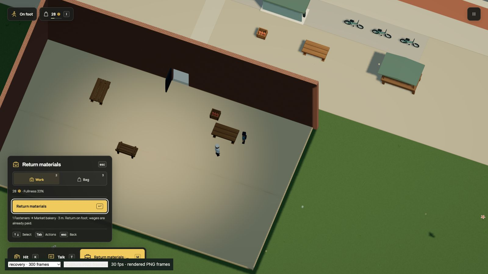
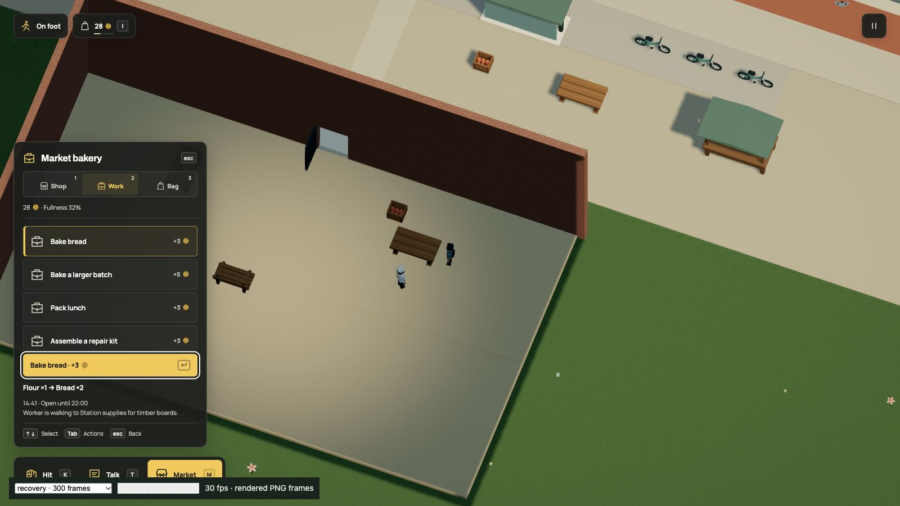

# Fixture hardware returns to work

Dream's existing recovery pair now applies to all 449 targets in the live
fixture service. Tables, benches, lamps, tubs and stalls share the same policy.
A completed repair may carry one fastener home, where the open staffed counter
accepts it for later kit assembly. Input kits and wages remain finite. Full
storage still permits an ordinary repair without output.

This is an authored policy using the existing transaction. No new vocabulary,
engine transaction rule, good, actor, rig, geometry or navigation is added. All
1,773 objects and both service coverages remain. No mining or metallurgy is
simulated; saplings, boards, supplemental stock and business money still bound
the chain. [Complete runnable example](../../examples/hardware-recovery.dream).

## Registered progress

Format 19/simulation 35 remains current. The r89 accepted fingerprint is
`ff41ef8540f2b52d963f771948f948ce14f897a57936dad7e9ff30b2fb14096d`.
Removing only the fixture recovery pair reproduces exact r88:
`f47a995c431246b6234b69a05a38f7220a65e56fbd4414d02f54405e817f0f5b`.

The guarded upgrade validates that prior world and adds only
`recovered.market_tables=0`. Existing timber counters/cargo, spent sources,
damage, growth, jobs, payments, clocks, player pose and original source slot
remain. Old in-progress repairs retain their original recovery flag. No old
repair generates retroactive hardware. Current reloads do not initialize again;
missing predecessor metadata and unrelated targets are rejected.

## Actual controls

[Public native observations](native.json) show the normal H return taking
fasteners from six to seven, clearing the player's repair cargo and keeping
their balance at twenty-eight. Required chunks are ready and the fresh review
has no console errors. The flow uses real table strikes, paid repair and kit
replacement. It positions the initial doorway approach, walks inside and reaches
the table through ordinary movement; it does not prove an ordinary trip from
the player spawn or a real-time performance result.

The current workshop review stops at recovered output. The old two-unit fastener
shipment no longer fits alongside its reserved return. Historical world reviews
retain their original real procurement and handoff. No stock is discarded or
capacity bypassed to keep a demonstration working.

## Verification scope

The runnable example checks NPC repair, sealed carried hardware, guarded return,
actual paid kit production and complete material/credit conservation. Live tests
cover full-store fallback, subsequent recovery, R/reload, exactly one handoff,
forged output rejection, current timber recovery and all 449 fixture targets.
Migration checks retain an actual r88 timber return and old procurement, original
format-19 slot, current reload and the r87 growth-upgrade boundary. Existing
recovery, kit-production, workshop-supply and repair-world checks pass.

README, business/commerce guides, persistence, backlog and agent invariants are
updated. The new example and its inline declaration agree. Existing product
GIFs, videos and stills remain accurate for their named mechanics; no rendering
or controls change, so motion was not regenerated for an authored policy. The
two native stills document this material return. No provider calls or new
dependencies. This is a self-review, with focused checks rather than a second
full suite. Weaker-device performance remains unmeasured.

Executed checks: 37 unique behavior cases across recovery, migration, kit production,
workshop supplies and repair worlds; 129 documentation cases and the instruction-size
guard. Production typecheck/build, the complete hardware example and all 44 published
docs pages pass. The initial review assumption and stale live declaration were fixed;
only affected checks were repeated. The existing large-bundle advisory remains.
[Pinned source and evidence](manifest.json).
