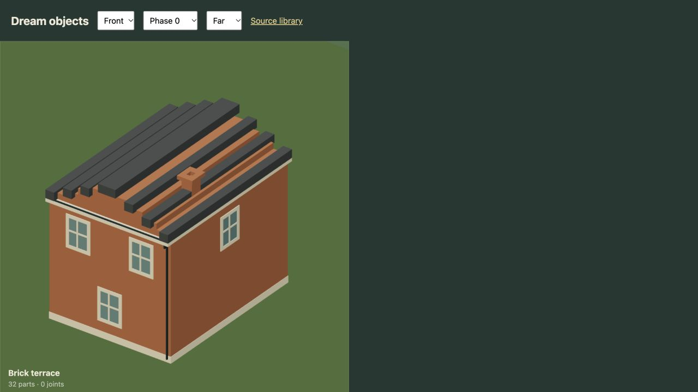
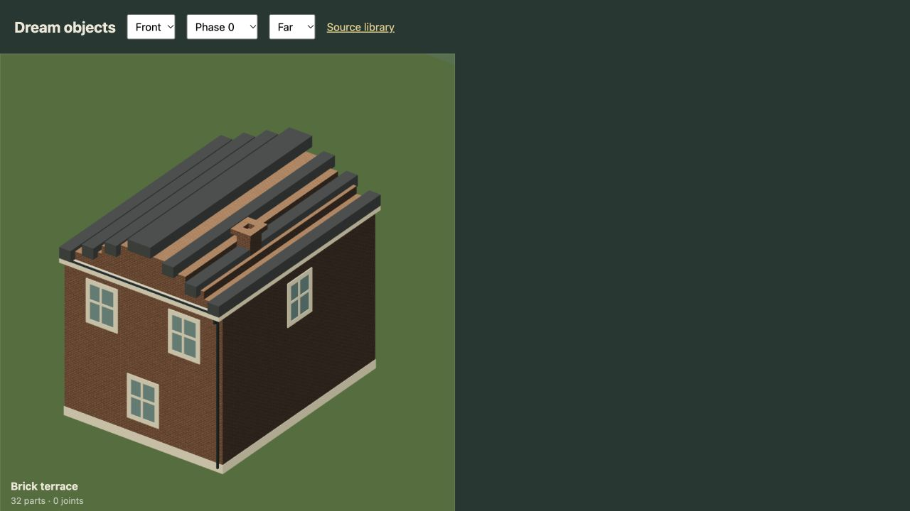
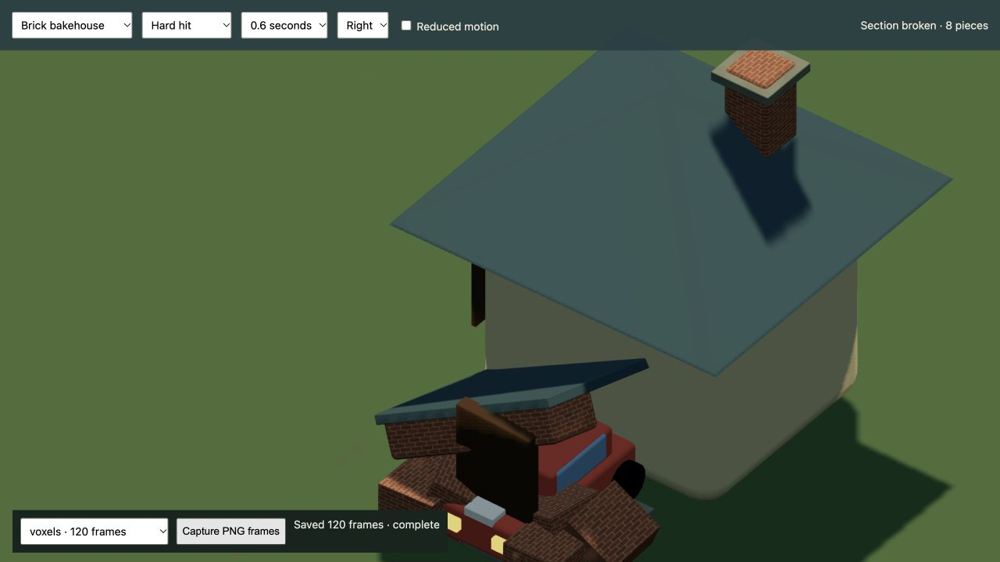

# Surface materials, r35

2026-10-17. Mock world, data-only materials, no provider calls.

The previous brick palette rendered as flat toon paint or paper grain. Dream now accepts `style=brick|wood|stone` through the same material command. Brick colors are fired face/mortar; wood base/grain; stone base/mineral. The engine owns course dimensions, shallow relief, roughness and detail filtering. There are no new texture URLs, arbitrary shaders, per-brick meshes or physics bodies.

The new brick course spacing is 24 × 7.5 cm, with staggered vertical joints and restrained per-brick variation. Mortar stays thin and recessed. Timber grain follows each member's long dimension; natural stone uses mineral variation. The architecture, civic brick walls, porches, benches, stalls, timber props, launch and skateboard use appropriate finishes. Transit tail lamps retain their original red paint rather than inheriting masonry from a palette name. The standalone bakehouse no longer cuts oversized open slots to simulate mortar; its doorway, zone and eight authored pieces remain.

Surface coordinates are separate from geometric positions. They survive rigid compaction and scenery prototypes, and sliced voxel fragments rebuild the coordinates on their exposed faces. Shaders recover physical scale from geometry derivatives, so uniform placement scale changes the number of bricks instead of stretching each brick. Filtered detail reduces distant shimmer. Normal relief affects lighting only; it does not change contact, silhouette or the shadow mesh.

Native checks:

- Terrace from front, right, back and left; unchanged voxel envelope, readable masonry on walls and chimney.
- Complete wall-and-bench example with brick, oak and limestone.
- Live instanced city at town square, suburbs, cycle tracks, medical center, airport, sports, lake and waterway; day, dawn, dusk and night.
- The bakehouse releases eight pieces with brick detail on newly exposed faces. The voxel wall releases four chunks. The bench releases seven authored pieces.
- Native W input moved the live car from X 6330 to 6409.4, with speed 124.8; the view retained zoom 1.180. The motion recordings cover boarding, walking, swimming and flight too.
- No shader or console errors in the checked gallery, city, destruction review and game.

The five new material tests cover compiler/formatter behavior, rejection of invented shaders, joins between adjacent parts, coordinates through compaction and scenery prototypes, wood direction/scale and the actual simulation-to-fragment path. Legacy vertex-painted fracture coverage remains separately tested. Body/contact/proportion, vehicle controls, racing, whole-world voxels, daylight and scene validation tests remain in the suite. The final diff was self-reviewed.

The [render sample](render-sample.json) compares native counters at the same spawn and 16:9 framing: 243 to 257 submitted calls, with about 320,000 triangles in either view. Separate surface material groups account for additional draws. Small clock and capture-resolution differences mean this is a submission sample, not a controlled GPU timing or a low-power laptop benchmark. No render resolution, asset quality, world residency or collision budget was reduced.

The README, object/reference/model guides, grammar notes, generated contract, rendering guide and exact live house/boat/wall examples were updated. Media provenance and retained captures are listed in the [media record](../../media/README.md#material-finishes-r35). All eight motion sets contain 1,710 fresh rendered frames at 30 fps, with GIF/video/still sets refreshed together. The current 83-asset atlas and relevant world/lighting stills were refreshed. Earlier construction-only views remain explicit references rather than evidence of the new finish.

These are procedural stylized materials. There is no imported PBR texture library, displacement tessellation, arbitrary material graph or physical mortar geometry. Real hardware performance beyond the native browser checks has not been measured.

Validation: 783 tests in 48 files passed; the post-review material/fragment recheck passed 25 tests. Production build/typecheck, the 30-page docs build and a 71-test docs/material recheck passed. Every changed motion set was encoded successfully from its required consecutive source-frame count.
