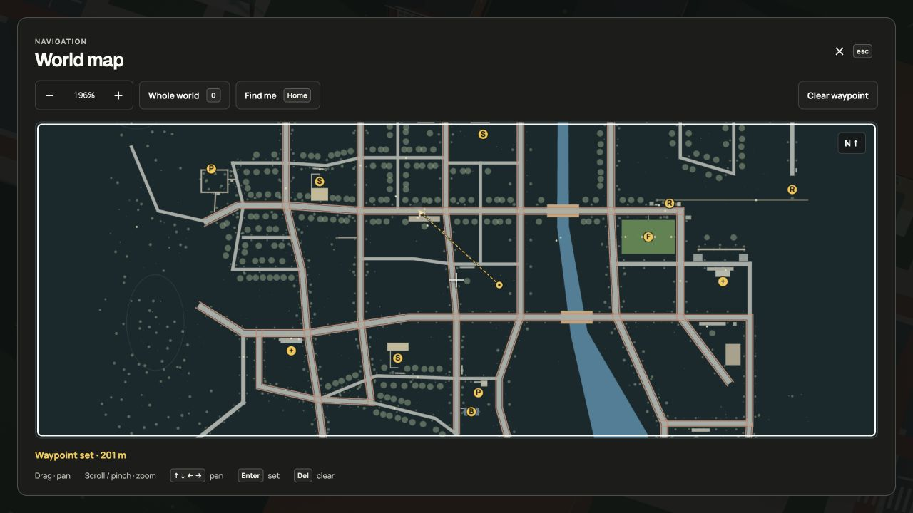
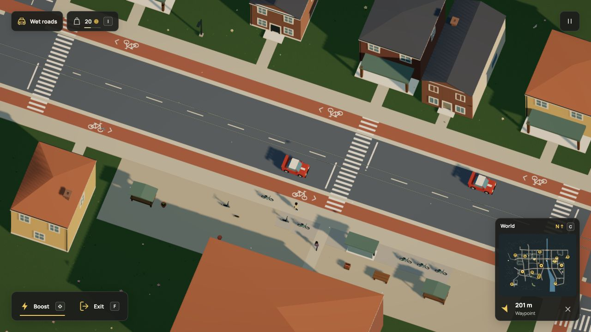

# Minimap activation and production release

The reported failure occurs on the deployed site. Vercel inspection on
2026-10-25 identifies production as commit `b9fa201f88802bdfbd4e2ade6614a09aa21506e9`,
which predates `src/game/world-map.ts` and the expanded-map button. Branch pushes
created previews while production remained on that older main revision.
The deployment difference explains why the local navigation feature was absent
on the public site. Release verification follows separately after the full gate.

There was also a smaller local dead area: clicking the map image opened the map,
but clicking its World/Nearby header did nothing. Both now belong to the same
native button, with the existing accessible name, expanded state and C shortcut.
The separate Remove waypoint button is outside the opener. Layout, canvas
geometry, gestures and navigation/save rules are unchanged.

## Local browser checks

Actual pointer clicks on both the map image and the formerly dead header opened
the modal. Zoom reached 196%; a pointer click set a 201-metre waypoint. Closing
with C displayed its arrow/distance in the driving HUD. The separate HUD clear
button removed it. C reopened the map; Enter set a center waypoint and Delete
cleared it. These checks used the current local game at `?test-navigation`, in
the in-app browser. Console warning/error output was empty.

[Focused checks](focused-checks.log): 57 pass across world-map, map-route-render
and docs-site, including the published documentation build. [Production
build](build.log): TypeScript and Vite pass, with the existing large-chunk warning.
No new test framework or dependency was added for a markup/CSS change.

README and context-actions now explicitly include the header as an opening
target. Existing navigation GIF, video and still remain accurate: their visual
layout, gestures and map data are unchanged. The screenshots above verify the
new hit area and existing flow; another motion export would duplicate the same
appearance. Dream vocabulary, examples, simulation rules and save format stay
unchanged.

## Release gate and historical regression corrections

The complete local suite exercised 2,133 tests across 214 files in 960.90 seconds
on Node v26.8.1. It reported 2,130 passing and three failures, all caused by
r113's added crossing connectivity: the current orchard test still expected 58
crossings, and the older verge regression expected both 58 crossings and the
old disconnection when a single crossing was removed.

The orchard assertion now checks the actual 62-crossing city. The verge
regression uses the exact r112 crossing projection, including stripping only the
four new source declarations from its missing-crossing compiler case. Its
original routing, target and rejection assertions remain. The new r113 crossing
file separately checks all 23 four-way intersections, all 62 painted crossing
declarations, all fourteen shorter station journeys and preserved old targets.
No simulation, engine, save or navigation rule changed during these corrections.

[Original full run](full-suite.log) and [focused corrections](crossing-corrections.log) retain the
failures rather than presenting the original run as all-green. Existing successful
checks are reused; the full suite is not restarted for test expectations or this
report. All ten focused cases passed after the corrections. This is local validation, not a claim that Node 22 CI has already passed.

The older production map was also inspected in the actual browser: clicking its
passive image left the accessibility tree unchanged. [Production identity](production-before.json) and [browser view](production-before.png) record that
state. The current source had already built successfully on Vercel as preview
`dpl_H9AMEf8NFJNZZ27XoDRvSpiQ4NFJ`; previews do not assign the public domain.

The obsolete station-repair PNG sequence was retired after checking that its
final GIF, video and still exactly match committed Git blobs. The newest
crossing-walk source sequence remains. [Retirement counts](capture-retirement.json)
record 375,951,360 allocated bytes removed. No source, dependencies, final media
or Git history was deleted.

[Final documentation build/checks](release-docs.log): 53 pass.
[Final typecheck](release-types.log): passes after the two test-file corrections.
Application source, entry HTML, dependencies and deployment configuration match
the already built and browser-checked `2ba6352` tree.
