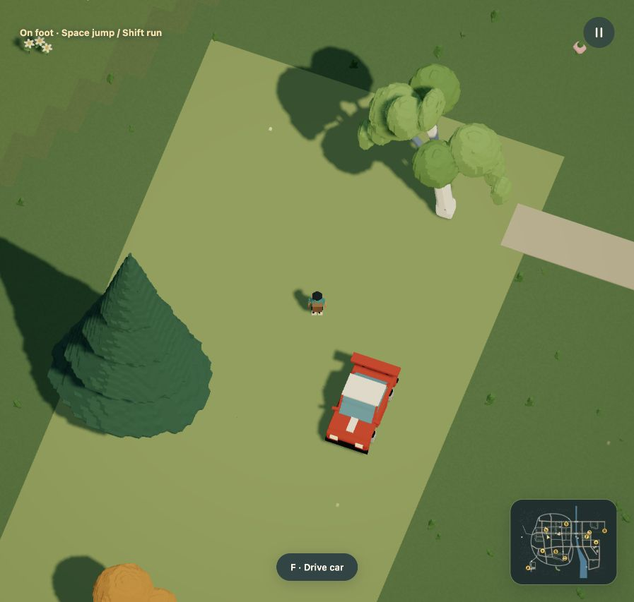
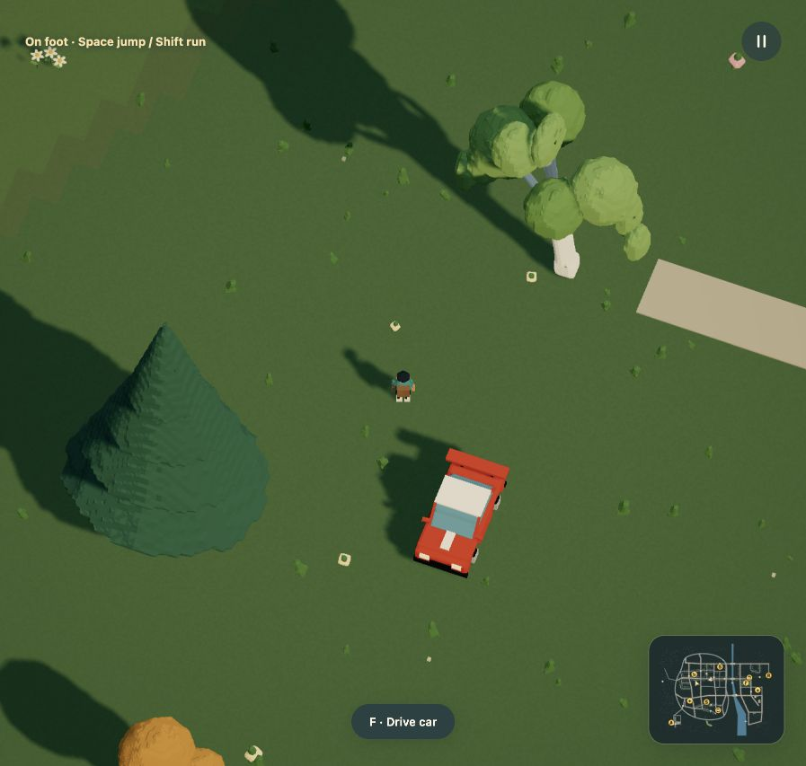
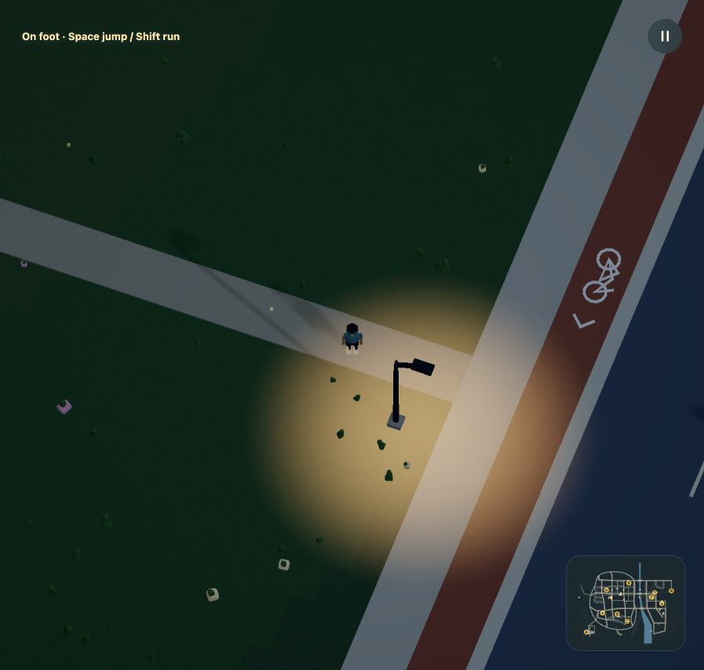

# Natural work grounds

The r53 orchard had a rectangular green surface painted over the landscape.
Native play reproduced it before editing. The new Dream finish keeps the same
work footprint on natural terrain, retains cosmetic grass and leaves the garden
path visible. This is authored mock world data, with no provider integration.

These are native play captures at different live clock times. They show the
surface change, not a controlled lighting or performance comparison.

## Shared coverage, different appearance

`surface(...,finish=terrain)` omits `color`. The default painted finish still
requires it; explicit `finish=paint` works too. Invalid combinations produce
compiler diagnostics. Natural coverage adds no mesh, map fill, collider,
flattening or path. Street furniture and habitat exclusions still reserve the
same footprint. Only cosmetic grass/flowers may appear within it.

The bounded polygon checks still reject street-riding overlap, self crossings,
out-of-world coordinates and oversized grounds. Existing paint keeps its
original declaration-index lift when a natural area is skipped. Both maps read
the accepted scene and omit the natural overlay. The generated city plan is
refreshed from that scene.

The live world keeps all 1,695 objects, 57 crossings and 37 ground areas. Exact
contacts and both public/worker navigation graphs remain unchanged. Public
navigation has 2,813 nodes. The complete runnable orchard example also uses a
natural primary work ground, exercising the same feature outside this placement.

## Save and native movement

Format 8 / simulation 10 is unchanged: this is a pinned appearance upgrade.
The source hash is
`91365ab4039e6d9ce27554e10df13439d4631dbe70cd6fb97051f5c30246fd23`;
the current compatibility fingerprint is
`9d9cc87cdc01a9d2d67cfd6411a2724109308fcc354af58e13e6b415e9f0604e`.
The host verifies the full r53 projection against its registered fingerprint
before exposing the previous slot. Earlier upgrades remain chained.

An actual r53 backup is opened through the normal Backups UI, previewed as a
compatible update, restored while paused and exported. Every state field and
the world clock match exactly. The tree retains 96.75 seconds of growth, the
worker retains its return path and the consumed sapling/payment stay recorded.
[Exact native export check](native-save-check.json).

Local automatic restore also retains the prior orchard pose. Walking reaches
the garden path's junction with High Street. The night view shows its continuous
connection, with the existing lamp and sidewalk clear.

Tests cover complete-source compilation, defaults and explicit finishes,
invalid combinations and road overlap, exact contacts/navigation, actual
instanced plants, and resident/chunked infrastructure without a natural-area
mesh. All registered saved-release upgrades are exercised with their original
fixtures. Original slots remain stored; a corrupt newer slot blocks fallback.

The complete 65,221-tick orchard replay also matches r53's event sequence, final
simulation state and navigation exactly. It includes damage, dispatch, planting,
full growth, return home and the worker buying bread. [Replay and CPU samples](fixed-step-replay.json).
Those fixed-step CPU samples are not browser FPS measurements.

## Browser measurement

One full-quality development orchard driving run on an Apple M3 Ultra with
96 GiB RAM measured 300 frames after 60 warm-up frames. The render target was
1920 × 1080 at DPR 1.5. Mean RAF interval was 16.67ms, p95 17.9ms; mean application
CPU prepare/submit was 3.35ms, p95 4.6ms. GPU mean was 1.23ms across 299 samples.
The run toppled the birch and retained one bounded debris assembly. Geometry
buffer accounting, including cached roots, was 269,207,136 bytes; this is not
total browser memory or VRAM. One local startup took 15.93s with a maximum
heartbeat gap of 318ms. This is not a comparative speedup, cold-start benchmark
or low-end-laptop measurement. [Raw profile, startup and streaming counters](browser-profile.json).

## Media and limits

The planting and growth GIFs, HD videos and source-resolution posters are
refreshed together. They use the existing actual impact, worker dispatch and
pedestrian journey, then 30 rendered frames per simulation second. Planting is
360 frames / 12 seconds; growth is 900 / 30 seconds and shows the beginning of
the 180-second growth clock. Selected 14:00 lighting keeps those offline exports
readable. No worker teleport or interpolated frames. They are not browser FPS
measurements. [Decoded frame counts, durations and file hashes](media-audit.json).

README, surface/reference/model/grammar, planting, persistence, rendering,
urban-world, priorities and media guides are updated. Other vehicle, market,
streetlight, sports and asset captures remain accurate for unchanged geometry
and mechanics. Historical evidence retains its own source hashes and captures.

Natural coverage remains a bounded ground area, not a general event trigger,
new habitat system, soil simulation or arbitrary walking shortcut. Tree recovery
still covers three orchard trees; 333 measured trees and 323 lamps need broader
recovery coverage. Interiors, schedules, autonomous courier work and biological
models remain future systems. Lower-powered laptops remain unmeasured.
