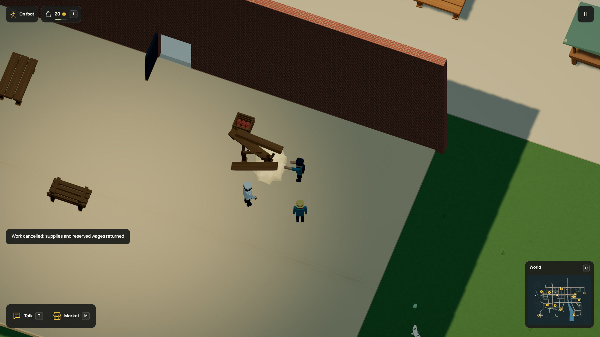

# Reachable props respond on foot

K now hits one reachable prop in front of the grounded player, outside sports
grounds. The contextual fist action uses the same request. Dream owns reach,
strength and cooldown through `strike(reach=10,speed=100,cooldown_s=.6);`;
existing prop rules still decide whether something bounces, topples or breaks.

[HD recording](../../media/hand.mp4) · [GIF](../../media/hand.gif) ·
[Capture state](native-capture.json) · [Keyboard check](native-keyboard.json) ·
[Source and media manifest](manifest.json) ·
[Runnable complete example](../../examples/on-foot-strike.dream)

## Native result

The browser accepted source
`855da33f33826f1a86e88ce0975ff8219bcf00d4a1ac041d5a220c1650188519`
and simulation-34 fingerprint
`f1a8ec4b7803b4bbd21984e5baef2689b3fc6378f81cca0c95060e8d34d374f3`.
The exporter completed all 600 frames. Its setup walks through the actual doorway
to the table and starts a real paid bake. Ordinary action requests then hit the
table, refund the interrupted batch, request the existing finite repair and start
a new bake. The final diagnostic asserts an intact table, 27 player coins, one
completed repair and one completed bake. Capture saves are disabled. The corrected
run records no browser console errors.

A separate manual keyboard check confirms that K breaks the table on foot and
starts the cooldown. That manually started bake had already finished before the
keypress, so that check alone does not demonstrate cancellation. The controlled
native recording supplies the interruption evidence.

## Checks and save compatibility

Nineteen strike tests pass. They cover syntax and bounds, scoped model context,
exact forward reach and height, walls and same-building zones, state immutability,
unchanged player momentum, dry grounded ownership, sports exclusions, cooldown,
shared bounce/break thresholds, immediate world containment, the 560-unit prop
speed cap, paid-batch cancellation, repair and the complete 600-frame input flow.
The humanoid check verifies arm extension with planted soles and rigid limb lengths,
including reduced motion. Neighboring vehicle, sports, destruction, compiler,
commerce and save suites pass their focused checks. The production build and the
complete runnable Dream example pass. The full test suite was not rerun for this
branch push.

Current saves use format 18 and simulation 34. The registered r83 projection
retains fingerprint
`a5b345f631855363a24d67e40268357e95970974fefd991788c46bf1c7f086ce`
at simulation 33. Its upgrade initializes only the strike deadline at saved time;
all other state remains intact and the old slot is preserved. Historical format-17
packets stay strict, and four actual r81 native backups still upgrade through the
retained migration chain. Tests that inspect those old fixtures still expect
format 17; new writes expect 18.

The compiler contract, model instructions, feature packet and language reference
share the new vocabulary. README and the affected behavior, commerce, interior,
language and persistence guides are refreshed, with the HD video, GIF and still
captured together. Construction and map images remain accurate because geometry
and placements did not change. The docs build produces 44 pages. All 40 published-doc/highlighting checks and
the instructions-size check pass.

## Limits

This is an unarmed prop action, with arcade equivalent-speed strength. There is
no handheld inventory, NPC combat or terrain editing. Sports retain their existing
K ownership, and their balls are excluded even when approached from the sideline.
The gesture uses the existing humanoid rig; no mesh, actor or physics-body budget
is raised. No FPS or browser-memory improvement is claimed. Providers remain mocked.
