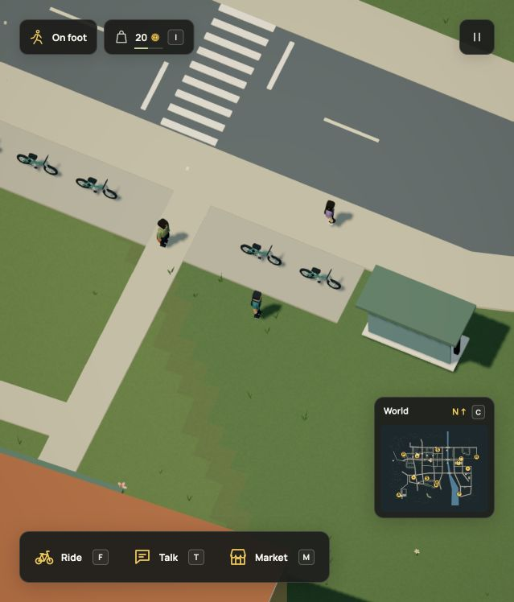

# A resident supplying school and workshop

The existing school resident now has one zero-credit courier account, with
`fasteners_run` before `school_run`. A full hardware shipment must fit before it
can be chosen. Otherwise the resident can bring bread from the bakery to school.
School staff and the courier can buy and eat that finite bread with their own
money. Existing contracts, invoices, wages, food and stock rules remain shared
with the player. No actor, rig, scenery, geometry or population limit is raised.

## Dream and acceptance

Couriers may have a stationary non-vendor home away from a receiving counter.
`on` anchors a convex work ground; home and both counters may use declared
grounds or accepted pedestrian pavement. Complete-world acceptance still requires
clear connected pickup, handoff and return paths. Ground/sample/node/link/path
bounds, dry support, headroom and vendor ownership remain enforced. No new
command or generated controller is introduced.

The resident's old position was off the walking network. Its new home is an
existing clear school-frontage approach, near enough to buy food after returning.
All 1,773 objects remain. Static contact data and the complete ambient walking
graph match r86. No paving or reservations are added, so the parked bicycles
and other furnishings are retained.

Current fingerprint:
`e2317da9bd916988c3f252eb1f1e1660b8f2c2ebc54113d6f5c02492afca59a8`.
The exact r86 projection is
`595e9821e3a223698fdc272e097ce119730359e85dc65ea75d647409921d4329`.
Format 18/simulation 34 stays unchanged. The registered upgrade adds only the
new account at the saved economy time, retaining all old fields and the original
browser slot. Current reloads cannot repeat initialization. The r85-to-r86-to-r87
chain retains its finite-stock initialization boundaries.

[Complete remote-home example](../../examples/neighborhood-courier.dream).
The helper starts at the depot, crosses the street, supplies both ingredients and
feeds kit assembly. Disconnected homes and vendor-owned courier policies fail.
Pickup, cargo and home phases round-trip through the full save validator.

## Runtime and verification scope

The city regression first uses the existing 120 Hz workshop fixture for actual
impacts, repairs and kit production. It cancels the player's sealed cargo through
the real transaction and uses R recovery, retaining the consumed materials. The
long portion advances the commerce and NPC modules at 4 Hz on the accepted city,
including normal hours, shifts, live route contacts and shared food decisions.
It checks both delivered goods, school meals, courier meals, bounded walking,
return, supplier invoices and one-time personal wages. Cosmetic crowd and vehicle
movement physics are not stepped in that long module replay; it is not a complete
gameplay or browser performance measurement. Long test loops yield so timeouts
and worker reporting remain responsive.

The save regression checks r86 migration with real outstanding player cargo and
completed repairs, unchanged existing state, the new empty account at saved time,
current round trips, rejection without the registered predecessor and original
slot retention. Earlier workshop, courier, recipe and agent-contract checks cover
their existing boundaries separately.

[Native state](native.json) records a clean browser boot at
`?test-npc=school_student`. The review places the player nearby and disables
saves. The ordinary game loop moves the resident from its authored home into a
school pickup journey; the rendered actor follows the same courier position.
Two public state observations show continued travel. Pause stops its clock and
position. Required chunks are ready and errors are checked only since that clean
reload, excluding earlier development reloads. This native visit shows departure,
movement and pause; the complete delivery cycle is the automated module replay.
No native full-trip, FPS, startup-speed or memory gain is claimed.

README, the model packet/contract, commerce reference, business guide, persistence
and world backlog are updated. Existing images and motion remain accurate for
their shown controls, rendering and caretaker/player mechanics. Earlier source-
pinned ledgers remain historical; they do not depict this new resident's trip.
No renderer or control change requires regenerating those recordings.

## Executed checks

- `tests/resident-supplies.test.ts`, `tests/kit-production.test.ts`,
  `tests/dream-v2.test.ts` and `tests/save-tools.test.ts`: all 79 pass.
- Earlier focused courier, workshop and agent-packet checks: all 26 pass.
- Published docs and instruction-size checks: all 41 pass.
- Production typecheck/build, the complete example CLI check and all 44 docs
  pages build successfully. The existing large-bundle advisory remains.

[City replay result](replay.json) records one school delivery, one hardware
delivery and both residents eating, at simulation time 2842.98 seconds. Supplier
invoices and personal pay settle once. Long walking routes and compressed days
can span several opening windows; there is no vehicle courier or general work
scheduler. Two initially overbroad replay attempts were intentionally stopped
during test development; the final long replay checks its owning modules and
yields for timeout/reporting responsiveness. No full-suite, merge or production
deployment check was run for this branch slice.
