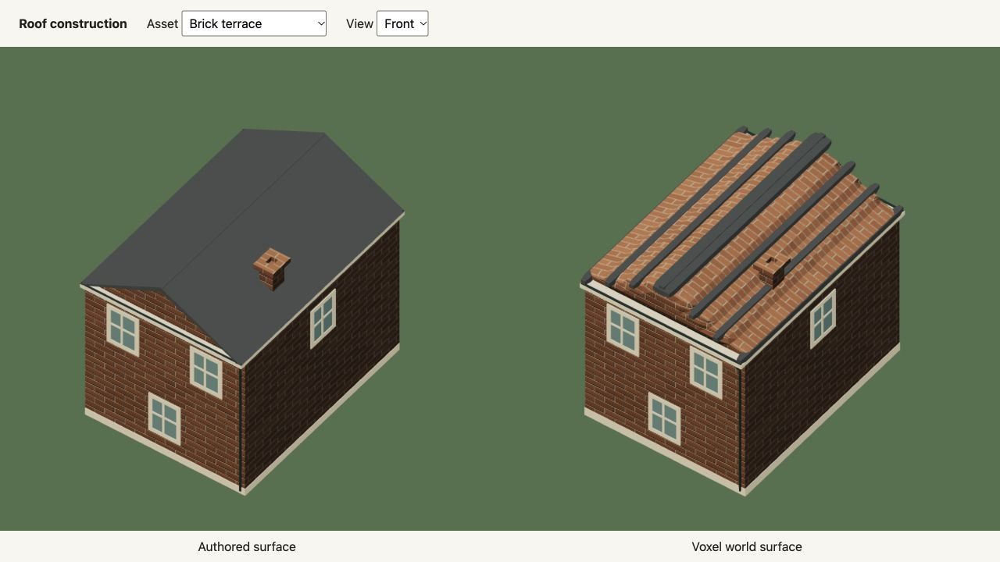
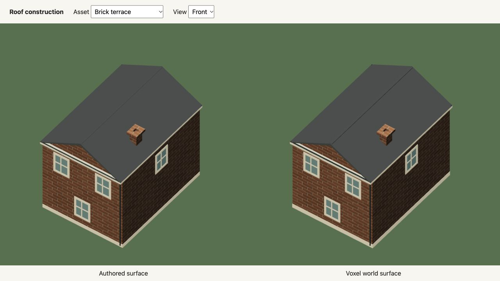

# Continuous roofs

## Current-world recheck

Rechecked the released r65 world at `377b3cd`. The correction below is already
present in this version; this recheck changes documentation evidence only.
The new native gallery captures show the live Brick terrace and Ochre terrace
from the [front](current-review/front.png), [right](current-review/right.png),
[back](current-review/back.png) and [left](current-review/left.png). The gable
panels remain closed, and the hip slopes have no artificial contour stripes.
The [running city view](current-review/city.png) was captured after ordinary W
driving and E camera rotation in a save-isolated suburban review.

All 12 published application files match the local production build byte for
byte, including the renderer and world worker: 2,291,444 bytes in total.
The [file hashes](current-review/published-app.json) pin the checked release.
This verifies that the existing correction is deployed, rather than assuming
that a source edit reached the browser. An already-open browser tab can retain
its loaded renderer until it reloads; no old tab was inspected in this check.

Reviewed the README, construction, rendering and voxel guides. The construction
guide now uses the current native capture. Existing motion exports and their
matching stills remain accurate because neither geometry nor simulation changed
in this recheck. No new performance claim or Dream vocabulary is introduced.

Checks for this recheck: all 1,286 tests in 94 files pass (236.93 seconds),
including the ten-template roof scan and hollow-underside/cache tests.
Production build and TypeScript pass; the existing bundle-size advisory remains.
The docs build produces 41 pages, the terraced-house example passes `dream check`,
both project skills validate, and `git diff --check` is clean. This is a
self-review, with no new low-powered-laptop performance measurement.

## Original correction

The roof stripes were holes. Centre-ray voxel sampling missed thin gable panels,
leaving the attic visible between isolated roof strips. Binary surface-net normals
also broke flat hip slopes into contour bands.

Baseline: `056419f96ea8f3e759779572715bdc95b6909f13`.
This is a renderer correction; the accepted Dream world, source, simulation rules
and save version are unchanged. Mock mode only.

## Correction

Undeformed prism and pyramid stamps now conservatively classify boundary cells
with triangle/box overlap. Their planar cut contours retain the exact source
boundary. Coplanar fragments from one source triangle merge back to that triangle,
so this does not submit a separate mesh or face for every cell. Thin roof shells
keep their underside and eaves; they are not replaced with thick caps.

Curved and deformed stamps retain their surface-net path. Explicit `voxels`,
`fill`, `cut` and fracture chunks retain exact block faces. The 32-cell axis and
shared 16 MiB CPU cache bounds are unchanged. Callers still own cloned buffers.
There is no cell editing, per-cell physics, changed contact or simulation migration.

## Geometry checks

The [before](before-sampling.json) and [after](after-sampling.json) scans cast 511
downward rays through each of ten live sloping roof templates. The brick terrace,
blue terrace and garden house formerly missed 364, 392 and 441 rays respectively.
Every repaired roof now hits all 511 rays at its authored surface height. Gables
have two upward-facing normal directions; hip roofs have four. Their slopes no
longer accumulate artificial contour normals.

The [library comparison](geometry.json) builds the same complete template library
with the baseline and corrected mesher. Unique library geometry falls from
475,832 to 455,132 triangles. This counts one copy per template, not visible city
triangles or live FPS. The complete accepted Scene JSON has the same SHA-256 in
both builds: `278fc3d4aebf7949bdc785f763c62a98e809c5f8092dc6e4fe9f2f4d661c0b77`.

Tests cover the ten roof envelopes and slopes, the hollow underside, independent
cached buffers, complete-library normals, original physical bodies, measured
scale, contacts, foundations and attached construction. The runnable terraced
house example is unchanged and passes `dream check`.

## Native review and media

- Four sides: [brick terrace](brick-terrace-four-angles.jpg),
  [ochre terrace](ochre-terrace-four-angles.jpg),
  [garden house](garden-house-four-angles.jpg). Each view compares the authored
  surface with the voxel renderer.
- [City view](city.jpg): ordinary W driving and E rotation in a save-isolated
  suburban review, including contact with an autonomous bus. No state injection.
- Refreshed the constructed asset sheet, complete live atlas, voxel asset sheet and
  rendering guide's four-angle comparison. Added the focused
  roof still used by the construction guide. Native render pixels are retained;
  JPEG encoding is quality 95 with no chroma subsampling.
- Main-game driving, switching, locomotion, swimming, day/night and flight exports
  are refreshed at 30 actual rendered frames per simulation second, with matching
  GIF, HD video and stills. These offline exports do not measure performance.
- Earlier evidence records remain pinned to their original sources. Isolated
  destruction, people, flora/fauna and explicit carved-volume closeups retain
  their represented geometry. The source-generated map is unchanged because
  accepted placement, footprint and infrastructure data are unchanged.

The README, construction guide, rendering guide, voxel guide, model instructions
and generated command contract describe the same construction policy. No Dream
syntax was added. Earlier task-specific economic recordings retain their pinned
scenario timing; use the new roof stills for current roof appearance.

## Executed checks

- Full run: 1,205 passed out of 1,207 in 88 files (171.02 seconds). The two failures
  were missing documentation assets while this change was still being assembled.
  After completing those files, the final roof/documentation suites pass all
  122 tests in three files. All full-run gameplay and geometry checks passed.
- `npm run build`: passed, including TypeScript; existing large-bundle advisory remains.
- `npm run docs:build`: passed, 37 pages. Native built-site review confirms the
  roof image, readable Minimum Effort styling and repository evidence links.
- The unchanged terraced-house example passes `dream check`; the reduced
  objects/voxels agent packet also generates successfully.
- Six consecutive PNG frame sets: 1,470 frames total, all 2400 × 1350. The
  encoder replaces matching GIF/1600 × 900 HD pairs. All six videos decode
  without errors. [Frame/output hashes](media.json), [source hashes](source-hashes.json).
- Posters: world/voxel-world = driving 40; on-foot/riding = switching 35/110;
  jumping = locomotion 70; swimming = 90; day/night = 240; city day/dusk/night/dawn
  = daynight 30/117/180/300; flight = 150.
- `git diff --check`: passed. Review is a self-review. No provider calls,
  new dependencies or low-powered-laptop FPS measurement.
