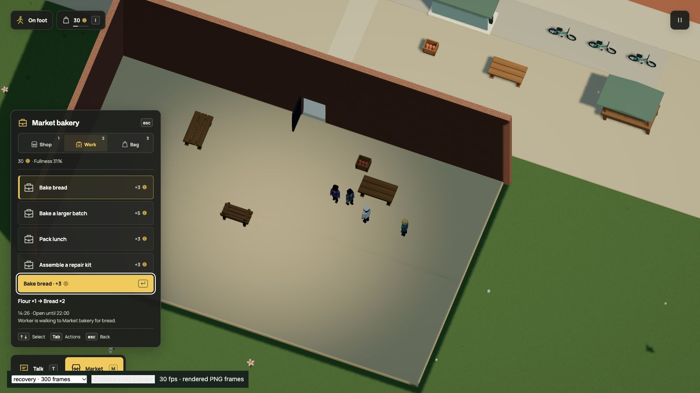

# Less repeated work during world acceptance

The compile profile at `d350576` put repeated work-route collision checks at the
top of the sampled CPU work. Many destination validations search the same
immutable graph. Acceptance now checks each directed edge once for its exact
Scene, graph array, static contact owner and body profile. Endpoints, pavement,
water and every stateful query retain their existing checks.

This extends the earlier endpoint index with a separate acceptance cache. It
stores one byte per directed link and four bytes per node offset, within the
existing 8,192-node and 32,768-link limits. Contact replacement, body-profile
changes and graph priming invalidate results. Weak ownership lets an obsolete
scene and its graphs leave memory. No result is authored, transferred to the
renderer or saved. This adds cache memory; it is not a memory-reduction claim.

## Matched measurements

Three sequential comparisons use Node v26.8.1 on the local Apple M3 Ultra / 96 GiB.
Each version creates a fresh accepted world through a separate Vite SSR server.
Module loading is outside the compilation timer. No test/build job, capture
export or agent-owned game renderer ran during the samples. Other host activity
was not isolated. The exploratory CPU profile was separate from these timings.

| Complete-world compilation | Baseline | Candidate |
| --- | ---: | ---: |
| [A](sample-a.json) | 7,184.42 ms | 5,511.61 ms |
| [B](sample-b.json) | 7,257.58 ms | 5,453.70 ms |
| [C](sample-c.json) | 7,130.31 ms | 5,437.96 ms |
| Median | 7,184.42 ms | 5,453.70 ms |

The median is **24.09% lower**. This measures local world construction, not the
entire test suite, browser startup, frame rate or a less powerful laptop.

All eleven data groups match exactly in every sample: accepted scene, streaming
bounds, current and historical compatibility hashes, contacts, public navigation,
all repair/journey graphs, the prior interior and verge projections, placements,
2,761 terrain samples and the driving mask. The current accepted fingerprint
remains `f47a995c431246b6234b69a05a38f7220a65e56fbd4414d02f54405e817f0f5b`.
Dream source, geometry, rendering settings and save format 19/simulation 35 are
unchanged. No migration is needed.

Repeat one matched sample from the current checkout:

```sh
node scripts/profile-world-acceptance.mjs d350576 .npm-cache/acceptance-sample.json
```

## Checks and actual gameplay

The focused navigation, repair-network and courier checks pass. Regressions
cover warmed acceptance followed by damage and parked-vehicle changes, body
profiles, identical graph arrays used by different scenes, replaced contact
owners and primed replacement networks. Stateful queries retain exact current
clearance instead of consulting acceptance results. Existing diagonal contacts,
vertical headroom, stable nearest-node ordering and connected-yard checks pass.

Another 48 checks cover staff shifts, shared meals, ordinary meal trips, school
repairs and the live resident courier. These include full outward/work/return
paths, blocking vehicles, phase saves, conservation and one-time payment.
Production typecheck/build passes, retaining the existing large-bundle advisory.

[Native observations](native.json) record the existing timber review's normal H
handoff. Boards move from seven to eight, the player's balance stays thirty,
sealed cargo clears, required chunks are ready and no console errors appear.
The review positions the outward approach and uses ordinary simulated work and
doorway walking; it does not prove an ordinary player journey to the tree.
Its loader timings are a functional snapshot, not a matched browser benchmark.



README, rendering notes, the world backlog and the agent invariants describe
the new cache and its boundaries. Product GIFs, videos and stills remain accurate
because visuals and controls are unchanged; no motion was regenerated. The
Dream vocabulary and examples are unchanged. This is a self-review, with focused
checks and exact accepted-data comparisons. The full suite was not rerun for
this bounded optimization. Overall turnaround and weaker-device gains remain
unmeasured.

Executed batches: 20 navigation/repair/courier checks in 1.26 seconds; 48 journey
checks in 41.58 seconds; final six navigation plus 128 documentation/instruction
checks in 1.78 seconds. The production typecheck/build and all 44 published docs
pages pass. Only the updated navigation cases were repeated in the final batch.
`git diff --check` passes. No new dependencies or provider calls.
