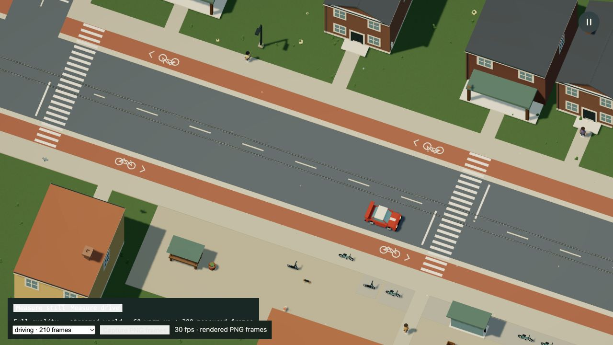
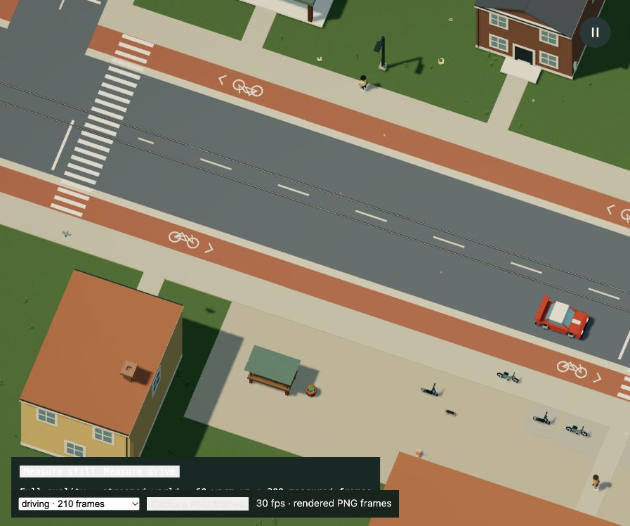

# Startup fingerprint reuse

Baseline: `a2a21fe087cdaf4c523d3da15bc58de99cc549b5`, including the continuous roof correction. This change targets the worker's repeated canonical save-world encoding. It changes no accepted Dream world, simulation rule, save version, render detail or graphics setting.

The encoder belongs to one immutable bootstrap batch. It reuses unchanged world-list entries across the current and historical projections, preserves separate raw/rounded contracts, and releases its references before navigation packets and render chunks are prepared. Retained text has a combined 32 MiB UTF-16 budget; overflow is encoded normally, with no skipped fields or checks. Map/key overhead is separate. One-off compatibility checks still read their current input without a global memo.

## Acceptance and measurements

The comparisons below use the current source. Earlier pre-roof, resized-window and shared-dependency-cache trials remain in ignored local cache and are excluded from the published timing comparison.

The Node comparison uses the same complete accepted world, all nineteen current/historical source hashes, stream bounds, contact order, pedestrian and repair navigation, two historical navigation projections, placement transforms, the road mask and 2,761 terrain/bridge/water samples. All eleven compared data groups match exactly in each run. Raw reports: [A](node-a.json), [B](node-b.json), [C](node-c.json).

| Nineteen-fingerprint phase | Baseline | Candidate |
| --- | ---: | ---: |
| Run A | 1,712.3 ms | 375.6 ms |
| Run B | 1,699.6 ms | 378.2 ms |
| Run C | 1,735.4 ms | 870.2 ms |
| Median | 1,712.3 ms | 378.2 ms |

Run C also has slower candidate construction and support steps; it is retained rather than discarded. These sequential cold Node SSR constructions are diagnostics on the development machine, not browser loading times or a low-powered-laptop benchmark. Node is v26.8.1 on the local Apple M3 Ultra / 96 GiB machine. No concurrent project verification job or agent-owned game renderer ran during these three comparisons; unrelated host activity was not isolated.

With explicit GC, the candidate's held-cache heap checkpoint is 10.5–13.2 MiB above its initial checkpoint; after releasing the encoder, all three checkpoints are below their initial level. These are point-in-time Node JS heap readings, not peak allocation, browser heap, VRAM or total process memory.

## Native browser checks

The two final development servers use separate Vite dependency caches, matching packages and the same fixed capture layout. The project now keeps its default cache in each checkout's ignored `.npm-cache/vite`; this avoids collisions when installed dependencies are linked across worktrees. Both measured servers have no browser warnings or errors. Each origin had an excluded warmup before measurement. No PNG recording was running during timing. Other host activity was not isolated.

The development URL uses `?profile&profile-dpr=1.5&test-driving=town&capture`. Capture supplies a fixed 1600 × 900 CSS game canvas, while the profiler samples real rendered frames at a 2400 × 1350 drawing buffer. Do not press the PNG export button for these timings. The outer app window resized during review; the fixed game canvas and drawing buffer remain unchanged. Earlier runs using the ordinary viewport are not included here.

| Warm reload | Before world check | After world check | Before complete loader | After complete loader |
| --- | ---: | ---: | ---: | ---: |
| A | 7,306.4 ms | 6,492.1 ms | 14,021.3 ms | 13,447.5 ms |
| B | 8,320.1 ms | 6,428.9 ms | 15,325.5 ms | 13,233.0 ms |

Raw loads: [before A](isolated-before-a.json), [before B](isolated-before-b.json), [after A](isolated-after-a.json), [after B](isolated-after-b.json). The slower baseline remains in the report. First draw is measured separately: 161.4–174.5 ms before and 164.3–173.0 ms after. Maximum main-thread heartbeat gaps were 281.6–295.0 and 285.2–299.0 ms; this change does not claim to remove those remaining preparation stalls.

Both still and driving checks use 60 warmup frames plus 300 measured frames. [Still before](isolated-before-render.json), [still after](isolated-after-render.json), [drive before](isolated-before-drive.json), [drive after](isolated-after-drive.json). Mean still CPU time is 2.25 / 2.20 ms and GPU time 1.39 / 1.35 ms. Driving CPU/GPU and all frame-interval readings remain in the raw reports. These small timing differences do not establish a render-throughput improvement. The change targets bootstrap encoding.

Still draws are exactly 377 with 566,526 submitted triangles and 230 uploaded geometries in each build. Driving draw/triangle distributions and the final 385 uploaded geometries also match. [Retention checks](retention.json) assert exact constructed-buffer bytes, unique buffer counts, chunk membership and render counts. There are 163,498,840 counted bytes in 7,925 unique constructed render buffers, with 110,016,606 retained chunk bytes. These are not total browser memory or VRAM.

These are native visual checks of the running city. Their outer viewports are 1280 × 720 and 897 × 748, so they show different portions of the same larger game canvas. They are **not** a pixel-equivalence test: [the attempted comparison](pixels.json) records nonmatching screen pixels and that limitation. Exact accepted data, unchanged renderer/asset sources, render counts and resident buffers establish retained content independently. No texture, shader, shadow, particle, antialiasing or resolution setting is reduced.

## Documentation and limits

The README, rendering and persistence guides describe the same temporary cache and byte-preserving contract. No Dream vocabulary or runnable source example changes. Current roof, gameplay and HD/GIF/still captures remain accurate because the accepted world and rendering behavior are unchanged. The loader image also keeps its current labels and appearance. New native stills and raw reports document this preparation change without replacing product motion footage.

Cold-network loads, sustained thermal behavior and less powerful laptops remain unmeasured. Startup is still around thirteen seconds on this machine and some main-thread preparation gaps remain. This is a bounded improvement to repeated checks, not a completed performance solution for every browser or world size.

## Checks

- `npm test -- --maxWorkers=2 --testTimeout=60000`: **1,211 passed in 89 files**, 170.99 seconds locally.
- The focused encoder/save suites pass 31 tests, including complete raw/rounded byte comparisons, the worker's old-parking projection, Unicode and numeric-key ordering, mutable one-off checks and the uncached overflow path.
- `npm run build`: passed, including TypeScript. The existing large-chunk advisory remains.
- `npm run docs:build`: passed, 37 pages.
- Three source-pinned Node comparisons pass all eleven data groups; clean native still/driving reports preserve draws, triangles, geometry counts, resident buffers and chunk membership.
- `git diff --check`: passed. Review is a self-review. No new dependencies, provider calls, Dream vocabulary or save migration. [Pinned source hashes](source-hashes.json).
