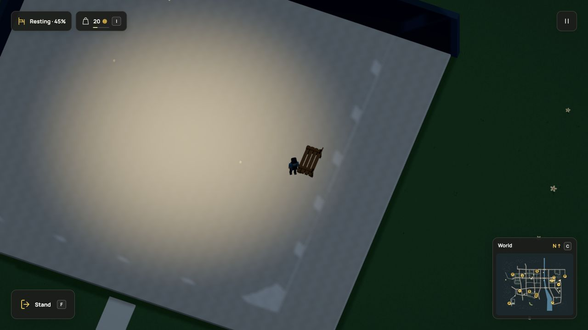
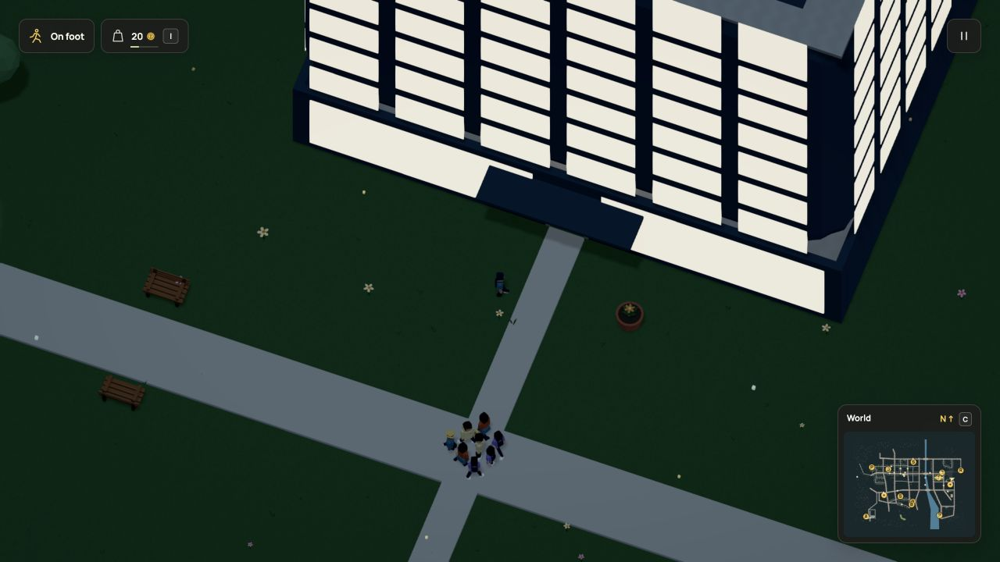

# Station play-through after the route update

This page records the simulation-54 review. [Simulation 55 implements and verifies
the crowd correction](../crowd-flow/verification.md).

The reviewed source is commit `6d44b668b4a0710b3b3cac41cd062f9c0071974d`,
r113 / simulation 54. The route is `?test-driving=station-quarter` on local Vite
in the in-app browser. That query seeds the initial car position; all subsequent
walking, doorway entry and sitting used ordinary keyboard controls. Provider calls
remain mocked. This review does not claim the full living-world goal is complete.

## The office works as a lobby

The player left the car, crossed the street, followed the entrance path and
walked through the office doorway. The floor lifted the player to 1.953125 world
units and the upper shell cut away. The existing bench accepted F, retained foot
ownership and displayed ordinary energy recovery. The browser console had no
warnings or errors. Review saves were disabled, so this play-through is not a
save/reload test.

[Observed seated state](office-seat.json)

There are still no usable upper rooms or lifts in this building. A working lobby
and a tall shell do not establish those features.

## Four walkers stopped at one portal

The promenade group looked stationary during the approach. Two read-only
`#game` population samples are 80.6 simulation seconds apart. The nearest-six
samples share four identities with unchanged XY positions and distance counters,
zero speed and expired wait clocks. Each still targets node 1778. This is direct
evidence about those four residents, not a count of every stalled walker.

[First sample](crowd-before.json) · [Later sample](crowd-after.json) ·
[Computed comparison](crowd-comparison.json)

## Next acceptance criteria

Reproduce this congestion in a deterministic fixture, then let the group clear
the portal without overlaps, unsupported shortcuts or teleporting. Keep the
existing 20 Hz, population, geometry and rendering limits. Check that ordinary
traffic waits, resumed old saves and continuous foot animation still work.
Any gameplay change needs its own simulation registration, live verification and
refreshed motion. A diagnostic candidate is not the production implementation.

## Isolated candidate, not shipped

An SSR probe seeds the six native sampled members into a fresh accepted r113
world and advances only the existing ambient controller for 30 simulation
seconds. Other people and NPCs start fresh, so this is a diagnostic fixture, not
a replay of the complete native world. Current source remains unchanged.

| Variant | Result in this fixture |
| --- | --- |
| [Baseline](experiment-baseline.json) | All six remain at the same position. |
| [Yielding](experiment-yielding.json) | People move, but four stay near the junction and circle. |
| [Arrival margin](experiment-arrival.json) | A target changes, but all six remain stationary. |
| [Both changes](experiment-combined.json) | All six leave the original node and travel 226–354 units away. |

The combined probe lets a higher-ID walker take a safe moving candidate instead
of always preferring a stationary one, and recognizes a portal within the
walker's own support radius. Existing candidate, relative sweep, dry pavement,
traffic and body-clearance checks remain. Each sampled position stays supported;
the smallest measured pair gap against every resident walker is positive, about 0.0004 units. No sampled tick moves more than 0.8 units. These checks
cover this fixture, not every crowd configuration. Elapsed probe times in the
raw files are not browser performance comparisons.

This is the next implementation candidate. It still needs ordinary fixtures,
saved-state registration, native replay and current media before it can be
described as a working fix. No Dream vocabulary, actor cap or renderer budget
changed in the experiment.

README, the station-quarter guide and existing media were reviewed. The current
layout, controls, materials and animations are unchanged by this review, so the
existing HD/GIF/still remain accurate. The two new stills document the observed
state; no new gameplay or rendering feature is claimed.

The route release gate subsequently passed all 2,143 tests in 216 files on the
unchanged production source. [Full report](../short-links/full-suite-final.log).
The isolated crowd changes are not included in that pass or in the checkout.

## Follow-up

Simulation 55 implements and verifies the portal-flow correction. It also caps
arrival space on short links to preserve authored waits. [Current native
restoration, recording and complete checks](../crowd-flow/verification.md). The
review and isolated experiment above remain historical evidence of the cause.
