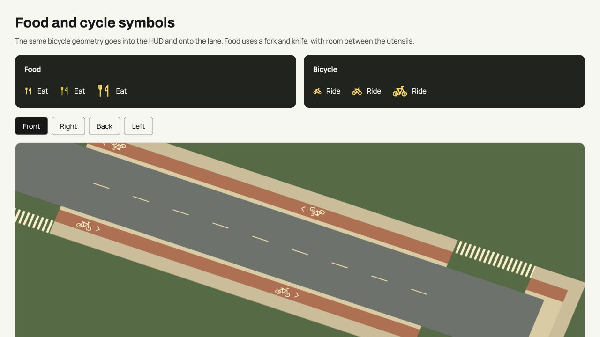
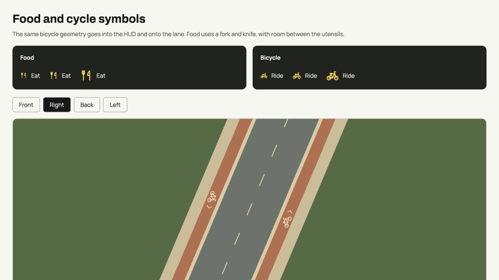
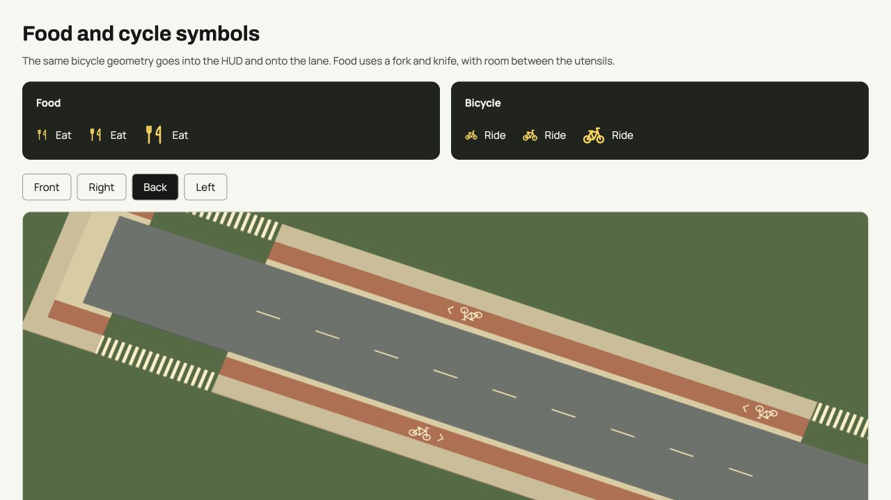
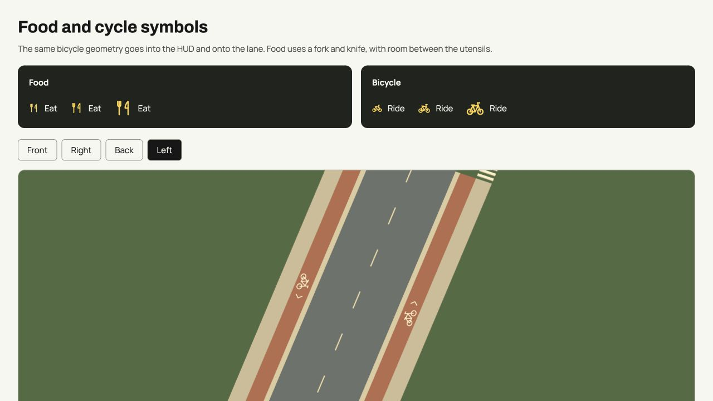
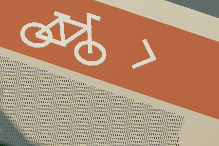
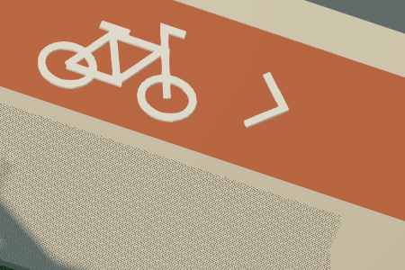
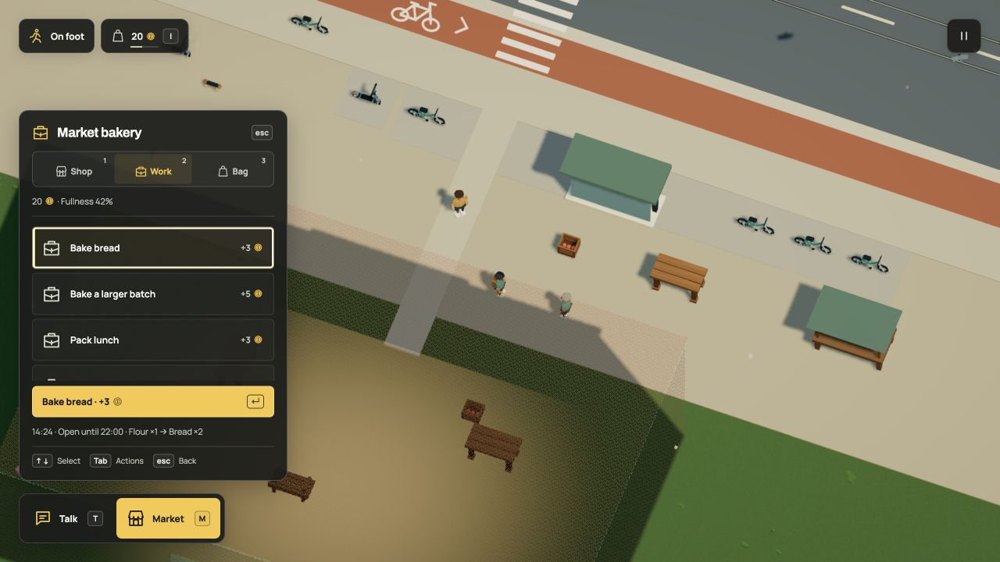

# Food and cycle symbols

The bicycle previously joined both wheels with one zigzag. The replacement has
separate rear and front frame triangles, a crank, saddle and steering fork.
The HUD and street paint now read the same side-view geometry. Lane paint keeps
its direction arrow, terrain projection and whole-symbol clearance checks.
The food icon is a separated fork and knife, removing the overlapping plate.

These are native browser captures from the actual SVG and Three.js builders,
viewed at 18, 22 and 32 CSS pixels and from four paint angles:

| Front | Right |
| --- | --- |
|  |  |
|  |  |

The visual fixture uses the actual street renderer and cut-cell policy, with a
flat street, both cycle directions and circuit crossings. It adds no production
UI or model-authored markup. Review it at `tests/visual/symbols.html` through Vite.

The focused street audit and transport checks pass: 21 tests. They cover complete
symbol omission beside crossings, terrain/deck projection, joined tracks,
road clearance, bridge continuity and sailing below bridges. The production
build passes. These icon changes add no Dream fields, contacts, actors or saved
simulation state. Existing controls, labels and accessible names remain accurate.

The food/commerce and bicycle-switching motion exports and their corresponding
GIF, HD video and stills are refreshed at 30 actual rendered frames per simulation
second. These offline captures are not live frame-rate measurements. Older
recordings remain historical demonstrations of their unchanged mechanics.

## Smooth coverage and selected tabs

The native game exposed a second problem: multisampling on the canvas did not
reach the offscreen post-processing targets. A final SMAA pass now resolves the
coverage of wheels, frame bars, arrows and other diagonals at the existing render
size. Its two normalized targets use six bytes per drawing-buffer pixel. Lookup
images and all three programs join the existing first-frame preparation owner;
failed preparation keeps the ordinary terminal loader error. Four focused tests
check readiness, failure cleanup, exact target formats and shader preparation.

These crops use the same business export frame 400, at original source pixels
(450 × 300, origin 1850, 740). No image interpolation was used for the comparison.

| Before | After |
| --- | --- |
|  |  |

The Work tab also loses the yellow bottom stripe. Selection retains its filled
background, icon and text; keyboard focus keeps its separate outline. A native
keyboard pass opened the market with M and selected Work with 2. The focused tab
reported `box-shadow: none`; this capture shows the actual result:

The complete isolated release suite passes: 1,311 tests in 99 files. Production
build and the 42-page published documentation build pass. This release changes
no accepted Dream world or saved simulation semantics. The separate six-a-side
implementation remains outside this release.

## Local rendering cost

The fixed town drive used the same r66 source and accepted-world fingerprint,
1920 × 1080 drawing buffers, DPR 1.5 and 60 warm-up plus 300 measured frames.
This was the Codex in-app Chromium browser on an Apple M3 Ultra with 96 GB memory.
Other desktop applications were running; these are sequential local samples,
not an isolated hardware benchmark or a claim about weaker laptops.

| Mean | Before | After |
| --- | ---: | ---: |
| GPU submission query | 1.310 ms | 1.490 ms |
| CPU preparation + submission | 3.775 ms | 3.689 ms |
| Frame interval | 16.667 ms | 16.665 ms |
| Draws | 271.173 | 274.173 |
| Triangles | 587,564.807 | 587,567.807 |
| Resident geometries | 385 | 385 |

GPU queries returned 299 measured samples per run. The extra three full-screen
triangles add approximately .180 ms mean GPU time here. The small CPU difference
is sampling variation, not an optimization claim. The two added targets account
for 12,441,600 normalized storage bytes at this size, excluding driver overhead;
this is not total browser memory or VRAM. Raw [before](profile-before.json) and
[after](profile-after.json) results retain means and p95 values. No browser shader
errors or warnings were reported in the smoothed run.

All four refreshed clips were audited from 1,410 consecutive actual source
frames at 2400 × 1350. All eight GIF/video files fully decode to their exact
source frame counts. Twelve current stills and all encoded outputs are pinned
in [the media manifest](media.json). There is no frame interpolation.
