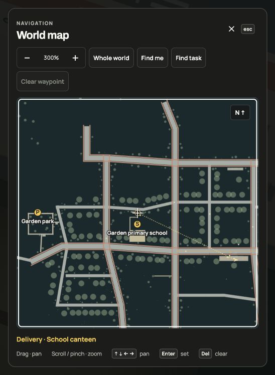
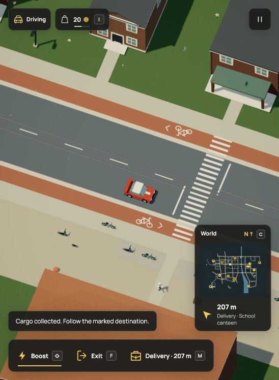

# Guidance for active work

2026-10-20. A delivery already drew a line on the minimap, but clearing a
personal waypoint left no HUD bearing. The map and HUD now share one derived
task target. Deliveries point to the receiving counter; repairs and planting
point to their accepted approach. Personal waypoints take priority. Removing
one reveals the task guide without cancelling work. T / Find task frames the
work site without changing either target or gameplay camera.

No Dream vocabulary, geometry, simulation transition or saved field changed.
The guide reads existing task state, including after restore. Nearby is a
distance cue, not task completion or evidence that handoff rules are satisfied.
The HUD removal button belongs only to a personal waypoint; task cancellation
stays in Activities.

## Native checks

The in-app browser used the real city with `?test-npc=vendor&test-navigation`.
Review storage was isolated; public saves and preferences were not read or
replaced. The 548 × 748 screenshots retain their native size.

- Collected school bread through the actual Work menu. With no personal
  waypoint, the HUD showed Delivery · School canteen and 222 m. Map T centered
  the accepted counter at [4436,3420], at 300% zoom.
- Arrow-key pan and Enter created a separate personal point at
  [4981.8089668615985,3420]. It took priority while school cargo stayed held.
  Delete restored the delivery target and hid the HUD removal button.
- R returned to the car with the same cargo and guidance, now 207 m from
  the receiving counter. Both HUD distances use upward rounding in metres.
- Cancelled through Activities and observed the fixed-step result before
  opening the map. The guide, task marker and Find task control disappeared.
  No delivery pay was awarded. Console warnings/errors were empty.

An initial automated cancellation check opened the map before a simulation
tick, discarding that pending request under the existing pause policy. It was
repeated after observing the actual cancellation; no simulation policy changed.
[Public DOM assertions](native-checks.json) retain the completed checks.

## Verification and limits

Focused tests cover task coordinates, personal priority, NPC exclusion, R,
cancellation, delivery handoff and repair completion, alongside existing map,
camera-input, controls, documentation and instruction-size checks. Production
build/typecheck and the 44-page docs build passed; the existing large-bundle
advisory remains. Exact counts and commands are in [checks.json](checks.json).
The full suite was not repeated for this UI change. This was self-reviewed,
without an independent review.

Native testing covered delivery pickup, guidance, map controls, R and
cancellation. Delivery handoff and repair completion were verified in the pure
engine fixtures, not replayed across the whole city in this browser pass.
No street routing, automatic steering, new storage or performance claim.

README, context actions, movement, world priorities, media provenance and map
invariants were updated. The two new task stills document this context; earlier
personal-waypoint stills remain accurate. Existing economic recordings retain
their recorded HUD and unchanged transaction rules. Dream examples and asset
captures remain accurate because neither their data nor geometry changed.
