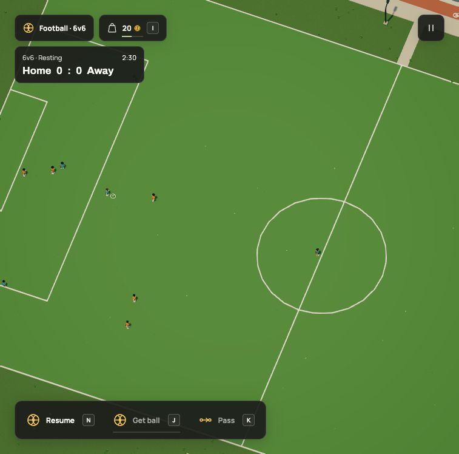
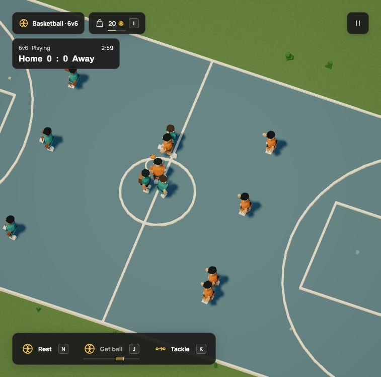
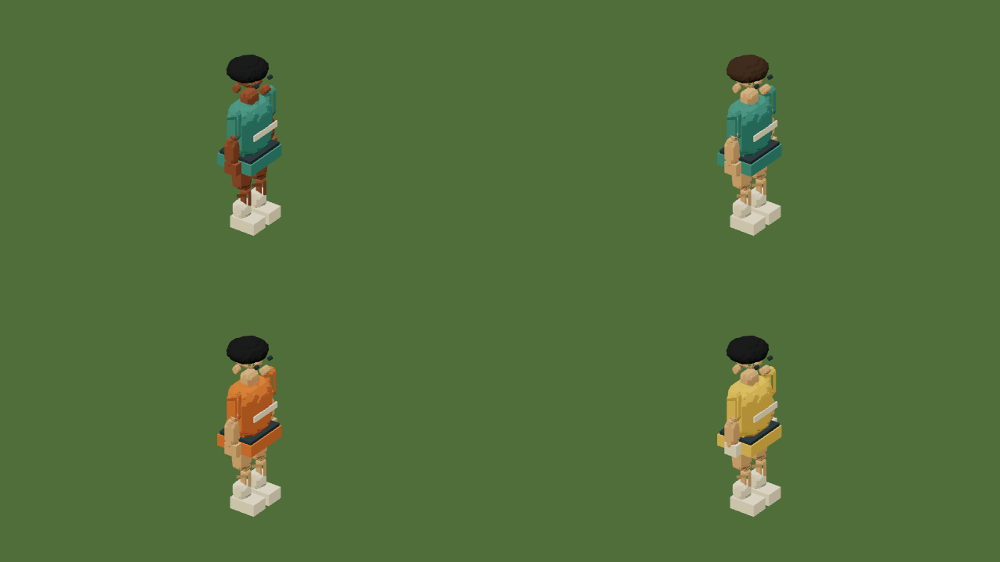
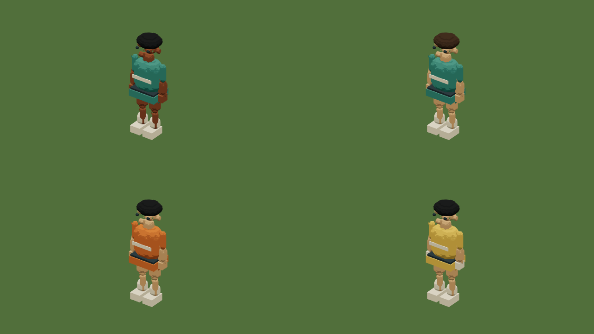
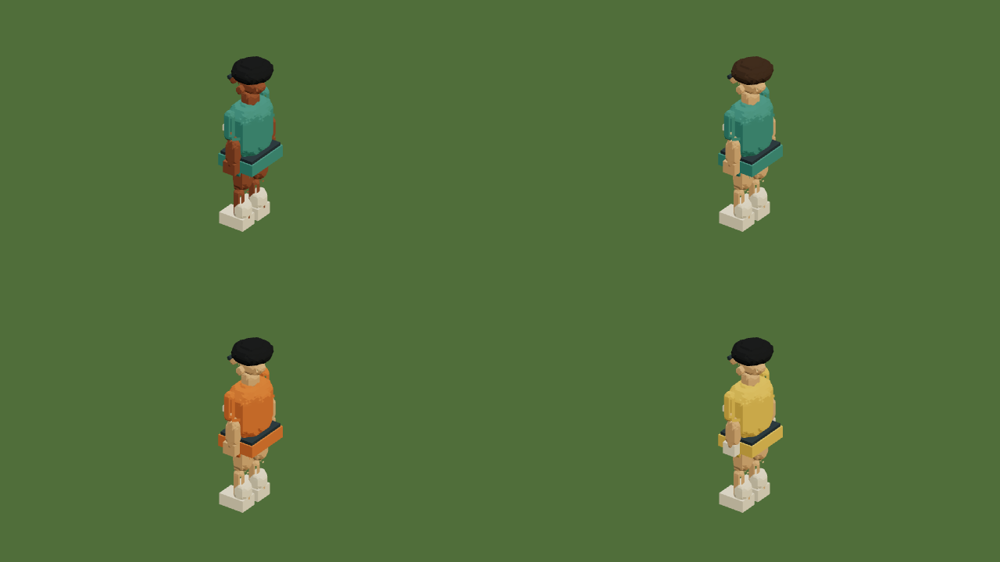
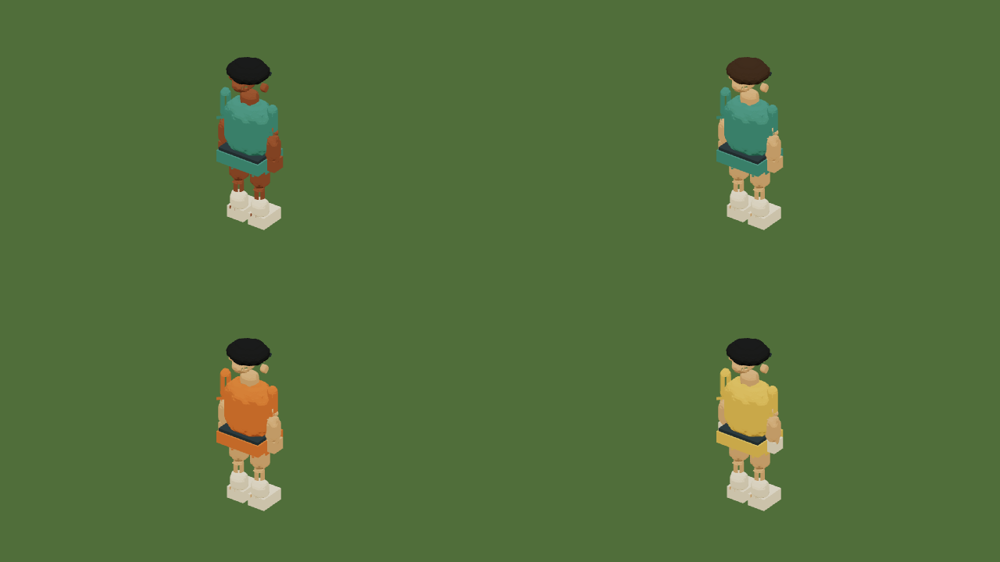

# Six-a-side grounds

The live football pitch and basketball court now connect actual home/away teams,
with the player plus five teammates against six opponents. Dream supplies kits,
variants, NPC identities, tactic style, skill, time and score limits. The engine
owns movement, possession, passing, tackles, shots, goalkeepers and scoring.

- Revision: r67; save format 16; simulation 24.
- Dream source SHA-256: `517c73ac86916f9c36691af4c1defa218991f7e2a0a22ba2338a9d1d103bee03`.
- Accepted-world fingerprint: `b06274e07914b9b26b720ac81f155e6e6f51406adb84768a5a1c1ec01e49b082`.
- Its exact pre-match projection remains the released r66 fingerprint,
  `2ed89b889367d51c6ff3f458bc6faf16028e48076482fdbe4cdb3e69125276ab`.

The city keeps its 1,700 object placements. Its eleven-person shared squad reuses
four sports residents and adds seven identities, reaching the existing 32-NPC
cap beside civic life and transit. One venue displays the shared squad. Assembly
at a newly joined venue is an arcade transition, without a pedestrian journey.
One match plays at a time. CPU rig, route, ambient and destruction caps are unchanged.

## Rules and regression checks

Tests exercise home/away roster sizes, strict ownership/templates and bounds,
shared identities, the reserved `player` member ID, actual motion, one ball owner,
player passes and calls, both directions of stealing, tackle recovery, keeper
catches and distribution, pointer aim, charged shots, goal/basket crossings,
score/time results, court exit/rest/resume, R, deterministic replay and saved state.
Athlete clearance uses its measured radius and height; the post regression would
fail with the former fixed walking radius. Both goal directions contain complete
ball spheres against the side and sloping back planes, including the floor seam;
the mouth remains open. No per-thread contact bodies are introduced.

The complete runnable `docs/examples/team-sports.dream` compiles and passes
full-world acceptance: 9 assemblies, 228 parts, 60 joints and 6 placements.
Contract, model instructions, scoped context, grammar and reference were updated
together. Legacy solo-practice declarations still compile.

The registered r66 upgrade retains all non-sports state, old practice scores and
ball positions, adding ready matches. Historical migration regressions keep old
slots, balances, company ownership, inventory, work, repairs, NPC history,
vehicles, world clocks and physical state. No source/model-provider calls are added.

The frozen final suite passed all 1,338 tests across 102 files. `npm run build`
passed typechecking and the production build; the published docs build produced
42 pages. The focused compiler/context/docs/match run passed 204 tests.

## Native controls and saving

Native N joined football, then K released a pass: at match time .4333 the ball had
nonzero velocity, `lastTouch=player`, no owner and one pass. See
[keyboard-pass.json](keyboard-pass.json). A native short J hold/release in a fresh
basketball match produced one real airborne shot, recorded in
[keyboard-shot.json](keyboard-shot.json). A longer charge was correctly interrupted
by an opponent taking possession; it produced no shot.

The running football match produced a home goal. Basketball reached Home 3–Away 9.
N rested that match; Save now and ordinary reload in the isolated `test-save`
slot returned the exact match records, including elapsed time, scores, poses,
identities and action/tactic clocks. The ordinary world clock continued while
playing. [Before reload](before-reload.json) and [after reload](after-reload.json)
retain that comparison; production/user save slots were not replaced.

| Football | Basketball |
| --- | --- |
|  |  |

These are native review-session screenshots. The refreshed recordings and
posters in `docs/media` show the final active-match presentation.

## Constructed assets

All four new kits have 32 parts and the complete twelve-bone hierarchy. Shorts
attach separately to the thighs, socks and shoes follow ankle frames, and necks
join the heads. Keepers have gloves and a distinct yellow kit. The fitted clothing
uses rigid toon shading; the current `cloth` material's flag wind was unsuitable.
Existing civic anatomy and appearance remain exact in the pre-match projection.

| Front | Right |
| --- | --- |
|  |  |
|  |  |

These are native full-canvas PNG exports from the actual Dream gallery. The
complete 109-template library and the sports sheet were refreshed too. GPU
instances retain bone/finish channels, ordinary material/night behavior and
matching shadow poses. Tests check that only one eleven-person shared squad is
rendered, its instance attributes retain divisor one, resting actions clear and
owned geometry is released. Render-only updates do not allocate NPC physics bodies.

## Local rendering sample

The in-app Chromium sample used an Apple M3 Ultra / 96 GB, 1920 × 1080 drawing
buffers and DPR 1.5. After 60 warm-up frames it measured 300 active-match frames;
299 GPU queries completed. This is a sequential desktop sample with other
applications running, not a controlled benchmark or a weaker-laptop claim.
The [raw result](profile.json) includes means and p95 values.

The sampled scene uses eleven NPCs. Tactics run at 20 Hz; ball/movement stay at
the existing fixed step. The renderer interpolates resident poses and shares
bone transforms across color/shadow passes. No browser shader errors or warnings
were reported in this sample.

The [GIF/video audit](media.json) pins all actual 30 fps source frames, encoded outputs,
posters and asset captures. There are no interpolated frames or offline FPS claims.

## Limits

These are bounded arcade matches with a single active local player. There is no
foul/offside/referee system, competition rulebook, general crowd collision solver,
bank-shot backboard physics or independent sports schedule. Shared squads assemble
at the selected ground. Static world streaming and other people's lives retain
their existing behavior. The live circuit has not been removed in this release;
that and junction crossing consolidation are the next city-layout change.
