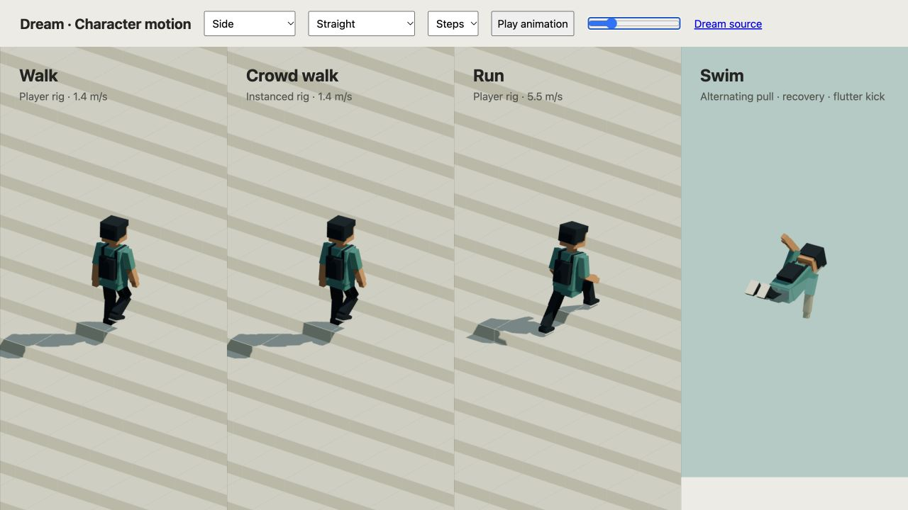

# Planted feet should stay on the ground

2026-10-19. Mock city r74. Reviewed by the implementing agent.

The previous contact pass kept shoes still horizontally. Walking uphill still
moved a planted ankle up with the body: 0.0933 world units per frame at 30
updates per second on the 20% review slope. A foot now keeps its world height,
surface normal and facing through stance. Returning feet follow bounded paths;
the pelvis fits both targets before the rigid leg solver runs. A foot beyond a
cliff cannot pull the body down into the void.

The player, individually animated pedestrians and instanced sidewalk people use
the same contact helper. Crowd color and depth shaders consume identical packed
targets and normals. Surface probes use the renderer's terrain triangles or voxel
column tops, continuous bridge field, cached street polygons and reachable
authored contact caps. Pavement no longer leaves feet under its visual lift.
Reduced-motion people retain a fitted resting height, and jumping carries the
surface lift without changing the physical body. Sitting, swimming and vehicle
ownership retain their existing animation paths.

## Checks and cost

Run `node docs/evidence/terrain-footing/check.mjs`. It compares immutable
`6fafe47be2b9396b0cb9b935e1da6d60250aa8d3` with the current renderer. At 30, 60
and 144 updates per second, maximum vertical drift between consecutive planted
samples falls below 2e-14 world units. These are numerical rig checks, not browser
FPS measurements. Tests also cover cross-slope turns, pause, reach, unsupported
cliffs, 20 Hz probe bounds, reduced motion, seats, takeoff, voxel support,
rendered bridge/pavement height, worker transfer and atomic cache rejection.
Reachable caps also yield to destruction. The first full run passed 1,499 tests
and exposed one stale assertion that counted cosmetic bicycle paint as support;
the comparison now raycasts the underlying rendered surface instead.
[First full run](full-tests-first.txt).

Final verification: **1,501 tests passed across 128 files**, using two workers
and the 60-second CI timeout. The focused set passes 101 tests. Production build,
typecheck, the 44-page documentation build, the humanoid Dream example and both
project skills pass. The native exporter/media audit verifies all 1,080 source
frames and each GIF, HD video and matching poster. The diff was self-reviewed;
no independent review or weaker-hardware test was performed.

The accepted world fingerprint remains
`9a92fe4e540748a1420268ce0221458d161d5a9ee6180f7dd21c4b59bc95b3f7`.
The scene stays r74 with 1,769 objects and 181 ambient members. No Dream command,
body, simulation transition, save format, path or actor limit changes.

The worker reuses the street mesh plan before handing off the Scene. Its 6,471
support patches contain 26,110 points, 985,127 bytes serialized as JSON in this
check. Those bytes describe transferred data, not JavaScript heap usage. Fine
bicycle stencils remain cosmetic: treating their 67,125 polygons as foot support
added avoidable query work. An index now rejects distant patch bounds before
polygon tests. Returning crowd probes run at most 20 Hz per foot; planted feet
hold their existing contacts. Offscreen anchors keep advancing.

The eleven ambient draws and all index counts remain unchanged. Five additional
floats per walking instance/material add 2,420 typed-buffer bytes, reusing four
existing attribute slots. This is not total browser memory or VRAM. A Node-only
whole-crowd replay on this host measured update medians of 0.108–0.139 ms before
and 0.264–0.301 ms after, across four runs. This feature adds support work; it
does not claim a rendering speedup. Support preparation measured 384 ms once
in the worker, and 10,000 repeated local probes took 8.45 ms. These timings
depend on the host and concurrent activity.

[Exact measurements](metrics.json) · [comparison output](metrics-check.txt) ·
[original red regression](regression-before.txt) · [focused tests](focused-tests.txt) ·
[full tests](full-tests.txt) · [production build](build.txt).

## Native review and media

The native gallery was inspected on Hill and Steps, including matching CPU/GPU
poses and shadows. The live park was checked with ordinary keyboard walking,
stopping, jumping and closer manual zoom. Native browser logs contained no
warnings or errors during these checks.

A separate native browser drive measured 300 frames after 60 warm-up frames,
at 1920 × 1080 pixels from the normal 1280 × 720 CSS view and DPR 1.5. Mean
CPU frame work was 3.87 ms, GPU work 1.42 ms and RAF interval 16.67 ms on this
host. This is one current-source driving sample, not a before/after result or
a weaker-laptop benchmark. Focused tests may have overlapped.
[Exact browser sample](browser-drive.json) · [profiler view](browser-drive.png).
The park loader observation took 17.95 seconds with a 161 ms first draw and
a 254 ms maximum heartbeat gap during concurrent verification. Startup still
needs work. Its render counters covered 186,210,338 unique typed-buffer bytes,
with fifteen resident chunks and nine required chunks; these are not total
browser memory or VRAM. [Public DOM diagnostics](native.json).

The character close-up uses Hill, Reverse and stop and the three-quarter view.
Character, pedestrians and locomotion GIF/HD sets and their posters are refreshed
from 180/720/180 actual rendered PNG frames at 30 frames per simulation second.
Poster frames are 40/90/70. There is no interpolation or live performance claim.
The README, behavior/population/rendering guides, media provenance and world
priorities describe the new support policy. Existing architecture, materials,
world layout, static asset sheets and tree/commerce recovery recordings retain
their represented geometry and actions; older activity recordings retain their
historical foot poses. Use the refreshed walking set for current footing.

This remains arcade articulation, with conservative contact-cap support rather
than full mesh collision. Fine bicycle paint cannot raise a foot. Sports squads
retain their existing match gait, and general authored stair-climbing, ladders
and full-body balance are not implemented. No weaker-laptop benchmark was run.
