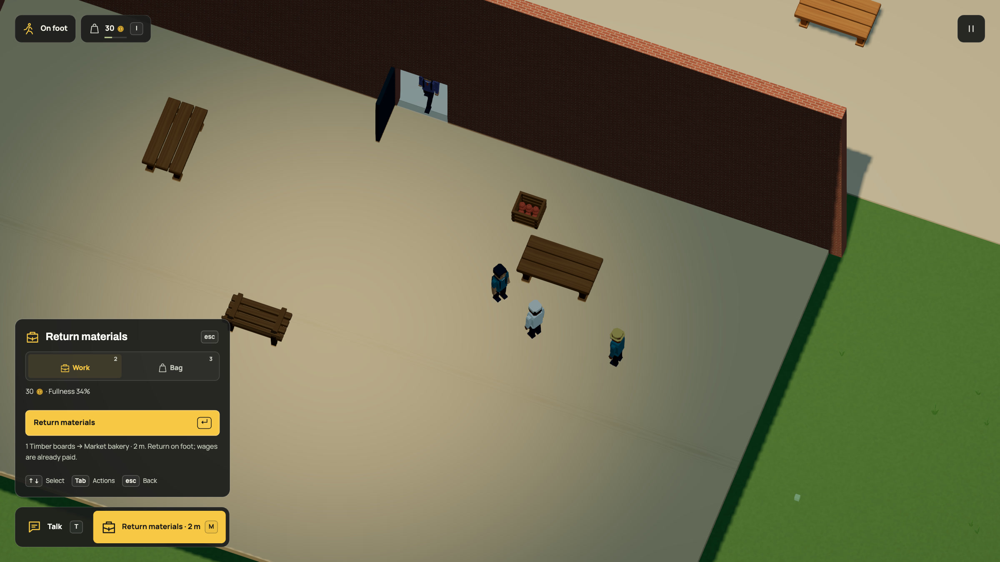

# Timber that returns to the workshop

Dream's optional repair `recover`/`amount` pair connects physical damage,
replanting, carried output and existing kit production. The live service names
boards and one unit. Its 106 sources, all 1,773 objects, contacts, ambient graph
and geometry remain unchanged. No actor, rig, physics body or render budget is
added. Ordinary repair remains available when recovery cannot fit.

## Ownership and bounds

A repair chooses recovery only when the source is mature and bag/shelf capacity
fits, including input refund and all pending output/delivery reservations.
Completion consumes the original input, pays the original wage once and counts
one recovery. Material stays sealed in the worker's home-phase repair until the
open staffed counter accepts it. Player H and NPC returns share the transaction.
The output cannot be eaten, traded or abandoned into remote stock.

Growing sources stay spent across sapling destruction. Only actual unobstructed
growth renews eligibility. There are at most 512 unique growing sources, within
the existing actor, damage and growth caps. Existing source/category data selects
behavior; labels, positions and renderer chunks do not create goods. The same
return rule is checked for furniture parts. Saplings, fasteners and money remain
finite, and timber mass/forestry biology are not simulated.

Current fingerprint:
`f47a995c431246b6234b69a05a38f7220a65e56fbd4414d02f54405e817f0f5b`.
The exact r87 projection is
`e2317da9bd916988c3f252eb1f1e1660b8f2c2ebc54113d6f5c02492afca59a8`.
Format 19/simulation 35 preserves old fields and slots, adds zeroed recovery
counts, and marks historical broken/growing sources spent. No retroactive wood.
Old schemas reject new recovery fields; current reloads do not initialize again.

## Native handoff

[Public browser observations](native.json) show a real H press moving workshop
boards from seven to eight while the player's balance stays thirty. Required
chunks are ready. The review prepares actual table damage/repair, paid kit
production, a car/tree impact and planting, then uses R and walks the doorway.
It positions the car and work approach; it does not prove ordinary outward travel
to the tree. The H press is an ordinary HUD action, with no state mutation through
browser scripting. Save checks separately retain sealed cargo through reload.

[Ten-second video](../../media/recovery.mp4) · [GIF](../../media/recovery.gif).
All 300 source frames are rendered at 30 per simulation second. Source frame 60
supplies the matching 2400 × 1350 still. Encoding produces a 1600 × 900 H.264 video
and 1280 × 720 GIF. These are offline exports, without FPS/startup/memory claims.

## Checks and documentation

Focused behavior covers NPC carry/return, player R and H return, no second wage,
cancellation refunds before completion, full storage, small bags, protected shelf
room, source maturity, closed returns, forged records and a second furniture
recovery scenario. Save checks pin the exact prior world, preserve real cargo,
initialize historical eligibility conservatively, retain the r85/r86/r87 chain
and reproduce the actual live review before a guarded handoff.

README, growth, commerce, business, reference and persistence guides describe the
new lifecycle. The model instructions and generated command contract share the
new vocabulary; highlighting checks whole-token boundaries and authored HTML
escaping. Prior motion remains accurate for its stated mechanics and historical
ledgers. The new return HUD has a refreshed GIF, video and still.

## Executed verification

- One full sweep: 1,670 passed and 23 failed across 156 files, in 559.83 seconds.
  The failures were old writer-version/slot assertions, an outdated surface
  count, documentation/module-map expectations, and a finished-kit test that
  predated automatic kit production and the indoor counter.
- Updated current-writer assertions retain exact historical packet versions.
  Procurement now has an explicit accepted food-only staff fixture and a separate
  live-production capacity check. The two planting examples are checked against
  their respective files; character imports receive the documented closed host
  module map. No runtime behavior was weakened to satisfy those checks.
- The affected ten files plus two new cases passed all 216 checks in 72.46
  seconds. Rechecks stayed within affected files. No second full sweep.
- Focused recovery/save/impact checks passed before that sweep. The native
  handoff and all 300 frame writes completed without browser errors.

README procurement wording and the live replacement-supply snippets were also
updated to reflect pending assembly and the indoor counter. Lower-powered laptop
performance and a complete ordinary journey to the tree were not measured.

Production typecheck/build, both documented CLI examples, all 44 published docs
pages and the final 43 documentation/capture-boundary/instruction-size checks
pass. The 300-frame export and its GIF/video/still are inspected. The existing
large-bundle advisory remains. [Pinned source and media hashes](manifest.json).
