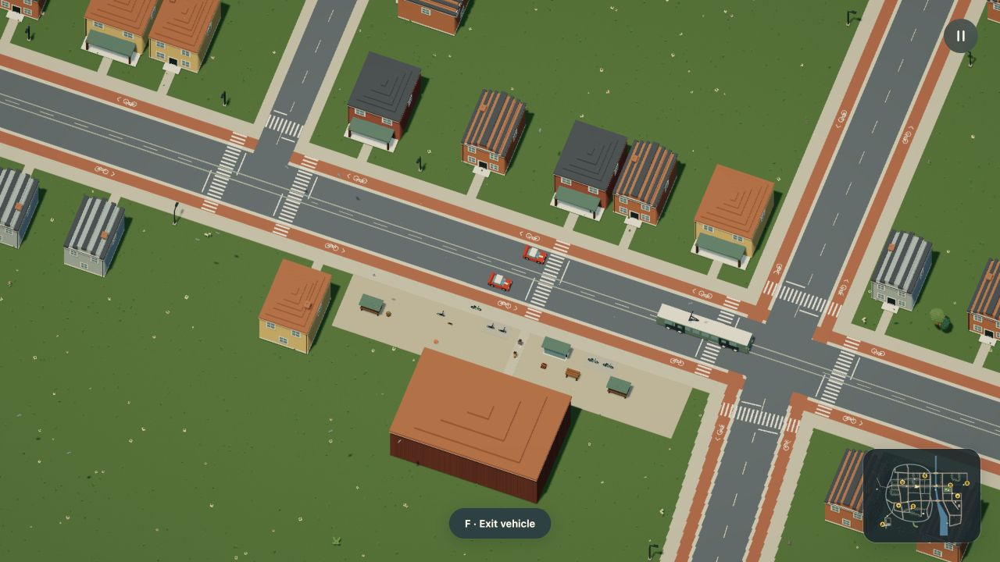
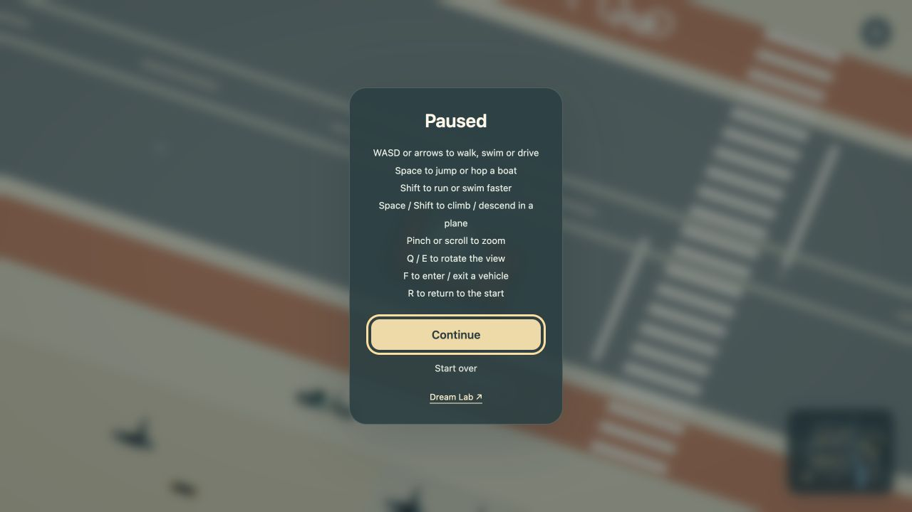

# Trackpad zoom verification

2026-10-17. Mock world; no model calls or simulation changes.

Pinch or vertical scrolling over the game canvas changes a bounded .5–3× multiplier on automatic vehicle framing. The existing camera easing and reduced-motion path apply. The heading and camera follow remain independent of zoom. R retains framing; Start over restores it. Pause-menu gestures are outside the canvas listener.

Native in-app browser checks at 1280 × 720:

- Scrolling reached car zoom .590 and 3.540, with the same position `6330,4233,1.5` and view quaternion `-.51308,.15225,.09304,.83959`.
- W still drove the car at close zoom: X advanced to 6419.6, speed 120.7, zoom 3.540.
- R returned to spawn at zoom 3.540. F exited to walking and eased to 6.750, preserving the 3× manual multiplier.
- Paused scrolling left zoom at 3.540. Start over resumed at 1.180. The pause help includes the new gesture instruction.

Focused checks: 17 tests in camera input, world presentation and sun coverage passed. Production build/typecheck and the 30-page documentation build passed. Input tests cover reversible scrolling, pixel/line/page deltas, pinch wheel cancellation, Safari cumulative gesture scale, duplicate wheel suppression, bounds and paused/horizontal input. Shadow checks cover .590–8.400 camera zoom and stable boarding coverage at every manual scale. The final diff was self-reviewed.

The browser tool sends native wheel input; it does not expose a physical trackpad pinch. Chromium/Firefox pinch-wheel and Safari gesture paths are covered by event tests. Browser event references: [wheel](https://developer.mozilla.org/en-US/docs/Web/API/Element/wheel_event), [Safari gesture scale](https://developer.apple.com/documentation/webkitjs/gestureevent/1632653-scale). Physical Mac trackpad/Safari verification remains unperformed.

The README, behavior guide, world-lighting guide and media record were updated. These captures show the new optional framing. Existing default-view recordings remain accurate because geometry, animations, default zoom and output quality are unchanged; no GIF/video regeneration was needed.
