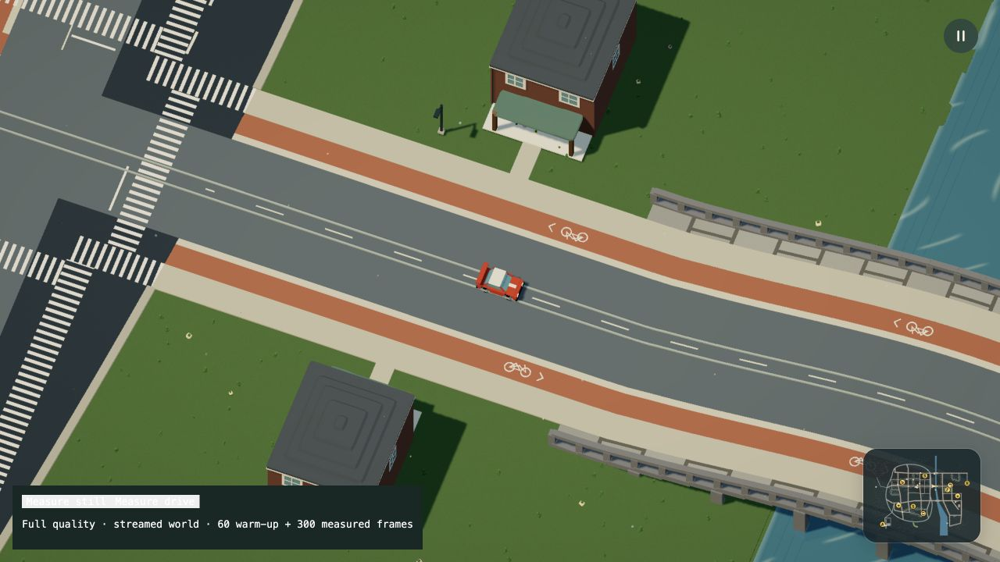
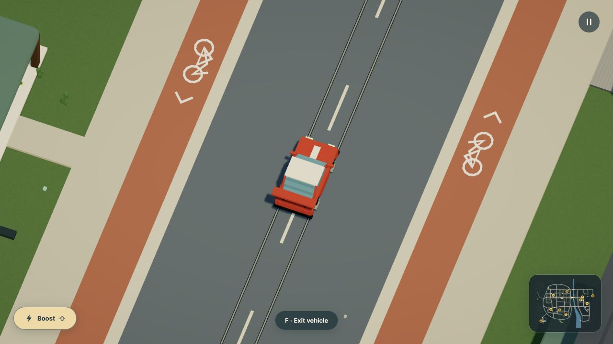

# Tram tracks in the street

Mock-only visual and resource-ownership change. The existing Dream `tram` route
and `gauge` own the path; no new command, provider call or controller is added.
This is a self-review, not an independent review.

## Reproduction and correction

The native bridge approach showed two raised strips covering the zebra. Source
and ray checks identify them as tram rail boxes, not street center paint. Their
tops were 1.5 world units above the street, or fifteen centimetres. The separate
regional railway uses that raised construction intentionally.

Tram grooves and heads now use the route's authored miter frames, including
corners and closed loops. Six-centimetre heads sit within twelve-centimetre
grooves. The renderer clips those footprints to actual constructed top triangles,
then interpolates their heights and UVs. It does not independently resample a
second height mesh. The heads use a three-millimetre rendering lift, grooves two;
the physical road and vehicle support remain unchanged. Bounded raster depth
bias retains those thin layers through worker transfer.

The first independent-strip implementation passed a flat-street check but failed
on bridge approaches: its triangulation sank by several millimetres in one place
and floated roughly two centimetres elsewhere. Projecting onto the real support
triangles resolves that failure without loosening the exact fit assertions.

Crossing stripes, stop lines, center paint, cycle glyphs and authored street
markings clear the same groove footprint. Circuit center and finish paint use that
clearance too. A final regression reproduced circuit dashes covering a rail when
the route put one head along the centerline; the shared cutout removes it while
retaining the neighboring dash. Track geometry stays continuous through
crossings. Road/deck builders retain their original triangles and are shared with
the projection pass. Temporary support buffers are disposed after construction.
Tracks belong to streamed street chunks rather than one resident full-route mesh.
Tram motion and passenger ownership retain their simulation owner.

## Bounds and limits

Existing route, point, actor, joint, physics and world bounds stay unchanged.
Projection clips convex footprint pieces against upward-facing support triangles;
it creates no per-cell node or collision body. Only the route's actual supported
street/circuit/deck surface receives a track. Regional railway rails/sleepers,
water, driving heightfields and every accepted Dream placement remain unchanged.
No general mesh physics, traffic signals, switch control or underground railway
is introduced.

## Checks and media scope

Focused checks cover flat crossings, physical width, complete span coverage,
stone/timber approaches, independently built voxel-chunk seams, angled/closed
routes, circuit-only tracks, indexed sloped projection, underside rejection,
worker geometry/depth-bias transfer and the retained raised railway. Existing
bridge and cooperative-construction checks also pass.

README, urban guide, rendering notes, world priorities and media provenance are
reviewed with this change. Dream vocabulary, model packet, generated contract,
highlighting, source examples and the source-derived city layout are unchanged.
Native controls and offline 30 fps recordings are checked separately from live
browser timings. Offline PNG export and encoding do not measure playable FPS.

The final local run passed 1,149 tests in 82 files in 169.94 seconds, including
eight focused track/inspection checks. The final production typecheck/build also
passes. Existing timeout/reporting and bundle-warning gates stay unchanged.

The [exact accepted-world comparison](acceptance-comparison.json) retains the
complete scene, contacts, masks, current/historical navigation, repair network,
placement transforms, 2,761 terrain samples and eleven fingerprints against
`8b984bda44bc6ad74e05cdd0fbbee9da2d307ae7`. Its Node construction timings are not
browser performance measurements. Dream source remains
`269c818e0f333fe8fb11fe881219eb363ab59e54da8817787ba24191002c5464` and accepted
save compatibility remains
`36a6b350b49fa07044768fde832c838f9a4be007484d285a93c18a8beb77f136`.

The [headless resource traversal](streaming.json) loads eighty chunks and releases
fifty-seven while visiting town, airport, waterfront and town again. Explicit
final disposal leaves zero resident chunks, owned streamed bytes, group children
and geometry-buffer bytes. These are buffer/ownership assertions, not total
browser heap, VRAM or driver reclamation measurements.

## Native travel and full-quality samples

The native dev review starts beside the actual tram using the normal exit
function. Walking into range and pressing F boards its passenger seat. With W/D
held, the player follows the tram actor from x=6,756.7 to 6,905.5 while y stays
4,200. The [record](native-passenger-check.json) checks passenger ownership,
matching actor coordinates, retained parked-car state and chunk eviction. F later
returns to dry ground at the civic stop. [Passenger view](native-passenger.png).
This is continuation from a declared review start, not a recording of reaching
the station from the ordinary spawn. The inspection helper now supports NPC
passenger seats without granting them driver controls.

The same check found the older broad-radius exit behavior can leave the passenger
several metres from the actual vehicle side. That is recorded in the world-system
priorities for a separate shared egress change; this graphics pass does not claim
to correct it. Creating/removing a temporary cached tsconfig retained the same
loader result and passenger session after excluding `.npm-cache` from Vite's
watcher. No public save was imported or replaced.

Apple M3 Ultra / 96 GiB, 1920 × 1080 drawing buffer, DPR 1.5. Tests, source audits
and encoders are stopped during each measurement. Each sample uses sixty warm-up
and three hundred measured frames, with 299 GPU queries. CPU/GPU timings overlap.

| Current profile | Frozen orchard | Driving |
| --- | ---: | ---: |
| CPU prepare/submission mean | 2.058 ms | 3.997 ms |
| CPU p95 | 2.500 ms | 5.200 ms |
| GPU query mean | 1.347 ms | 1.302 ms |
| Animation-frame interval mean | 16.666 ms | 16.711 ms |
| Frame-interval p95 | 18.400 ms | 17.600 ms |
| Draws mean | 211 | 157.84 |
| Submitted triangles mean | 636,946 | 577,265 |
| Uploaded geometries | 139 | 284 |

[Still report](browser-still.json), [drive report](browser-drive.json),
[drive view](browser-drive.png). The preceding unchanged-world still submitted
212 draws / 654,706 triangles / 140 geometries; its CPU mean was 2.018 ms and RAF
mean 16.667 ms. The current view submits one fewer draw and 17,760 fewer triangles.
The CPU timing is slightly higher in this small sample; this is not a demonstrated
gameplay FPS improvement or a lower-powered-laptop result.

The [frozen image comparison](image-buffer-comparison.json) finds zero changed
pixels outside the timing panel in the orchard view, where the refined track is
outside the camera. The same sixteen chunk keys retain 186,488,296 counted render
buffer bytes, against 186,502,920 before. That small difference is not a meaningful
browser-memory saving. [One quiet load](startup.json) took 15.645 seconds, retaining
the prior 15.6–15.7-second range; its maximum heartbeat gap was 287 ms. These are
warm local development loads. Cold-network, lower-powered laptops, total heap,
VRAM and sustained thermal behavior remain unmeasured.

The earlier profile source is pinned in [the profile manifest](profile-source-manifest.json).
The final circuit-paint correction adds a shared cached footprint and its cutout;
it does not change this live town's street-only tram layout. Final captures use
the separate [166-file source manifest](source-manifest.json), including new
untracked helper sources before the release commit. These reports do not claim
a new performance measurement for that last correction.

## Refreshed documentation media

Sixteen clips contain 6,060 consecutive native rendered frames at thirty frames
per simulation second. Their GIFs, HD videos and corresponding stills are
refreshed together. [Capture completion records](captures.json) pin the final
source digest; the long handoff survived a tool timeout without restarting the
exporter. Matching posters keep actual frame numbers. [Output hashes and sizes](media.json)
pin the encoded assets. No missing-frame interpolation is used.

Town, station, school, football, suburb, canal and waterway stills use the real
geometry-review canvas. The four bridge views inspect [front](tram-bridge.jpg),
[right](tram-bridge-right.jpg), [back](tram-bridge-back.jpg) and
[left](tram-bridge-left.jpg). The HUD and boost images use ordinary native
controls in a declared review session. The map, asset galleries, regional airport,
remote sports/wildlife/planting and isolated destruction captures keep their
unchanged geometry and behavior. Historical evidence remains pinned to its own
release. These offline media are not live performance samples.
