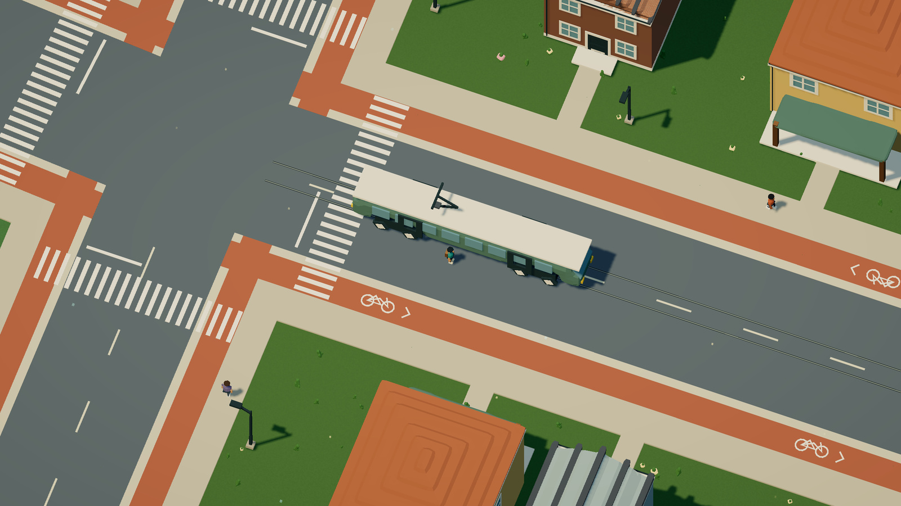

# Passenger exits beside the vehicle

This is a mock-engine control and save upgrade. There is no provider call, new
Dream command, driver profile, actor, joint, scene placement or rendering budget.
The review is self-review, not an independent review.

## Reproduction and rule

The released tram used its broad enclosing radius for a sideways exit. Its eight
actual cylinders follow the long carriage, so that radius left the player about
7.6 metres from the contact envelope. Buses and regional rail showed the same
problem. [The native before-state](before.json) retains the exited position,
matching tram pose and original parked car. It uses the declared development
vehicle review, not a journey from the ordinary spawn.

The shared exit function now intersects eight outward rays with the authored
cylinder union, expanded by the walking radius plus five world units. It starts
beyond the last intersected contact, then retains the existing seven outward
rings, dry-before-wet order, height, collision, world-bound and bridge checks.
A missing ray intersection retains the broad-radius fallback. A blocked exit
keeps the current owner. Contacts remain bounded to eight; this work happens on
F, not in each animation frame. No visual mesh is made into a collider.

The [before/after survey](survey.json) compares the archived released engine with
the working implementation. Unobstructed tram, bus and regional-train exits have
an eight-unit (0.8 metre) center clearance from their contacts. Original-car,
bicycle, boat and aircraft exit results remain exact in the surveyed cases.
This is a bounded clearance search, not an authored door or platform-side system.
There are no new door animations, fares, capacity or traffic avoidance.



## Save compatibility

Save format stays 9. Simulation rules advance from 12 to 13, with the registered
fingerprint changing from
`36a6b350b49fa07044768fde832c838f9a4be007484d285a93c18a8beb77f136` to
`f7b5f8bc696e111422148d51e068413050785a6dc03dcc418cbeb80d9f8adcfc`.
The old slot stays stored and takes priority over older upgrade candidates.
Corrupt or externally changed newer progress still blocks automatic replacement.

The new upgrade is separate from older physical migrations: it does not rebase
population, recover an old floor or initialize inventories. Tests compare every
saved field and clock for both a moving passenger and a growing tree/returning
worker. The fixtures were generated through archived release
`7b9d25b37d8998f0514254e6643d98e638b5731f`; no public user save was copied.
The life fixture uses that released engine's existing registered upgrade from
r53, then its normal format-9 encoder. Fixture generation records pin their
source and hashes. All older registered upgrade cases remain required.

The [complete accepted-world comparison](acceptance.json) checks the scene,
contacts, masks, current and historical navigation, repair network, placements,
2,761 terrain samples and unchanged historical fingerprints. The current
fingerprint change is asserted explicitly, not silently omitted. Dream source
remains `269c818e0f333fe8fb11fe881219eb363ab59e54da8817787ba24191002c5464`.
Diagnostic Node construction times are not browser performance results.

## Checks and media

Focused tests cover scaled and rotated bodies, immediate reboarding, obstructed
sides, complete enclosure, route ownership, retained parking, exact saved state,
wrong-world rejection, corrupt-slot precedence and changed-tab protection.
Existing car, bicycle, boat, aircraft, bridge, road, race, sports and destruction
checks stay in the full suite. Timeout and reporting gates are unchanged.

The transit clip exports 240 consecutive native 2400 × 1350 frames at thirty
rendered frames per simulation second. F is applied at frames 20, 105, 120 and
210 through the same ride action used by the UI. Video, GIF and frame-110 poster
are refreshed together with the existing encoder. No frames are interpolated.
The [source manifest](source-manifest.json) includes runtime source, HTML, compiler
data and tool pins. These offline exports do not measure live FPS.

README, behavior, urban guide, persistence, priorities, AGENTS and media provenance
are reviewed together. Existing out-of-transit clips retain the same pictured
models, placements and control paths. Their car/bicycle F transitions and
boat/aircraft clearance are unchanged. The map, galleries, Dream command contract,
model packet, highlighter and runnable sources retain their vocabulary and data.

## Native controls and upgrade rehearsal

The [tram record](native-controls.json) boards with F directly from the review
start, retains passenger ownership and heading while W/D are held, leaves beside
the moving carriage, then reboards without walking toward it. The original car
stays at 6330,4233. [Bus](native-bus.json) and [regional rail](native-train.json)
use the same direct F checks and retain that parked pose too.
[Tram view](native-exit.png), [bus view](native-bus.png), [rail view](native-train.png).

The [browser save rehearsal](native-save-upgrade.json) uses a separate localhost
origin and the existing review-only namespace. An archived, unchanged rules-12
engine imports the released-engine fixture through the actual backup preview and
restore controls. Only its HTML boot path is adjusted to serve the archive. The
current app then loads the old slot automatically, reports the registered
upgrade and keeps the passenger, parked car and visual-clock phase. A second
reload reads the new rules-13 slot as an ordinary saved world. No public or normal
local-player slot is imported, replaced or cleared during this rehearsal.

The [media audit](media.json) checks consecutive source names, export timestamps,
all 240 decoded video frames and the three encoded-output hashes. Other published
captures remain accurate for the reasons in the media guide. An earlier full run
started before encoding finished and reported three missing-GIF links; it did not
report a runtime regression. The final suite is run with all media present.

From the repository root, reproduce the accepted-data check with:

```sh
node docs/evidence/transit-exits/compare-acceptance.mjs 7b9d25b /tmp/dream-exit-acceptance.json
```

[Passenger fixture provenance](backup-source.json) ·
[Growth/return fixture provenance](life-backup-source.json).

Final local verification passes 1,157 tests in 83 files in 167.54 seconds,
including the previously missing media links. The production typecheck/build,
36-page docs build, standalone city-bus compiler check and 240-frame encoded-media
audit pass. The 171-file runtime/capture manifest is unchanged after recording;
the production build postdates every recorded runtime input. No live frame-rate
improvement or lower-powered-device benchmark is claimed for this exit fix.
