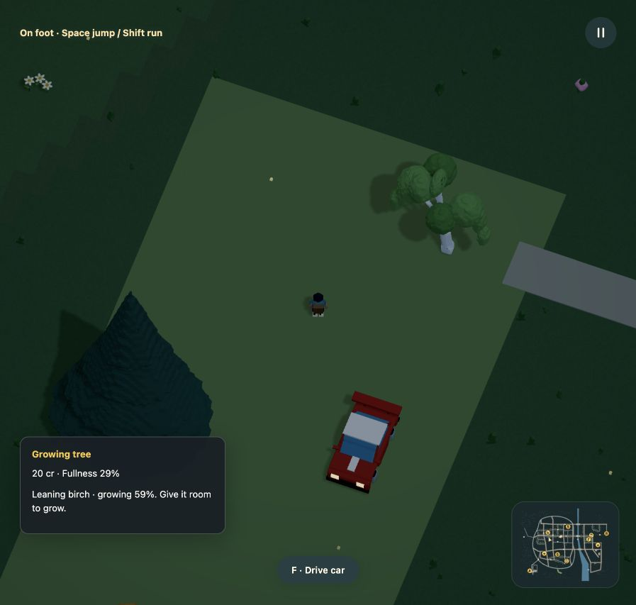
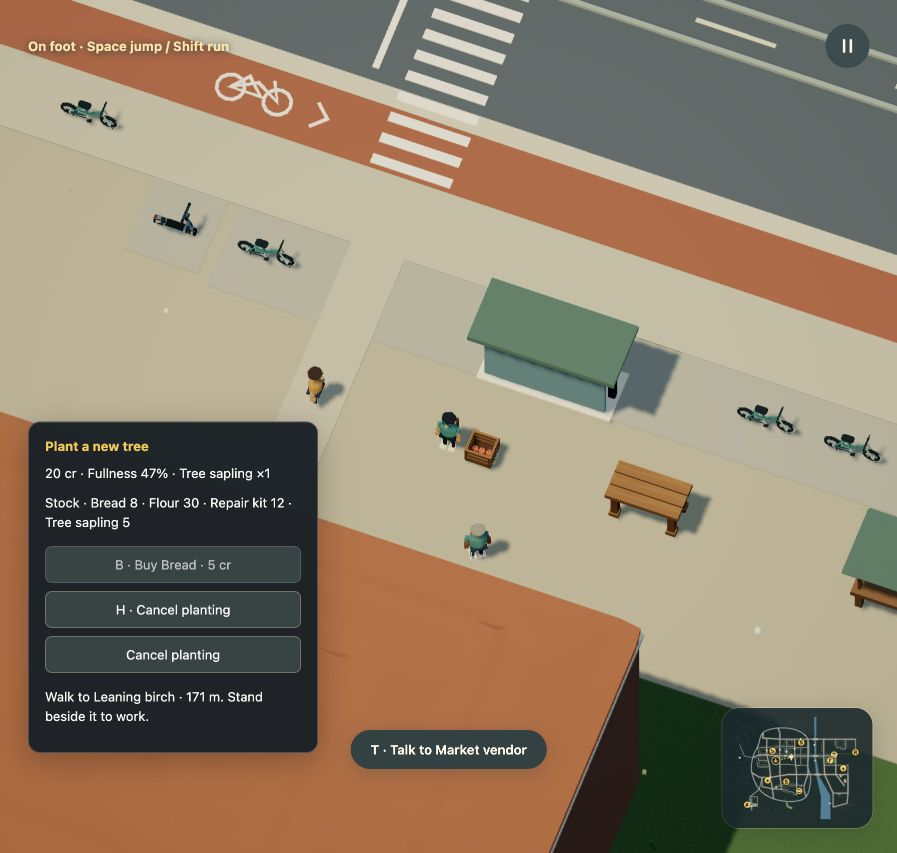

# Orchard recovery

This release adds a bounded planting loop for the existing three orchard trees.
The other 333 measured trees remain outside destructible/replantable coverage.
The world is authored mock Dream data; there are no provider calls or prompt UI.

## Baseline and acceptance

Before editing, native driving toppled the orchard birch and left it permanently
broken. The existing scene had 336 measured trees, three whole-tree topplers,
one single-service caretaker and no saplings or growth state. The intended
change was finite paid replanting, matching visible/physical growth, persistence
and reuse of the same worker without expanding actor or debris budgets.

All 1,695 placements and 57 crossings remain byte-for-byte equal as compiled
data. Two surfaces add a garden path and its orchard ground, taking the total
from 35 to 37. The path overlaps the work area and connects to High Street's
sidewalk. The map is regenerated from the accepted scene and uses each surface's
actual color. Overlapping work grounds connect through clear full-cylinder
portals; real gaps remain invalid.

The source hash is
`8f87ca7c33de44aa095340d797a19016565f10b9fbfa8985d50c3319707fb7bc`.
Format 8 / simulation 10 uses compatibility fingerprint
`5603fcbdc725e4cfe36e5284d0123a37d6cf46785904c3d235b44e6a52739f05`.
The r52 projection equals the registered prior fingerprint. Public ambient
navigation retains exactly 2,813 nodes. The unchanged furniture service has
3,521 nodes / 11,394 links; the orchard has 3,587 / 11,252, within existing caps.

## Complete engine journey

`node scripts/replay-maintenance-network.mjs --trees` drives into the tree,
reverses clear, exits and advances the complete fixed-step engine at 120 Hz.
It checks conservation and save acceptance throughout the journey. The worker
dispatches at 13.26s, starts planting at 273.51s and completes at 283.26s.
One sapling is consumed and six bakery credits reach the caretaker. Growth
finishes at 463.26s; the worker reaches home at 543.51s. Their hungry shop policy
then buys bread for five credits, leaving one credit and one loaf. The final
state has exactly one orchard planting and no broken/growing tree.
[Events, final ledger and CPU samples](fixed-step-replay.json).

The 65,221-step run is outside the browser. It measures fixed-step CPU work,
not live frame rate. The long round trip follows existing pedestrian connections
at 1.4 m/s. It is not shortened by teleporting the worker.

The first replay exposed a parked bicycle on the selected route. Network search
now accounts for parked vehicles and stationary physical actors, and blocked
workers discard the stale path and retry without losing claims or reservations.
Moving transit causes a wait. A native recording also caught shared-duty workers
rendering at home: the actor-pose owner lookup now recognizes both policy forms.
A regression test checks visible/body poses against the saved journey throughout
movement and work, rather than checking only the economic completion.

## Native browser checks

The production preview restores the working checkpoint through its normal
Backups interface. The tree appears small after paid planting. Walking closer
shows its progress, and native reload retains the growth clock. Recovery moves
the player to the start while retaining the planted tree, completion count and
supplies. Progress continues only while simulation runs.
[Native export comparisons](native-save-checks.json).

[The mature tree restored in the running app](native-mature-tree.png) · [Regenerated map review](native-city-map.png).

At the vendor, the player chooses **Plant a new tree**. The shelf changes from
six saplings to five and the bag shows one reserved sapling. Cancelling returns
the shelf to six and keeps the player's twenty credits. A real r52 backup is
then opened, previewed as a compatible update, restored while paused and
exported. Removing only the newly initialized planting keys gives exact equality
with every old saved field, including the world clock and navigation indices.

## Geometry, safety and captures

Growth uses the same scale for rendered geometry and contacts, with a fixed
planted root. Tests cover blocked expansion, resumed growth, scaled repeated
destruction and debris, player work, supply/wage conservation, policy priority,
32-slot reservation pressure and invalid saved records. Streamed mesh tests
round-trip worker packets, freeze static matrices and check actual transformed
vertices against culling/shadow bounds through young and mature stages.
Hidden/reset instances retain authored transforms, and geometry buffer bytes
remain unchanged as plants grow. Resident roots and debris reuse their buffers.

`planting` contains 360 rendered frames / 12 simulation seconds. `growth` contains
900 / 30 seconds, showing the beginning of the real 180-second growth clock.
The exporter cooperatively pre-rolls the actual impact and journey, selects
14:00 lighting for readability and renders every frame. There is no interpolation,
worker teleport or claimed live FPS. Both HD videos, GIFs and full-resolution
stills are refreshed together. The complete source example compiles, and the
new fields share the generated command contract and highlighting tests.

README, language/reference/model instructions, commerce, persistence, rendering,
urban-world, priorities and media guides are updated. Earlier lamp, market,
vehicle, sport and asset captures remain accurate for their unchanged geometry
and mechanics; they do not depict the new orchard work area.

## Browser measurement

One full-quality development run on an Apple M3 Ultra with 96 GiB RAM measured
300 driving frames after 60 warm-up frames. The render target was 1920 × 1080
at DPR 1.5. Mean RAF interval was 16.67ms, p95 17.4ms; mean application CPU
prepare/submit was 3.54ms, p95 4.6ms, with mean GPU time 1.34ms across 299 samples.
The scene retained 250,988,394 bytes of geometry buffers, including cached roots;
this is not total browser or GPU memory. One local development startup took
14.83s with a maximum heartbeat gap of 287.4ms. This is a single hardware/viewport
observation, not a cold-start, low-end-laptop or comparative speedup claim.
[Raw timing, startup and streaming counters](browser-profile.json).

## Checks

Production build/typecheck, the 35-page documentation build, runnable example,
media frame/hash audit and both project skill validations pass. The final
fixed-source affected run passes 120 tests across planting, all registered save
upgrades, guide examples, links and highlighting. Existing world, movement,
voxel, destruction and rendering coverage also ran in the full suite. Full-world
checks use `npm test -- --maxWorkers=2 --testTimeout=60000`, matching the publishing
workflow; the shorter default timeout is unsuitable for the older world fixtures.
Assertions, report yields and fatal unhandled-error behavior are unchanged.

## Remaining scope

This is authored plant recovery, not a biological ecosystem. There is no soil,
water, season or reproduction model, carried sapling mesh or digging animation.
Most trees still need a bounded animated destruction path. The new work grounds
are visibly simple surface patches; natural landscape finishes remain a visual
refinement. Cosmetic populations do not block growth. Depot stock and business
budgets are finite, workers have no schedule/skill system, and closed pages do
no work. Low-powered laptops remain unmeasured.
