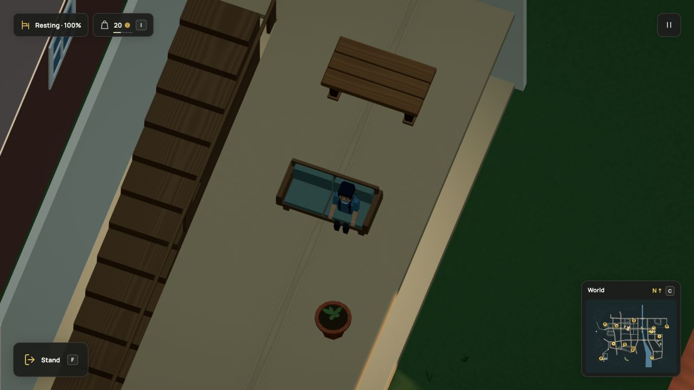

# Named floors and upstairs life, r99

The change connects upper-floor geometry to the existing resident rest and paid
repair systems. It is part of the living-world goal; lifts, further interiors,
relationships, broad daily routines and universal interaction remain open.

## Acceptance

- Dream `floor` binds an existing retained slab, validates its footprint and
  headroom, and anchors explicit static props with finite contact bottoms.
- Rest and repair plans name the building and its floors. Derived routes climb
  generated stair contacts in both directions with supported height and headroom.
- Player/NPC seats share claims; damage releases them. Upper debris uses retained
  slab support. Paid repairs consume finite supplies and pay once.
- Current positions, destinations and saved path segments preserve elevation.
  Forged heights fail. Registered r98 saves preserve commitments and resources;
  an obstructed old player pose recovers locally on its existing floor.
- Worker graph packets validate source, heights, supports and links. Indoor
  graphs retain 1024 nodes and the existing combined 8192-node/32768-link bound.
  Existing actor, route, live rig and fracture limits remain unchanged.

## Executed checks

Focused tests cover the standalone source, live resident out/sit/home trip,
repair dispatch/work/return, ledger conservation, claim release, broken debris,
streamed per-instance cutaways, each saved trip phase, the exact old projection,
retained old slots and local pose recovery. Files: `floors.test.ts`,
`upstairs-rest.test.ts`, `upstairs-world.test.ts`, `stairs-world.test.ts`,
`resting.test.ts` and `repair.test.ts`. Compiler/context/highlighting checks also
cover the new vocabulary and escaping. The production build passes.

The full run covered 1838 checks across 177 files in 630.29 seconds: 1832
passed and six failed. Five failures were old fixture counts; the sixth exposed
an access-cache reference retained before worker priming. The fix clears that
derived area cache after successful coverage priming and avoids indoor preparation
for scenes without named floors. Rechecking the eight affected files passed all
43 cases in 22.48 seconds, including exact packet-reference ownership and forged
packet rejection. Latest per-file results cover all 1838 checks successfully;
this was one full run plus focused corrections, not a second green full run.
See `tests.json`, `full-suite.txt`, `focused.txt` and `source-manifest.json`.

The final production build passes; the existing large-bundle warning remains.
The modified paper-game skill validates with no diagnostics. Documentation checks
build the published site and validate inline examples, vocabulary boundaries,
HTML escaping, links and media downloads: the final three documentation files
passed all 195 checks in 2.45 seconds. A fresh browser start after the cache fix
still restored the occupied upstairs seat with no console warnings/errors.
No render-quality or live FPS claim
is made. The cache-reference correction changes no geometry, controls or motion,
so the completed recording remains accurate.

## Browser evidence

Used the local Vite build in the in-app browser on this macOS machine. The
`?test-upstairs&test-save` walkthrough seeds only an exterior observation pose;
ordinary fixed ticks drive the resident and player through the doorway and stairs.
F sat on the upper settee. Save now and reload restored `home_upper_settee/right`
at elevation 35.21739130434783. Four camera angles retain the occupied slab and
furniture. Energy recovered through the existing seated rule. Console warnings
and errors were empty.

The inspected frame reported 252 draw calls, 208625 triangles and 189 geometries.
These are one runtime diagnostic snapshot, not an FPS benchmark, total browser
memory or a performance improvement claim.

## Media

480 consecutive 2400×1350 frames at 30 rendered frames per simulation second.
The camera follows the resident through the stair climb, landing and seated rest.
The player remains outside so the passage is clear. HD video and still are
1600×900; GIF is 1280×720. Poster frame 420. This deterministic offline capture
is not a live performance measurement. Earlier stair/home/rest clips are labelled
historical where their furnishings differ. Other venues and transport captures
remain accurate because their geometry and controls are unchanged.

## Limits

One enclosing room per building. No lifts, independent stacked room ownership,
upstairs trade/work equipment or permission system. Floor props are static
furnishing, without controllable vehicles, joints or knockable bodies. Indoor
lamp pools remain on the ground floor. The browser also used K to break the upper table, then moved clear. The
caretaker reserved one timber unit, climbed to elevation 35.21739130434783,
worked for the authored eight seconds, restored the table, received four coins
once and started walking home. Native snapshots record the reserved supply,
work pose and completed counter. Concurrent city restocking remains active.
See `native-working.json`, `native-repaired.json` and `repaired.png`.
