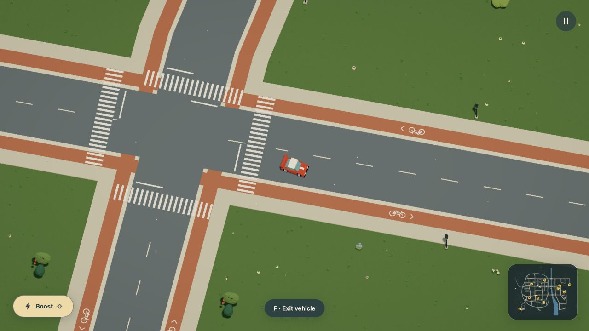

# Street-verge repairs

The live service now covers 84 targets, including 77 lamps, without moving any
of the 1,695 objects or 35 surfaces. Other districts and replanting remain further
work. The world is still authored mock data; no provider calls or prompt feature.

## Baseline and routing

Before editing, native production-browser driving broke `center_lamps_0_11_l`.
After 122.84 simulation seconds the lamp remained broken, the caretaker was idle,
and all 12 market kits remained. This actual r51 backup was retained for upgrade
verification. The old service selected only eight targets, including one lamp.

The new street declaration selects Market Avenue, High Street and Civic Walk.
It adds 78 short dry approach polygons near existing matching contacts. Riding
surfaces, the circuit and water are excluded; there is no new paving or global
walking raster. The repair graph has 3,521 nodes and 11,394 directed links,
within the existing 8,192/32,768 limits. The extra approach limits are 512 street
targets and 2,048 polygons per service.

Four lamps exposed a missing crossing at the actual High Street/South Avenue
intersection. One authored four-arm junction crossing connects them. Removing
it makes complete-world validation reject the same service. The new crossing
brings the accepted count from 56 to 57; all older crossings are unchanged.
Native views show zebras, cycle tracks and cleared road/stop paint from two
angles. The published map is regenerated from accepted geometry.

[Rotated native view](native-junction-rotated.png).

## Fixed-engine replay

`node scripts/replay-maintenance-network.mjs --street` drives the car into the
lamp, reverses, exits and advances the complete journey at 120 fixed steps per
second. It checks conservation, serializable state and the one-kit/four-credit
outcome. The caretaker dispatches at 13.26 seconds, starts work at 63.26,
restores the lamp at 71.01 and is home at 112.76. The replay contains 13,531 ticks.
[Replay events and final ledger](fixed-step-replay.json).

This replay runs outside the browser and is not a live performance measurement.
The recording cooperatively pre-rolls those actual mechanics before capturing
twelve simulation seconds of work and return at selected 22:00 review lighting.
No worker teleport or frame interpolation.

## Save continuity

Format 7/simulation 9 has an explicit r51 upgrade. The earlier graph has 2,800
nodes; the new graph has 2,813. Every old coordinate remains. Saved population
node indices are validated against the earlier graph and mapped by coordinate
and adjacency. Positions, history, random state, needs, jobs, damage, inventory,
money and clocks stay saved. Graphs are prepared in the world worker.

The automated upgrade uses an actual native r51 backup with a damaged park lamp,
a bench and an active caretaker. It compares all other fields exactly and checks
node coordinates. A forged old node index valid only in the larger new graph is
rejected. All earlier registered release fixtures retain their upgrade path.
This is a pinned migration, not a general world-edit migration.

## Native play, media and performance

The production preview accepts the actual r51 damaged-street-lamp backup through
its normal Backups UI. After resume, the worker restores the lamp. The 199.59s
export has one completed repair, four caretaker credits, 11 kits and a return
journey. R and native reload retain those totals; the 266.57s export has the
worker home and no damaged lamp. A separate native restore/export of the active
r51 park job compares every saved field exactly except derived navigation indices,
whose coordinates match. [Native save checks](native-save-checks.json).

The new recording contains 360 actual 2400 × 1350 source frames at 30 fps. HD
video is 1600 × 900, GIF is 1280 × 720, and the still is source frame 250.
All three were inspected together; the lamp returns with its ground light pool
as work finishes. [Decoded frame counts, durations and hashes](media-audit.json).
Earlier park/furniture clips remain accurate. The regenerated city plan has the
same road footprints; it does not depict individual crossing paint.

The full-quality town drive measured 300 frames after 60 warm-up frames on an
Apple M3 Ultra with 96 GiB memory. The render buffer was 1345 × 1279 at DPR 1.5.
Frame interval averaged 16.664 ms, p95 18.2; renderer CPU averaged 3.153 ms,
p95 4.3; GPU averaged 1.213 ms. Geometry buffers measured 250,904,300 bytes,
including owned hidden geometry. No owned tests, encoders or replays were running.
This is a single current sample, not a speedup claim, total browser-memory reading
or evidence for a less powerful laptop. Startup took 13.55s with a 288.4ms maximum
loader heartbeat gap on this development navigation. It was not a cold start.
Startup latency remains a limitation. [Raw timings and streaming data](driving-profile.json).

## Completed checks

All 1,086 tests in 74 files pass. They cover the complete racing loop, hills,
boat/bridge/aircraft contacts, target reachability, an absent-crossing rejection,
blocked verge work with saved resumption, all historical save migrations and
source/highlighting/media boundaries. Production typecheck/build, 34-page docs
build, the complete street-verge example and both project skill validations pass.
The production build retains its existing large-chunk warning. The diff received
a source self-review, not an independent review.

README, commerce, rules, NPCs, reference, model instructions, grammar, generated
contract, examples, persistence, urban world, rendering, systems and media guides
are reviewed and updated. Existing object/lighting/terrain/sports captures remain
accurate because their geometry and mechanics are unchanged. The new street
repair has a complete HD/GIF/still set. Remaining 323 lamps, tree replanting,
automatic supply couriers and multiple service policies per worker are further work.
