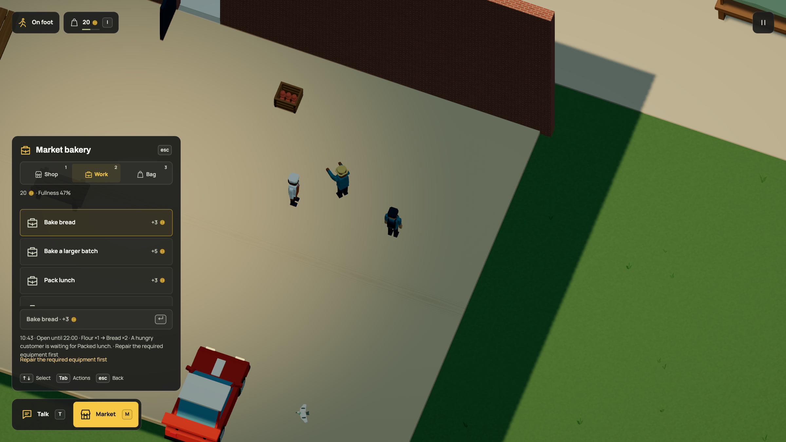

# Production depends on physical equipment

Dream jobs now accept one to four static solid prop placement IDs in `equipment`.
The live bakery's three food jobs name its existing table. A complete
[food/workshop example](../../examples/work-equipment.dream) uses two different
workplaces and the same finite caretaker service. Objects, geometry, body shapes,
populations and rendering budgets remain unchanged.

[Native recording](../../media/equipment.mp4) · [GIF](../../media/equipment.gif) ·
[Observed state](native-after.json) · [Capture manifest](manifest.json)

## Native result

The running world accepted source
`621f0942302af7171ba9f34d0bf8694fc8e9cc4e7bbc049ec24c86643c1f5e5b`
and simulation-33 fingerprint
`a5b345f631855363a24d67e40268357e95970974fefd991788c46bf1c7f086ce`.
The native exporter completed all 480 frames. Its setup starts a car inside
the hall and uses ordinary fixed-step collision, reversing and pedestrian
dispatch. It does not demonstrate driving through the door or an on-foot tool.

The baker started lunch at 0.250 seconds. The table collision cancelled that
batch with reason `equipment` at 0.575. The caretaker claimed repair at 13.325
and completed it at 22.075. The baker resumed at 22.325. The player started a
bake at 22.833 and received one payment at 28.833, ending with 23 coins and one
completed bake. The caretaker earned four coins for one repair. No browser
console errors were recorded in this corrected run; capture saves were disabled.

The first capture attempt found a missing exporter allowlist entry. Runtime
inspection also caught a missing binding on the block-form lunch recipe. Both
were corrected; the final capture and world-binding assertion use all three jobs.

## Checks

Seven equipment tests cover linked placement validation, cardinality/duplicates,
template/NPC/remote reference rejection, canonical formatting and scoped model
context, all-items-required availability, independent food/workshop production,
player/NPC cancellation at sub-quarter-second and completion boundaries, exact
refunds, real caretaker repair/restart, saves and the ordinary collision review.
The compiler accepts the complete runnable example.

The exact registered r82 fingerprint remains
`08c37a536a120c91b5175e8a5771f04c12230bfe179ebe7da6afdc924938cada`.
Its projection removes only equipment bindings and uses simulation 32. A real
old paid batch with newly broken equipment refunds without advancing clocks,
changing damage or awarding output/pay/practice. Current round trips cannot
refund again. Four actual r81 native backups also upgrade and round-trip through
the retained indoor-service layer. Missing registration fails.

The focused neighboring suites passed: 37 commerce/recipe/model/indoor tests,
60 save/fingerprint/character/staff tests and 55 equipment/appearance/repair/park
tests. Historical appearance fixtures now explicitly pin simulation 32 rather
than comparing their saved world to the current simulation-33 hash. The
production build passes; 39 published-doc/highlighting checks and the instructions
size check pass. The docs build produces 44 pages.
The full suite was not rerun for this branch push.

## Limits and remaining work

Equipment is an intact/damaged requirement, not powered machinery, durability,
tool inventory or a crafting station animation. Any broken zone disables its
declared whole placement. References use the counter's horizontal reach; no new
equipment journey is inferred. Trade, delivery and repair stay available, so
the equipment cannot prevent its own repair procurement. No upstream resources
or new actor, navigation, fragment or render budgets are introduced.

The ordinary hall doorway excludes cars and there is still no hand tool. The
next interaction pass must make indoor damage directly accessible on foot. The
expanded activity panel also repeats a blocked reason in its status text; this
pass retains the existing HUD layout. All providers remain mocked. No live FPS,
startup-time or total-browser-memory gain is claimed.
