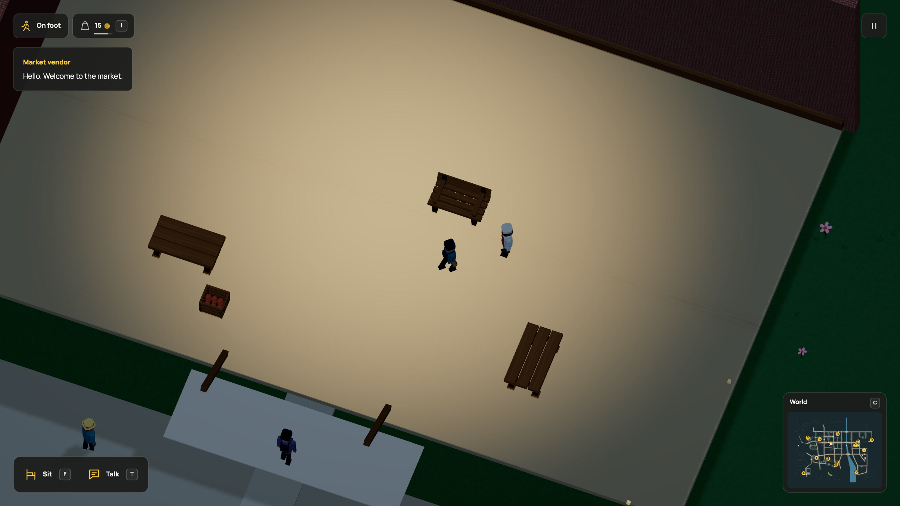

# Worker motion follows the business clock

2026-10-20. Worker movement runs on the bounded commerce clock, usually every
quarter second. A player transaction can advance that clock sooner. The former
renderer replaced its two endpoints on every such update, assuming all samples
were a quarter second apart. That restarted interpolation ahead of the visible
person. Cached limb clocks also froze between updates; a stopped worker could
stop stepping before their visible body reached its destination.

The renderer now retains timestamped samples and reads the pose a quarter second
behind presentation time. It derives walking speed from that visible segment,
keeps the supplied animation clock advancing and preserves distance across a
handoff to an ordinary route. A resumed route releases its buffer at its next
stationary stop. Reset, rewind, teleport and reduced motion release samples.
There are at most 64 samples per cached account within the existing 16-account
cap. No bodies, rigs, draw passes, materials, shaders or world data were added.

## Reproduce the timing regression

```sh
node docs/evidence/worker-continuity/compare.mjs
npm test -- tests/repair-view.test.ts tests/staff-shifts.test.ts --maxWorkers=2 --testTimeout=60000
```

The comparison loads the released renderer from commit `629b11c` and the current
one, using the same irregular commerce timestamps and 14-unit-per-second walk.
At 60 rendered samples per second, maximum frame travel changes from
3.278333 to 0.233333 world units, the expected travel at that speed. The largest
position error against the delayed clock changes from 3.045 units to floating
point noise. At 30 and 144 samples per second, travel also matches the expected
step. This is a deterministic presentation replay, **not a live FPS benchmark**.
[Exact inputs and results](comparison.json).

A separate integration check advances the real staff/commerce simulation at
120 Hz. Five failed player purchases insert real intermediate commerce updates.
The 60 Hz visible worker remains continuous, while the physical state remains
unchanged by presentation. Focused checks also cover route handoff, reactivation,
memory bounds, pause, rewind, teleport, stopped strides and continuous limb clocks.

The accepted-world fingerprint remains
`5bd553a8bc5a9639513a5d19a2bcad969ec74e06b46627ffd6448b60067f16b3`.
No migration, Dream vocabulary or model contract change is needed. The existing
staff-shift example remains runnable and unchanged.

All 64 focused checks across eight test files passed, covering maintenance
presentation, staff shifts, couriers, meals, shared meals, sports presentation,
sun and daylight. The 38 documentation checks, instruction-size guard,
production build/typecheck, 44-page docs build and complete-world check of
`staff-shifts.dream` passed too. The existing production bundle-size advisory
remains.

## Native recording

The in-app browser used the actual `?capture` renderer and existing `shifts`
review setup. It bought bread through the real counter, advanced the complete
simulation to closing and followed the baker with walking controls. At frame
101, G ate that bread. The event is recorded at simulation time 300.383333,
between normal commerce updates, while the baker was travelling to the hall.
The player retained 15 coins and no bread afterward; the baker reached
`[6360,4490]` with zero speed and an empty path. Frame 540 talks to the resting
baker. [Public runtime observations](native-after.json).
Pause held the presentation clock and poses exactly; the native console had
no warnings or errors. [Paused samples](native-pause.json).

The GIF, HD video and frame-570 still are refreshed together from 600 consecutive
native PNG frames at 30 rendered frames per simulation second. There are no
interpolated or missing video frames. The captured path uses the same scene,
physics, source identity, stock and clocks as the game. Review saves are disabled.
[Source, frame and output hashes](manifest.json).



[HD recording](../../media/shifts.mp4) · [GIF](../../media/shifts.gif)

README, rendering, shift authoring, world priorities, media provenance and motion
invariants are updated. Other recordings retain their historical presentation
and unchanged mechanics. Asset/DSL examples and their captures remain accurate
because geometry and authored rules did not change.

This fixes identified worker timing discontinuities. Paths still use the existing
bounded navigation and straight interpolation between sampled positions. It is
not a claim that every animation artifact is gone. No lower-powered laptop
frame-rate or total browser-memory improvement is measured. Review was a
self-review; the full suite was not rerun for this renderer-only change.
