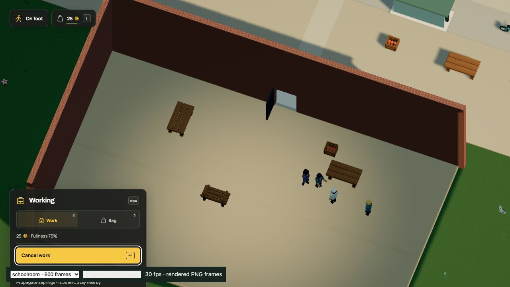

# Worker provisions, r92

The caretaker and school courier can pack one portion from their home counter
using their own earnings and real stock. At the authored fullness threshold,
they eat owned food during a repair or delivery without losing the commitment.
The player can press G during paid work or repairs through the same transaction.
Sealed cargo, held recipe ingredients, repair supplies and wages stay separate.

Dream adds optional `ration(good,market,below)` and `account.ration`. There are
at most eight plans. Acceptance requires food with a priced lot, a stationary
repair/delivery worker and clear counter reach from the authored home. Plans
cannot combine with production, shifts, meal trips or social policies. Packing
reserves capacity for the largest declared task load. Buying retains ordinary
stock, money, hours, staffing, capacity and sight checks. Missing food does not
stop ordinary jobs. Decisions run at most once per simulation second.

No geometry, actors, rigs, routes, starting resources or saved fields are added.
The live world retains 1,778 placements. Format 19 now pins simulation 37. Its
accepted fingerprint is
`685d508191100e9740e378b70f14fbe60ffe02177e70c7d756aa6c626cb5abd0`.
Removing only ration definitions/references at pinned simulation 36 reproduces
the exact r91 fingerprint
`1563d4e8511812ec931cb475b615d75978b72a2efcd8f69e1c4190f24c7bc554`.
Migration retains every saved value and old slot, without buying or consuming
anything during load. All earlier registered projections remain connected.

## Verification

- `npm run build`: typecheck and production build passed. The existing bundle
  size advisory remains. No separate duplicate typecheck was run.
- `npm test -- --maxWorkers=2 --testTimeout=60000 --reporter=default --reporter=json --outputFile=.npm-cache/rations-tests.json`:
  1,738 checks in 162 files, 528.35 seconds. The initial run passed 1,734 checks
  and failed four assertions: the new command's reference-table row, old school
  furniture/fragment counts in two tests, and the caretaker's balance before
  accounting for a purchased two-coin portion. There were no unhandled errors.
- The corrected reference-coverage check passed individually. The 14 checks in
  `repair-world.test.ts` and `interaction-rules.test.ts` passed in 15.21 seconds;
  both `voxel-city.test.ts` checks passed in 6.52 seconds. Those reruns cover all
  four failures. The full suite was not restarted for these table/assertion fixes.
- The initial seven `worker-rations.test.ts` checks passed in a 1.03-second run.
  They cover malformed/unreachable/obstructed policies, finite paid packing,
  task capacity, NPC repair travel, owned food versus sealed cargo, player work
  and repair reservations, closed counters, contention, R and reload.
- Self-review found the old generic shopper could override a ration plan's
  threshold or reserved capacity. The plan now owns automatic food decisions.
  A targeted regression covers both cases. The final eight provision checks,
  nine commerce checks and three live repair checks passed together in 13.49
  seconds. Unchanged neighboring passes were reused; no second full run.
- Both `rations-world.test.ts` checks passed, including exact fingerprints,
  unchanged contacts/navigation/resources and a real in-progress r91 paid batch
  restored field-for-field with its original slot preserved.
- All 42 docs-site checks passed, including ration token boundaries and HTML
  escaping. The runnable `docs/examples/worker-rations.dream` passed complete
  world acceptance. The generated command contract, model guidance and readable
  language reference describe the same policy.

These durations are local command measurements on Apple M3 Ultra, macOS arm64,
Node v26.8.1. They do not measure browser FPS or watch-mode improvement.

## Native browser check

The in-app browser opened `?test-nursery=ready&capture`, with ordinary player
saves disabled. Keyboard controls bought one bread for five coins, selected
Propagate saplings and started its twelve-second paid batch. Pressing G kept
the exact deadline `152.40833333336997` and the Working state, consumed the
one owned bread and raised fullness from about 30% to 75%. The ordinary batch
then completed once, taking the player's balance from 25 to 27 and recording
one completed nursery job. Its ingredients and reserved wage were not cancelled.

[Before/after state](native-work.json), [completed batch](native-paid.json) and
[console errors](native-errors.json) are DOM-backed observations. The final tab
reported no console errors. NPC automatic packing/eating is verified by the
deterministic engine tests; this native check exercises the player's shared
transaction, not an observed NPC food trip.

README, commerce/reference/model guides, persistence, world systems and media
notes are updated. Geometry, animation, camera, HUD layout and key bindings are
unchanged, so existing focused commerce/work/courier/school GIFs, videos and
stills remain accurate for their shown flows. They do not demonstrate automatic
provision use. No motion set was regenerated for this policy-only change.

This remains a mock game need, without nutrition claims, food meshes, extra
shopping routes or general meal planning. The larger living-world goal remains
incomplete.
