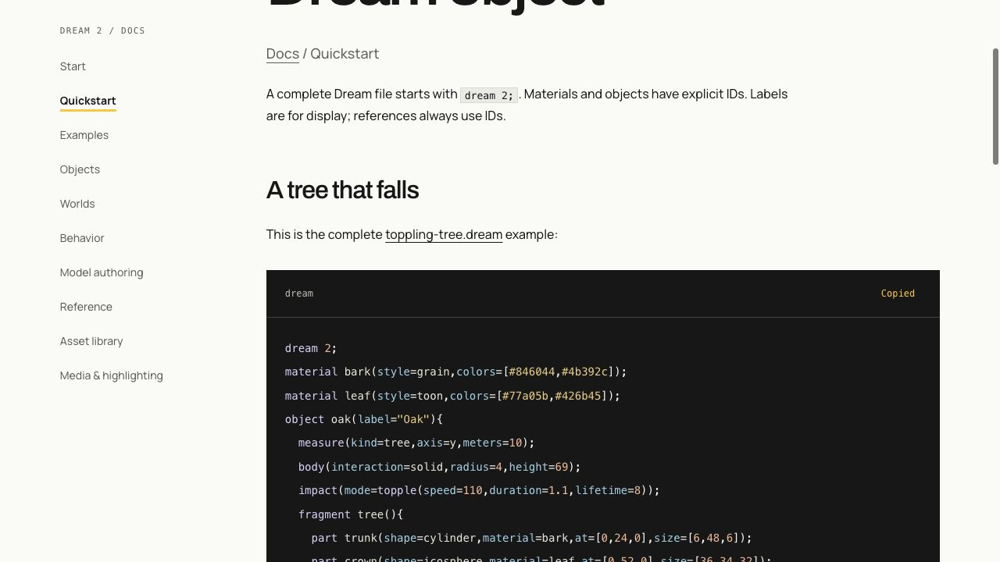

# Media and Dream highlighting

These are captures of the running mock prototype. The game and asset geometry are rendered by Three.js from the checked-in Dream source.

## Motion you can actually follow

Driving, vehicle switching, jumping, swimming and destruction are exported at **30 frames per simulation second**. Every frame is rendered; there is no frame interpolation. GIFs are 960 × 540 with a palette computed across the clip and Gifsicle compression. The matching 1600 × 900 H.264 videos keep more color and detail at a smaller download size.

| Capture | GIF | HD video | Duration |
| --- | --- | --- | --- |
| Driving | [driving.gif](driving.gif) | [driving.mp4](driving.mp4) | 7 seconds |
| Car → walking → bicycle → walking | [switching.gif](switching.gif) | [switching.mp4](switching.mp4) | 8 seconds |
| Voxel wall destruction | [voxels.gif](voxels.gif) | [voxels.mp4](voxels.mp4) | 4 seconds |
| Bench destruction | [destruction.gif](destruction.gif) | [destruction.mp4](destruction.mp4) | 4 seconds |
| Walking, running and jumping | [locomotion.gif](locomotion.gif) | [locomotion.mp4](locomotion.mp4) | 6 seconds |
| Swimming in the city canal | [swimming.gif](swimming.gif) | [swimming.mp4](swimming.mp4) | 6 seconds |
| Aircraft takeoff, climb, bank and descent | [flight.gif](flight.gif) | [flight.mp4](flight.mp4) | 10 seconds |
| Day and night | [daynight.gif](daynight.gif) | [daynight.mp4](daynight.mp4) | 12 seconds |

The main-game captures use the real simulation, follow camera, scenery, particles and post-processing. The destruction review replays fixed simulation phases. These are offline exports, not frame-rate benchmarks. GIF timing is rounded to hundredths of a second by the format; the video preserves the 30 fps clock.

## Refresh the captures

Run `npm run dev`, then open `http://127.0.0.1:5173/?capture`. Choose driving, switching, locomotion, swimming, daynight or flight and press **Capture PNG frames**. Export destruction at `http://127.0.0.1:5173/tests/visual/destruction.html?docs&capture`.

The exporter advances the live renderer by 1/30 second only after the previous PNG has been saved. Frames go to `.npm-cache/media/<clip>/`. Its local Vite endpoint accepts only same-origin PNGs for the allowlisted named clips; it is absent from the production build. The capture layout is 1600 × 900 CSS pixels, with the renderer's existing pixel ratio applied to the source PNGs.

Encode after the selected clips finish, using local FFmpeg and Gifsicle installations:

```sh
node scripts/encode-media.mjs /absolute/path/to/ffmpeg /absolute/path/to/gifsicle
```

Append clip names to refresh only those captures, for example `switching locomotion swimming`. Refresh each selected clip's GIF, HD video and corresponding still together. `jumping.jpg` and `swimming.jpg` use original frames from their named clips.

The encoder checks for consecutive source frames before replacing a GIF and video. Generated `dist-docs/` files are excluded from the development watcher, so rebuilding the documentation does not restart the game or interrupt a capture. Keep source frames local. Commit only the finished media. Still images use the original render or a native browser screenshot at its full resolution, with high-quality JPEG encoding where useful.

`world.jpg`, `on-foot.jpg` and `riding.jpg` come from the main game. `cycle-meadow.jpg` uses the terrain/road review. `assets.jpg` and `assets-all.jpg` use the Dream assembly gallery. `woodland.jpg` uses the gallery with `?all&asset=Standing%20deadwood&asset=Fallen%20log`; repeated `asset` filters focus a review without changing the world. `ecology.jpg`, `fauna.jpg` and `flora.jpg` are focused native gallery captures of the new wildlife and plants. Sets of more than two focused assets use 360-pixel cards; single objects and pairs retain the larger inspection view. `proportions.jpg` uses the shared metre grid. `code-to-tree.jpg` shows the complete checked tree source beside its rendered result. `pipeline.svg` labels the planned sketch/Muse boundary separately from the implemented engine.



`exploration-hud.jpg` is a native main-game screenshot of the current HUD, with lap progress and checkpoint targets removed. The motion exports capture the WebGL canvas without HTML controls.

The birch refinement refreshes `birch.jpg`, the complete `assets-all.jpg` atlas, the shared-scale `proportions.jpg`, the cycle meadow and HUD screenshots, both driving/switching GIF and HD-video pairs, and their `world.jpg`, `on-foot.jpg` and `riding.jpg` stills. The clips include a birch near the castle. The focused birch gallery uses `?all&asset=Birch&asset=Leaning%20birch`; both trees are checked from four sides. See the [media audit](../evidence/birch-assets/verification.md) for captures kept unchanged and why.

## Syntax highlighting

The documentation shares [Minimum Effort's](https://minimumeffort.dev/) visual identity: Manrope body text, Archivo headings and wordmark, warm white `#fafaf7`, charcoal `#171717` and yellow `#f7c843`. Page gutters use `clamp(1.25rem, 6vw, 5.5rem)` with a 1304-pixel maximum, the same spacing scale and a shared alignment for header and content. Code panels use the site's charcoal surface, with Dream tokens kept distinct and readable.

The tokens in `docs/site/style.css` follow Minimum Effort's `src/app/globals.css` and `src/app/site-theme.css`, checked against the live site. The Latin variable fonts are hosted with the docs, so reading needs no Google Fonts request. Font sources and their SIL Open Font Licenses are included in [`docs/site/fonts/README.md`](../site/fonts/README.md). Keep this identity when extending the docs.

The published documentation is built from the repository's Markdown using `npm run docs:build`. The custom [Dream highlighter](../site/dream-highlight.mjs) recognizes commands and nested constructors from the compiler's generated contract, named fields, symbols, numbers, colors, strings and comments. It preserves source text and escapes HTML before adding spans. Copy buttons copy the original code, without markup.

Use a `dream` fence in Markdown. Complete examples are checked by the compiler, and tests compare the guide's snippets with their downloadable source files. JavaScript is only needed for the copy button; highlighting and navigation are already in the generated HTML.

The site is published to [GitHub Pages](https://minimumeffort-dev.github.io/muse.dream/) by `.github/workflows/docs.yml`. Relative links let the same output work under the repository subpath or in a local preview. The workflow runs the complete test suite with two workers and a 60-second test timeout: the full-world mesh checks take longer on GitHub runners. Test assertions and the local default timeout are unchanged.

GitHub's repository viewer has its own syntax system. Adding our grammar to this repository cannot change how github.com renders a `dream` fence or a `.dream` file. Native support there requires an accepted [Linguist language and grammar](https://github.com/github-linguist/linguist/blob/main/CONTRIBUTING.md#adding-a-language). The highlighted site and code-to-object image provide the visual treatment now, while the README keeps selectable source and links to complete files.

## Planned-world captures

`town-center.jpg`, `suburbs.jpg`, `sports-park.jpg`, `basketball.jpg`, `golf-park.jpg` and `south-lake.jpg` come from the live geometry review's native canvas, with untrimmed context captures retained in [the verification record](../evidence/urban-world/verification.md). `urban-assets.jpg` and the updated `assets-all.jpg` come from the same actual Dream gallery. Assets, turf, streets and shorelines are procedural engine output; these are not concept images. The README and [planned-world guide](../urban-world.md) link the corresponding Dream sources and current mock limitations.

## NPC programs

`npc-attention.jpg` is a native screenshot of the actual game at
`/?test-npc=vendor`, with the market vendor watching the nearby walking player.
`npc-people.jpg` retains the standalone assembly gallery for Town pedestrian, Park visitor,
Football player, Basketball player and Park walker. The complete and urban asset atlases, town, sports park,
basketball court, golf and south-lake stills were refreshed after the people gained
faces and +X-facing assemblies. They retain native render resolution and JPEG 95
encoding. The new [NPC guide](../dream/npcs.md) contains the checked complete example.
The existing driving/switching and destruction GIFs, HD videos and stills remain
accurate: their visible geometry and prescribed actions did not change. The baker
and naturalist keep their continuous joint routines, now selected by Dream programs.
See the [verification and media audit](../evidence/npc-programs/verification.md).

## Connected transport world, r24

`city-cycle-lanes.jpg` shows the actual canal bridge, connected tracks and open junctions. `connected-waterway.jpg` shows the larger lake/river/bay/canal layout. Both use the native geometry-review canvas. Town, suburb, sports, basketball, golf and southern-lake stills were replaced for the new lanes and shoreline. `cycle-meadow.jpg` is retained as a historical capture; the live world no longer contains that oval and current product pages use the connected lane image.

Driving and switching were exported again at 30 simulation/rendered frames per second, and the GIF, HD video and world/on-foot/riding stills were refreshed together. The destruction review uses an isolated fixture with unchanged bench geometry, so its source frames remain accurate; the encoder regenerated the matching pair from those frames. Asset atlases, proportions, ecology, code-to-tree and birch/woodland captures stay accurate because this pass changes placement and infrastructure, not their assembly geometry. The HUD and NPC attention screenshot were refreshed for the expanded minimap and streets.

The [transport verification](../evidence/transport-world/verification.md) keeps uncropped context, player-control checks, world counts and the matched local profiler report. These screenshots and offline recordings are evidence of rendered behavior, not a low-powered laptop benchmark.

## River city, r26

The live layout was replaced, so the main-game driving, switching, locomotion and swimming GIFs, HD videos and their corresponding stills are refreshed together. The town, suburb, sports, basketball, golf, lake, cycle-crossing and waterway images come from the updated geometry review. `city-assets.jpg` shows the new civic architecture and transit assemblies from the actual Dream gallery; the live atlas is refreshed too. The map `city-plan.svg` is generated from the accepted Scene with `node scripts/render-city-map.mjs`, so its roads, footprints, entrances, stops and bridges cannot drift into a separate illustration.

The isolated destruction recording, tree/code example, flora/fauna galleries, birch/woodland details and physical-proportion comparison retain their existing valid geometry. Those images demonstrate unchanged asset definitions, not the removed city layout. Earlier media notes above describe historical passes; the [city verification](../evidence/city-research/verification.md) identifies the current captures and checks. No source frames are interpolated. Offline recordings do not measure browser frame rate.

## r27 street populations, 2026-10-16

The [population verification](../evidence/street-life/verification.md) records the source fingerprint, coverage and limitations. Refreshed `driving`, `switching`, `locomotion` and `swimming` GIF/MP4 pairs use 210/240/180/180 actual frames at 30 fps, with matching `world`, `on-foot`, `riding`, `jumping` and `swimming` stills. Added `street-assets.jpg` and `street-life.jpg`; refreshed the 78-assembly atlas, source-derived city map and all district, sports, bridge and waterway scene views affected by the new populations.

Retained closeups show unchanged authored geometry: wood, birch, flora, fauna, proportions, civic buildings, people and isolated destruction. These do not claim to show a new world layout. The earlier evidence sections describe their own revisions.

## r28 day and night, 2026-10-16

`daynight.gif` and `daynight.mp4` use 360 actual rendered frames at 30 fps. The lighting clock advances through the full ten-minute cycle over twelve seconds; ordinary street activity retains normal replay timing. `daynight.jpg` is a matching native replay frame. `city-day.jpg`, `city-dusk.jpg`, `city-night.jpg` and `city-dawn.jpg` come from one fixed city-review camera at 10:00, 17:30, 22:00 and 06:30.

Driving, switching, locomotion and swimming GIF/HD pairs and matching stills were refreshed for the current renderer. Existing static district/asset views retain unchanged geometry and daytime appearance, while the new captures show the lighting states. The isolated destruction fixture is unchanged. The [day/night verification](../evidence/day-night/verification.md) records executed checks, browser evidence and limitations.

## r29 aircraft, 2026-10-16

`aircraft.jpg` and four evidence angles show the rebuilt 31-part Cloudhopper. Refreshed `assets.jpg`, `assets-all.jpg` and `proportions.jpg`; the scale viewer uses the live Commuter after its former character was removed from the city. `flight.gif`, `flight.mp4` and `flight.jpg` come from 300 actual main-game frames at 30 fps, covering takeoff, climb, banking and descent. Existing city and other-vehicle recordings retain unchanged visible geometry. The [aircraft verification](../evidence/aircraft/verification.md) records the surface-overlap regression, runtime checks and limitations.

## r30 ground vehicles, 2026-10-16

`vehicle-kit.jpg` shows the rebuilt rally car, town car, hatchback, delivery van, bicycle and scooter. Four gallery angles are retained with the [construction verification](../evidence/ground-vehicles/verification.md). Refreshed the activity/full/street asset sheets and physical-scale comparison. Complete car and bicycle examples match the live assemblies; the Dream guides explain bounded extruded profiles and rigid distance-driven joints.

Driving, switching, locomotion, swimming and day/night GIF/HD pairs use 210/240/180/180/360 newly rendered frames, with matching world/on-foot/riding/jumping/swimming/daynight stills. Vehicle-visible district, transport and four lighting views, the HUD and NPC context are refreshed. The unchanged aircraft/airfield flight and isolated fixture destruction recordings retain their accurate geometry. Civic buildings, people, trees and wildlife sheets and the source-derived map are unchanged. See the verification record for counts, native-input checks and retained-capture reasons.

## Prompt and task lab, 2026-10-16

`dream-lab.jpg` is a native full-page capture of `/lab/`, paused at step 22 of the default town exercise. Source, declared connections, service capacity, agent state and metrics are actual runtime output. It is a logical network dashboard, not a screenshot of agents controlling the 3D city. The [verification record](../evidence/scenarios/verification.md) includes the exported browser episode and its headless replay. Existing world/asset stills and recordings retain their unchanged geometry and mechanics. The game only gains a Dream Lab link inside its pause menu; its ordinary HUD and recordings remain current.

## Aircraft terrain contact, 2026-10-16

Refreshed the flight GIF, HD video and matching still together after changing aircraft terrain contact. Native hillside taxi/takeoff screenshots use the actual eastern heath and player controls; see the [verification record](../evidence/aircraft-terrain/verification.md). Aircraft geometry, the city layout, lighting and render settings are unchanged, so the asset gallery, scale lineup, city stills and other movement/destruction recordings remain accurate. The survey uses a cached underside profile; it does not add mesh collision for buildings or aerodynamic simulation.

## r31 city services and regional airport, 2026-10-16

`airport.jpg` and `east-medical-center.jpg` are native geometry-review canvas exports, with complete viewport context retained in the [verification record](../evidence/city-services/verification.md). `city-service-assets.jpg` and the four evidence angles show the new Dream assemblies. The complete 82-assembly atlas and HUD screenshot are refreshed; the latter includes the semantic destination markers.

The flight GIF, HD video and still are refreshed together using 300 newly rendered frames at 30 fps. This recording includes the rebuilt airport surroundings. The wide waterway overview is refreshed too. Existing car, bicycle, swimming, day/night and destruction recordings retain their accurate local geometry and behavior. The new roads and buildings sit outside those camera views; those clips export the WebGL canvas without the HTML minimap. Existing car/plane models, school and hospital models, wildlife, tree and scale galleries are unchanged. The source-generated city map includes the airport link, separate service access, new medical entrance and bus services. All captures show actual procedural geometry; no image generation or frame interpolation was used.

## Voxel city, r32

`voxel-assets.jpg` and `assets-all.jpg` are native screenshots of the actual Dream
asset gallery. The atlas now contains 83 assemblies. `voxel-park.jpg` is the
untrimmed geometry-review canvas showing the two wall sections beside the existing
bench and connected park paths. Four-angle context images are retained in
`docs/evidence/voxels/`. The new voxel wall and updated bench recordings each use
120 actual rendered frames at 30 fps, with GIF, HD video and still refreshed
together. They are offline fixed-step exports, not live browser benchmarks.

Reviewed README, object/impact guides, language reference, model instructions,
examples and generated highlighting contract. Existing airport/medical, vehicle,
woodland, flora/fauna and movement captures remain accurate: their visible models,
placements and mechanics did not change. City overview/day-night captures still
illustrate the same layout, lighting and proportions; the new captures above show
the changed shell/board construction. Historical evidence retains its original
revision and counts. No prompting UI was added or removed.

## Constructed buildings and transport, r33

`constructed-assets.jpg` shows the actual rebuilt terraced house, garden house, bus, tram, regional railcar and launch. Housing, civic/transit, voxel detail and complete asset sheets are refreshed. All images retain native browser/canvas resolution; geometry-review PNG exports are encoded as JPEG at quality 95.

Driving, switching, locomotion, swimming, day/night and flight use 210/240/180/180/360/300 freshly rendered frames, with each GIF, HD video and corresponding still refreshed together. Town/suburb, sports, water/bridge, street and four lighting views show the current models. The [construction verification](../evidence/asset-construction/verification.md) records retained captures and limits. Isolated destruction, existing ground vehicle/aircraft detail, flora/fauna and character assets retain unchanged geometry. These are procedural runtime captures, not concept images or frame-rate measurements.

## Whole-world voxel construction, r34

The live city now converts every shaped asset and landscape surface through the
world voxel policy. `voxel-world.jpg`, `voxel-hills.jpg`, `voxel-water.jpg` and
`voxel-vehicles.jpg` show the current renderer. The full 83-asset atlas, focused
vehicle/building/transport/plant/wildlife sheets, connected city/bridge/waterway,
sports, airport/medical and four lighting views are refreshed from native browser
or canvas exports. The full atlas uses `?all&sheet`, a 1600-pixel native export
layout that fits all rows inside the WebGL renderbuffer limit.

Driving, switching, locomotion, swimming, day/night and flight GIF/HD pairs and
matching stills use fresh, consecutive source frames at 30 rendered frames per
simulation second. These offline exports are not browser FPS measurements.
Explicit-volume wall/bench destruction remains an unchanged standalone fixture
without a world policy. The code-to-tree example, physical-scale comparison,
source-derived map and logical Lab dashboard remain accurate standalone views.
Earlier evidence sections describe their original revisions. See the
[whole-world verification](../evidence/whole-world-voxels/verification.md).

The r34 timber curb follow-up preserves the small example's existing deck transition. Its native review is `tests/visual/roads.html?voxel`. The live city uses three stone bridges, so its current screenshots and recordings remain accurate; their construction is unchanged by the taper fix.

## Trackpad framing

`zoom-overview.jpg` and `zoom-close.jpg` are native browser captures at the same player position and view angle, using the minimum and maximum manual car zoom. The pause-help capture in the [verification record](../evidence/trackpad-zoom/verification.md) shows the new instruction. Default framing, world geometry, vehicle animation and lighting remain unchanged, so the existing 30 fps GIF/video pairs and their stills remain accurate. These screenshots demonstrate framing, not measured performance or a physical trackpad test.

## Material finishes, r35

`material-finishes.jpg` shows the complete brick/oak/limestone example. The current 83-asset atlas, curated object sheet, constructed asset sheet, town/suburb, city cycle tracks, airport, medical center, sports, lake/waterway and four lighting views are refreshed from native browser screenshots or the review's Save PNG action. Evidence includes the terrace from four sides and a bakehouse section breaking into eight pieces.

All eight motion sets use new consecutive 30 fps frames: driving 210, switching 240, destruction 120, voxel wall 120, locomotion 180, swimming 180, day/night 360 and flight 300. GIFs, HD videos and their stills were refreshed together. The source frames are actual renderer output, not frame interpolation or a live performance benchmark.

The map, scale lineup, code-to-tree, logical Lab, focused wildlife/plants and dedicated car/bicycle/aircraft views retain their unchanged geometry and materials. Older focused city sheets remain construction references; the refreshed atlas and material example show the current finishes. The zoom/controls captures retain the same framing and mechanics; their earlier background paint is superseded by this pass. [Material verification](../evidence/materials/verification.md).

## Manual car boost

`boost.gif` and `boost.mp4` use 210 actual frames at 30 fps. The car accelerates,
then Shift triggers a single burst. Native screenshots `car-boost.jpg` and the
refreshed `exploration-hud.jpg` show the new control; the verification record
also keeps active, recharging and small-screen states. Existing canvas-only
recordings remain accurate because they don't boost a car or include the changed
HTML HUD. World geometry, assets and their stills are unchanged. The
[boost verification](../evidence/car-boost/verification.md) records checks,
encoding and limits.

## Walk-up sports, r36

`football.gif` / `football.mp4` and `basketball.gif` / `basketball.mp4` use 240
and 210 consecutive frames at 30 fps, with matched practice stills. Native
source frames are 2400 × 1350; videos are 1600 × 900 and GIFs 960 × 540, without
interpolation. Separate native HUD screenshots show the shot control, gold
power band and scores. The football park, both basketball image paths and full
85-assembly atlas are refreshed. `sports-assets.jpg` and four retained gallery
angles show the new balls and connected horizontal hoop.

Existing movement, boost, day/night and destruction recordings retain their
unchanged local geometry and actions. Canvas exports exclude the updated HTML
map legend and pause help. Other district, vehicle, material and flora/fauna
captures do not show the modified grounds. Historical evidence retains its
original revision. The [sports verification](../evidence/sports/verification.md)
records native controls, retained-capture reasons and the solo-practice limits.

## Aircraft world-edge recovery

The [boundary verification](../evidence/aircraft-boundary/verification.md) keeps
native before/edge/returned screenshots with the actual controller readings.
README and movement docs now explain steering back from edges and corners.
The existing flight GIF, HD video and matching still remain accurate: that
runway departure and bank stay inside the world, so their movement is unchanged.
All other world, asset and action media retain their existing geometry and
behavior. No new offline recording or performance claim was needed for this fix.

## Shared interaction rules, r37

The [rule verification](../evidence/interaction-rules/verification.md) keeps
native square/round table impacts under one shared policy, a gentle touch and
the older bench before/after its boards detach. Four bench angles retain the
construction review. These captures opt into the measured town car in the
isolated impact viewer. Existing action GIF/HD/still sets, city imagery and
asset sheets remain accurate: live furniture parameters and placements are
unchanged, and the older bench's intact geometry/materials keep their shape.
Its new destruction ownership is shown in the new guide and evidence.
`rule-square-table.jpg`, `rule-round-table.jpg` and `rule-supported-bench.jpg`
are unchanged copies of those native captures for the published guide.

## Articulated characters · 2026-10-17

`character.gif`, its HD video and `character-motion.jpg` show the actual Explorer rig walking, running and crawling side by side. The close-up uses 180 newly rendered frames at 30 fps. The nine main-game GIF/HD pairs are refreshed too: driving/boost 210 frames each, football 240, basketball 210, switching 240, locomotion/swimming 180 each, day/night 360 and flight 300. Matching stills are refreshed with their recordings. No interpolated frames or image generation.

The full asset atlas, `city-people.jpg`, shared-scale lineup and NPC context now show the bound civic characters. Other model detail sheets, the city-layout map and isolated destruction/voxel wall clips retain unchanged content. The [animation verification](../evidence/character-animation/verification.md) separates tests, native controls, capture counts and limitations. Offline frame exports are not performance benchmarks.

`hill-taxi.png` preserves the existing native aircraft-terrain screenshot in the published media directory, fixing its former evidence-folder image embed. Its geometry is unchanged.

## World audit, r40

Street bends, crossing paint, boost placement and access to sports grounds and school yards were audited in the real world. The [verification record](../evidence/world-audit/verification.md) retains matching before/after views and four public-space asset angles. `public-space-assets.jpg` shows the supported shelter seat, mounted hoop, table crossrails and market stall. The complete atlas and sports asset sheet reflect the same source. The source-derived map, affected district and four lighting stills are refreshed.

Driving, car boost, football, basketball, switching, locomotion, swimming, day/night and flight GIF/HD pairs and their matching stills use newly rendered 30 fps source frames. Existing isolated bench and voxel-wall destruction recordings remain accurate, as do focused galleries of unchanged vehicles, architecture, character motion, materials, plants and wildlife. These captures are rendered evidence, not a laptop benchmark.

## Road overlaps, r41

The [road verification](../evidence/road-overlaps/verification.md) keeps matched
native views of the circuit joins and whole bicycle symbols. Refreshed the
source-derived map, city/recreation/bridge/airport/medical views, voxel city/park/
water views and four fixed lighting states. The HUD uses the revised map polygons.

Driving, car boost, switching, walking/jumping, football and day/night recordings
use 210/210/240/180/240/360 fresh source frames respectively, at 30 rendered frames
per simulation second. Their GIFs, HD videos and matching stills are replaced
together. Basketball practice, swimming and aircraft clips retain unchanged local
geometry: their cameras stay around the court, canal and airport/flight corridor,
away from the repaired circuit joins and crowded glyphs. These canvas exports do
not include the HTML minimap. Focused asset, character, material and destruction
galleries are unchanged. No performance benchmark or interpolated frames.

## Fuller city and habitats, r42

The [population verification](../evidence/population-expansion/verification.md)
records 1,695 accepted placements, unchanged engine limits and matched local
rendering observations. `city-residents.jpg` shows four new resident variants;
`population-assets.jpg` shows the dog, cat, sparrow, meadow grass and hydrangea.
Both sets were reviewed from four angles. `assets-all.jpg` now shows 103
reusable assemblies. City/recreation/transport and four lighting stills, the
source-derived map, voxel terrain/park/water views and clean HUD are refreshed.
Additional `population-*.jpg` views show native habitat and hospital context.
Focused galleries of unchanged vehicles, original wildlife/flora, architecture,
materials, shared proportions and character mechanics remain accurate.

All nine main-game GIF/HD pairs use newly rendered source frames at 30 fps:
driving/boost 210 each, football 240, basketball 210, switching 240,
locomotion/swimming 180 each, day/night 360 and flight 300. Matching stills are
replaced with them. Isolated bench and voxel-wall destruction clips are unchanged.
No interpolation, image generation, per-instance geometry simplification or
camera-based world unloading. The offline exports are separate from the local
300-sample rendering comparison and are not performance measurements.

## Moving ground populations

The added 111 sidewalk residents now walk, and 60 ground animals and birds roam and
react to nearby players. `pedestrians.gif` / `.mp4` use 360 newly rendered frames,
as do `wildlife.gif` / `.mp4`. Their matching JPEG stills come from frames 180 and
30. The deer clip shows initial flight and later recovery; the pedestrian clip
shows movement along the actual paving. Source PNGs remain local, without frame
interpolation. These offline recordings do not measure live performance.

The nine main-game motion sets are refreshed at 30 rendered frames per second:
driving/boost 210 each, football 240, basketball 210, switching 240,
locomotion/swimming 180 each, day/night 360 and flight 300. Each GIF, HD video and
matching still is updated together. The dog and cat now have four walking hip
joints; `population-assets.jpg` and `assets-all.jpg` show their current geometry.
Four native asset angles and the two motion sequences are in the
[movement verification](../evidence/moving-populations/verification.md).

The source-derived city map, architecture, roads, plants, physical proportions,
character-only motion and isolated destruction examples retain their accepted
geometry. Their existing captures remain accurate. Existing district stills show
the same layout at a particular moment; the new clips demonstrate moving
populations. A separate native browser profile compares full-quality driving,
with all members resident and the same pixel ratio, viewport and inputs.

## Startup screen

The [loading screenshot](loading.png) is a native browser screenshot taken while the live world was actually being constructed. Startup now uses the same bundled Manrope and Archivo files and warm-white, charcoal and yellow identity documented above. Column faces gained indices; the represented surfaces, asset shapes, clocks and animation controls remain unchanged. Existing gameplay recordings and their paired stills remain accurate, so this pass does not replace them.

## Streaming and continuous contours

The streaming pass refreshes driving, boost, switching, locomotion, swimming,
football, basketball, flight, daynight, pedestrians and wildlife as paired GIF/HD
video exports, with their corresponding stills. All source frames were rendered
at 30 per simulation second. This run produced native 1600 × 900 PNG frames;
[the media audit](../evidence/world-streaming/media-audit.json) records frame counts,
pixel dimensions and write times. No frames were interpolated. Exports hold while
required chunks are missing and do not establish live frame rate.

`world.jpg` and `voxel-world.jpg` share the new driving still. `voxel-vehicles.jpg`
and `voxel-contours.jpg` use the native four-angle car, bicycle, plane and house
review. Untrimmed captures remain in the [evidence](../evidence/world-streaming/verification.md).
`loading.png` shows the real first-neighbourhood loading phase. The follow-up
water/bridge review replaces swimming GIF/video/still and `voxel-water.jpg` after
fixing persistent water paint, continuous bridge tops and water seams.

The explicit fill/cut destruction clips, architectural construction examples,
material examples, proportion references, maps and original terrain closeups were
reviewed. They retain useful coverage of unchanged authored dimensions, exact
carved cuts, finishes, layout and stepped ground. Their dated verification records
remain historical evidence; use the refreshed world/vehicle captures above for the
current contoured appearance. Dream vocabulary and its checked examples are
unchanged by streaming.
