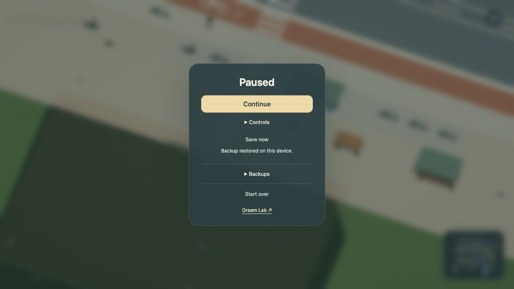
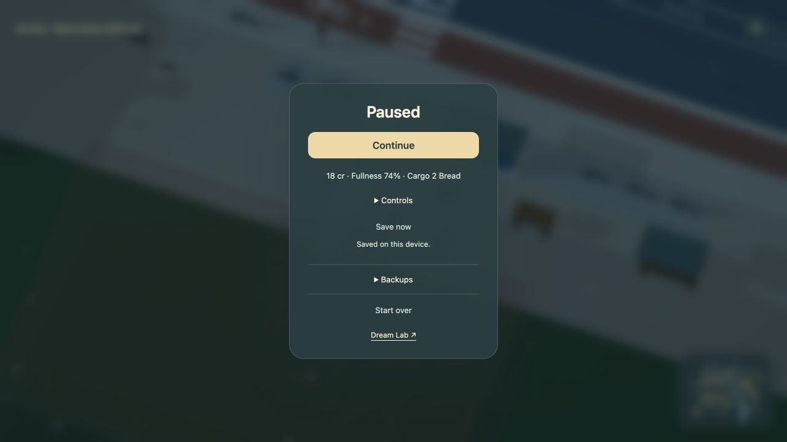
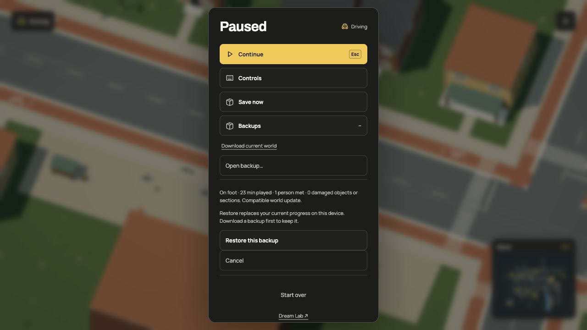

# Leave and come back

The world now saves on this device. Meet someone, park a bicycle, move a ball or break a table, then reload the same world. Those changes return with you. A person you have met can recognize you through their Dream program.

Autosave runs every ten simulation seconds, after a conversation press or committed economic event, when pausing and when leaving the page. **Save now** in the pause menu writes immediately. Reopening the page restores the saved state before the first neighbourhood is loaded.

| Saved state | What returns |
| --- | --- |
| Player and vehicles | Position, active control, motion, signed wheel travel and parked poses |
| People | Program state, routine clocks, facing and whether you have met |
| Physical changes | Moved props, damaged objects/building zones and remaining debris |
| Sports | Scores, balls and practice state |
| Market life | Credits, inventory, fullness, shelf stock, consumed food, completed batches, reserved work, sealed cargo, completed deliveries, repair claims/journeys, consumed supplies and planted-tree progress |
| World clocks | Simulation time, ambient population state and day/night phase |

Held controls, buffered jumps and shot charges are cancelled on restore. Transient impact flashes are not replayed. The engine checks the active body's clearance; an unsafe pose recovers the player while retaining valid world changes. Public transport restores passenger ownership beside its saved route clocks.

**R** still recovers your vehicle and keeps the world's changes. **Start over** resets the world and replaces its current saved slot, including NPC familiarity. The pause menu shows whether saving worked. If storage is unavailable or full, the game remains playable and reports that saving failed. A malformed or externally changed saved slot is preserved. **Save current session** explicitly replaces it with your current session; Start over replaces it with a fresh world. Automatic writes stop if another tab has changed the slot. Keep one active world tab; this is not multiplayer synchronization. **Controls** opens the keyboard guide without crowding out save actions.

Active deliveries return too. The pause menu shows the sealed cargo beside your
balance; reloading keeps its destination and reserved pay.

## Take a backup with you

Pause, open **Backups**, then choose **Download current world**. The JSON file contains the current simulation state, its source identity and a compatibility fingerprint. It contains no meshes or executable code. Keep it somewhere you can find again, or move it to another browser or device yourself.

Choose **Open backup…** to inspect a file. The preview shows your control mode, play time, people met and damaged objects or sections. Nothing changes until you choose **Restore this backup**. Cancel leaves the current session intact. Restore writes the validated state to local storage before applying it to the running world. If validation or storage fails, the current session continues unchanged. Download a backup first if you want to keep the session you are replacing.

Files are checked locally. Opening one does not upload it. A backup from incompatible rules or geometry is rejected, even if its member IDs look familiar. Oversized, malformed or unsupported files are rejected too. Backups are editable single-player data, not signed records or cheat-proof evidence.

## Source and compatibility

The host hashes the complete supplied Dream source and module map with SHA-256 before acceptance. A second SHA-256 fingerprint covers the accepted world and a pinned simulation version. Only host revision/source/provenance fields and behavior-state `say` text are excluded from this second fingerprint. Object-key order is normalized; array order remains significant. Derived numeric values are rounded to 0.00000001 for the fingerprint to remove browser math noise; simulation geometry is unchanged by that normalization. Comments and formatting disappear during compilation. This allows wording changes without treating different movement rules as the same world.

| Authored change | Progress |
| --- | --- |
| Comments, formatting, host provenance or dialogue wording | Continues automatically when the compiled contract matches |
| Placement, geometry, terrain, routes, NPC transitions, materials or other accepted world data | Separate slot; automatic migration is not supported |
| Shader or UI code only | Source identity is unchanged; simulation-version changes still require an explicit upgrade |

Format 8 retains the exact source hash and the compatibility fingerprint, with simulation version 10. Its economy records include reserved ingredients/wages, work deadlines, fullness, consumed items and completed batches, sealed cargo and completed delivery counts. Restore checks total credits and material conservation, including reservations, before applying anything. Work does not finish while the page is closed or compiling.

The first market has an explicit registered upgrade from the earlier world. It verifies that every pre-market rule still matches, then initializes only the new accounts/stock/needs at the saved simulation time. Player position, vehicles, damage, sports, NPC memory, population and day/night remain saved. The known r44 format 1 source and format 2 browser fingerprints are supported; original slots are kept. A malformed newer slot blocks writes rather than silently loading an older copy. The registered upgrade chain includes the first-market, first-delivery, usable-parking, local-repair, replacement-supply and connected-repair releases. Later incompatible economy edits cannot silently replay older progress.

Format 1 cannot establish arbitrary cross-source compatibility. Format 2 worlds outside the registered release require their exact earlier fingerprint. Unsupported format 3 economies are rejected. The first-delivery release also upgrades the known format 3 market: it checks the earlier world and economy, preserves existing balances, stock, fullness and reserved work deadlines, and initializes only the depot, canteen, staff account and empty delivery ledger. Sealed cargo and reserved delivery wages round-trip in format 8. Cancelling, recovery and reloading cannot pay a delivery twice. Future engine or economy changes need their own tested migration; no general layout or rule migration exists. A compatibility fingerprint is a safety check, not a signature proving a file's origin.

The parking release upgrades the known r46 format 4 backup only after the host confirms an exact projection of the previous world. It preserves all economic/physical state and validates vehicle ownership against the old prop roles before accepting it. Old slots remain intact. Formats 5 and 6 permit up to 281 saved unoccupied poses (256 dormant parking records, the resident fleet and the original car); old formats keep their 24-record bound. This changes saved metadata capacity, not live animation limits.

Restoration checks the format, world identity, source/compatibility, finite fields, exact members, NPC states/clocks, damage, fragments and vehicle ownership. Population clocks must be current enough to avoid replaying an unbounded backlog. One atomic browser storage write preserves the previous slot if writing fails. Files are bounded to one million characters; file reads are also bounded before allocation.

Incompatible worlds keep separate local slots. An update that adds buildings or changes rules can still start a fresh world; old saves remain stored but cannot be played by incompatible source. The registered first-market, first-delivery, usable-parking, local-repair, replacement-supply and connected-repair additions are migrated; later layout, economy or schema changes remain separate slots. No save is uploaded or synchronized across browsers. Clearing site data removes local saves, so download a backup before clearing them. There is no offline catch-up or cloud service.

Render chunks remain replaceable. Simulation and damage state live outside them, so unloading scenery cannot reset a person, repair a building or move a parked car. Wave texture disturbances and temporary particles are visual effects and are rebuilt after reload; water settings and clocks remain authored/saved.

Development capture, profiling and review starts are isolated from normal saves. A dev-only `test-save` review uses a separate local namespace for reload verification. These helpers are absent from the production build.

[Talk to people](dream/npcs.md#talk-to-a-person) · [World systems and next capabilities](world-systems.md)

The repair release verifies an exact projection of r47 before accepting its
format 5 saves. It preserves all existing accounts, inventories, market stock,
NPC memory, damage, population and vehicle ownership, then initializes only the
repair kits, caretaker account and repair ledger. Original slots remain stored.
Earlier registered upgrades continue through this projection. Format 6 records
repair notices, claimed target/zone, worker position, bounded path, progress,
reserved kit/pay and return home. Restore checks membership, path area, clocks,
claims, material consumption and money conservation before applying the state.
A currently blocked path remains valid saved intent; movement checks obstacles
again every step. Closed pages perform no work. Arbitrary geometry or economy
changes still need a separate migration.

The replacement-supply release keeps format 6 and advances simulation rules to
version 6. Its registered r48 projection removes only the new depot-kit lot and
delivery, and restores the former table-only service declaration. A matching
backup keeps every old account, stock unit, completion counter, in-progress
repair, return path, parked pose and memory. Only 32 new depot kits and a zero
`kits_run` completion counter are initialized. Completed repairs are never reset.
Older registered releases continue through the same chain; arbitrary edits cannot
opt into it. Both r48 and current local slots are retained, and a corrupt newer
slot prevents fallback. Delivery invoices are derived from the pinned contract;
save validation includes their escrow and incoming treasury reservations.

The connected-repair release keeps format 6 and advances simulation rules to 7.
The registered r49 projection removes the two new seating surfaces and restores
the former market-only policy; every existing object, contact and public-pavement
field is preserved. Matching r49 saves keep their complete simulation state,
including paid supplier deliveries, completed repairs, supplies, in-progress
work, needs, memories, damage and vehicle ownership. Older registered upgrades
continue through this projection. Original local slots remain stored.

Repair paths may now span accepted pedestrian infrastructure between declared
grounds, with the same 128-point bound. The large derived graph stays out of saves;
it is prepared by the world worker. Current obstacles can block saved intent
without invalidating it. Presentation interpolation is transient and resets on
recovery; it does not change saved contacts or clocks.

## Pooled streetlight destruction

Format 7 supports independent damage records for up to 4,096 world objects,
while active debris remains capped at 24 object assemblies and 128 pieces.
Unknown IDs, duplicates, incompatible impacts and over-budget active debris are
rejected. Legacy formats retain their 24-whole-object damage bound. Mesh caches
and light-pool visibility are derived after restore and are never saved.

The registered r50 projection removes the pool policy and lamp rule, restores
the earlier lamp categories/ungrouped metadata and keeps exact geometry,
contacts, placements and economy state. Its fingerprint must match r50 before
old progress is accepted. Actual r50 backups retain their complete saved state,
including existing repairs, journeys, kits, credits, needs and parked vehicles.
Older registered upgrades remain chained. Original slots stay stored.

A lamp stays dark after its falling piece fades, after streaming eviction and
after reload. A completed repair restores its full collision and light pool;
R preserves damage and Start over restores the authored world. Capacity pressure
can retire older cosmetic pieces, never the saved damage record. There is still
no offline repair or general migration for arbitrary world/rule edits.

## Street-service navigation upgrade

The registered r51 upgrade keeps format 7 and advances simulation rules to 9.
It removes only the new service-street fields and High Street/South Avenue
crossing to verify the earlier fingerprint. Every object, work surface, contact,
balance, kit, job, damage record and clock remains saved. Earlier registered
upgrades continue through the same chain; old slots stay intact.

The crossing adds pedestrian navigation nodes. The engine validates saved node
references against the earlier graph, then maps them to the same coordinates
and compatible neighbor connections in the new graph. People retain their
positions, travel history, random state and clocks. Worker paths are already
coordinate-based and remain unchanged. Both graphs are prepared in the world
worker. This is a tested migration for this release, not a general map-edit
migration. Unknown old indices or missing coordinates are rejected.

## Orchard recovery upgrade

Format 8 / simulation 10 adds at most 32 growing-tree records: object, planting
service, planted-at clock and elapsed unblocked growth. A damaged young tree's
debris retains its captured size. Restore checks membership, uniqueness,
authorized service, valid clocks/progress, planted-input consumption and reserved
planting capacity. Paused or closed pages accumulate no growth.

The registered r52 format 7 projection removes only the orchard grounds, sapling
stock/delivery/service and extra worker policy. Existing objects, crossings,
public-pavement graph and old market rules must still match. A matching save keeps
all balances, stock, damage, jobs, paths, clocks, memories and vehicle ownership;
only the new inventory keys, six market saplings, eighteen depot saplings and zero
new completion counters are initialized. The earlier upgrade chain remains
supported. r52 node indices already belong to the current pedestrian graph and
are retained; older releases still use their registered graph conversion. No
other layout or economy change can silently opt into this upgrade.

## Natural-ground appearance upgrade

The r53-to-r54 upgrade keeps format 8 / simulation 10. It changes only the
orchard work area's finish, retaining the same geometry, navigation and physical
rules. The host verifies the complete r53 projection before exposing its old
slot. Existing growth progress, worker paths, supplies, money, damage, memories,
vehicles and clocks remain exact; no new stock or counters are initialized.
Derived public node indices already match and are retained. Original slots
remain stored, and a malformed newer slot still blocks fallback. Other layout
or rule edits require their own migration.
