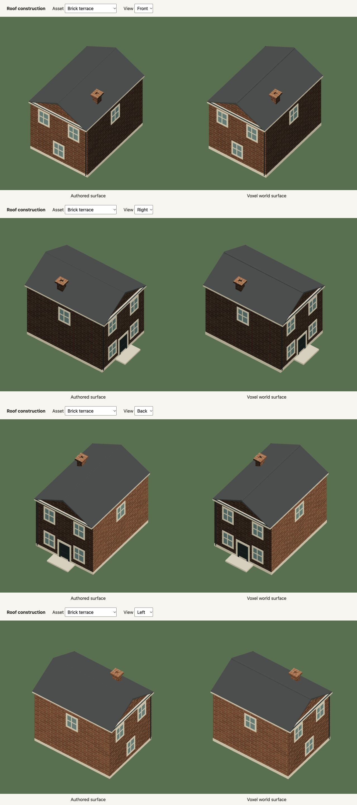

# Rendering

The final image now has a spatial antialiasing pass after output conversion.
Canvas antialiasing did not cover the offscreen post-processing targets, leaving
stair-stepped cycle stencils and other fine diagonals. SMAA finds edges and blends
their coverage at the existing drawing-buffer size. It changes no world geometry,
textures, camera resolution, simulation or HUD text. The two normalized targets
use six bytes per drawing-buffer pixel in total, excluding driver overhead and
the existing composer buffers. Their embedded lookup images and shader programs
are ready before the first-frame handoff; failure follows the ordinary loader.
The pass releases its targets, textures and materials on final page exit.
A matched 1080p town drive on the local M3 Ultra added .180 ms mean GPU time
and three full-screen draws, with the same world geometry. Frame intervals stayed
near 16.67 ms. This does not establish performance on weaker laptops.
[Raw timings and verification](evidence/symbols/verification.md).

# Rendering the whole world

The mock world has 1,773 placed objects across a 14000 × 11000 landscape. Static render geometry now loads around the player and leaves memory behind them. The accepted Dream world and its simulation stay complete.

## Usable parked vehicles

The 91 parked bicycles, scooters, cars, pickups and parcel trucks retain their full construction. Untouched models stay in streamed instance batches. Boarding hides the original instance in both color and shadow passes and creates one full CPU rig. Leaving it disposes that rig and adds its saved pose to local instance batches by model and rigid part. Wheel phase is baked only when ownership, parking or residency changes. Local prototypes and instance buffers are released when their destination chunks leave memory. Collision queries keep immutable seeds plus a spatial index of moved poses; they never scan the entire fleet each fixed tick.

The 256-record dormant fleet cap leaves the limits at 24 resident route actors or controllable vehicles, 32 NPCs and 24 live joint assemblies. One active fleet rig is reserved. The matched original drive retained 253 mean draws, 647,115 triangles and 255,358,898 counted buffer bytes, with a 16.667 ms mean frame interval on the local M3 Ultra / 96 GiB. This is one local retention check, not a speed or low-powered-device claim. [Checks and browser evidence](evidence/parked-fleet/verification.md).

The ambient movement pass caches immutable rest radii and accepts a pavement step early only when its complete swept footprint fits strictly inside one convex piece. Boundary joins, concave pieces, thin gaps, water and physical contacts keep their existing checks. Candidate steps stop accumulating nonnegative spacing costs once they cannot beat the current choice. The [complete repair replay](evidence/pedestrian-cost/verification.md) compares exact saved results and local CPU time; it is not a browser FPS claim.

Segment samples now share their enclosing contact query, and distant vehicle forecasts yield before the exact two-second closest-approach calculation. Numeric cell rows avoid repeated string keys while keeping query order and moving-record buckets unchanged. The [matched replay](evidence/movement-queries/verification.md) records the exact state trace and local CPU timings; population and visual quality are unchanged.

Walking feet retain world position, height and facing during stance, then return at bounded rates. CPU rigs and sidewalk shaders share this policy and the longer strides. Two support probes fit shoes to the visible terrain, pavement, decks and reachable object caps; the pelvis adjusts before the rigid leg solver runs. Crowd probes run at most 20 Hz per returning foot, including offscreen members. Four existing attributes now pack fourteen contact floats plus phase and amount. This adds 2,420 instance-buffer bytes across the live city’s material batches, with the same eleven ambient draws and unchanged geometry. The host worker reuses the cached street render plan, sends bounded support polygons, and the client indexes them once. Fine bicycle stencils stay cosmetic. There are no additional meshes, navigation decisions, physics bodies or saved fields. Sports squads retain their existing match cadence and action poses. [Numerical contacts, cache sizes and local CPU measurements](evidence/terrain-footing/verification.md).

## Loading and memory

The development `?profile` panel also has **Measure journey**: use the normal
controls through 60 warm-up and 3,600 measured rendered frames. Keep the tab
visible. Unlike the short fixed-input drive, this uses ordinary elapsed simulation
time and does not steer for you. `presentationMs` includes gaps between completed
frames; `wait` reports complete-run streaming/shader hold episodes and duration.
`cpuMs` excludes those hold intervals and is active-frame work, not total browser
CPU time. `wallMs` includes warm-up. Hidden tabs interrupt instead of publishing
a partial result. [Checks and a native sample](evidence/travel-profiling/verification.md).

Cycle surfaces are resolved once per accepted Scene before chunk clipping.
Declared junctions connect existing cycle facilities within the shared riding
footprints and crossing-arm bounds. Their convex pieces are unioned once, so
matching orange ribbons do not stack. Separators, centerlines and stop bars yield
to this surface, while glyph placement still checks the dedicated lanes. Maps
reuse the same helper. Collision masks and pedestrian envelopes are unchanged.
[Geometry and native checks](evidence/cycle-crossings/verification.md).

The loading screen arrives in the first HTML response. One worker compiles and validates Dream, then builds terrain, streets, water and static object chunks on demand. Finished mesh buffers are transferred to the renderer, along with engine-owned material recipes and per-instance occlusion data. Object stamping and batching stay off the main thread. The first complete view starts the game; the rest of the map is built as it becomes relevant.

The worker also supplies the pedestrian portal graph, surveyed static collision
cylinders and whole-world culling bounds. The game restores their local
query helpers instead of repeating graph construction and terrain-support surveys.
Graph node order stays exact so saved pedestrians retain their destinations. These
are host-owned caches, outside Dream source and saved state. Source identity,
bounds, links, starting nodes and cylinder structure are checked before use.
Route surfaces/paint/rails and live interactive assemblies use cooperative build
steps: the loader can update between pieces without changing their geometry or
creating a lower-detail version. Individual mesh builds and the first GPU upload
can still block; this does not make startup instantaneous. Once the first required
chunks arrive, Three.js prepares shader programs asynchronously before the first
draw. Browsers with parallel shader compilation can complete that work while the
loading screen remains active; other drivers may still block. Simulation waits
for both the required chunks and shader readiness. A failure exposes Reload,
stops rendering and releases the streaming worker.

Work-ground entrances now reuse the same exact nearest-node index as live path
queries. Candidate selection still keeps the nearest 32 linked nodes, distance
ties retain source order, and at most eight clear links attach an entrance.
All eleven current work/journey packets remain byte-for-byte identical. A local
512-probe benchmark reduced median lookup cost from 120.49 ms to 5.55 ms;
complete world acceptance stayed around 5.7 seconds. This does not establish a
browser startup or frame-rate gain. [Method and raw results](evidence/work-network-build/verification.md).

On the local M3 Ultra / 96 GiB, the recorded maximum startup heartbeat gap fell
from 1,949 ms to 289–293 ms across two final samples at full settings. Loading
still took 11.5–12.2 seconds; this mainly improves page responsiveness. Matched
drives retained the same draws, triangles and roughly 16.7 ms frame intervals.
[Measurement conditions, raw reports and limits](evidence/startup-responsiveness/verification.md).

The terrain-query pass skips hills outside their compact support, rejects distant
water/pavement outlines before exact polygon tests and reuses immutable bridge
frames. It changes no terrain samples, contours or render detail. An exact
comparison against the preceding release checks the complete accepted world,
navigation, masks, contacts, placement transforms and eleven save fingerprints.
The [query evidence](evidence/startup-queries/verification.md) separates
construction timings from native browser measurements. On the same local M3 Ultra,
two quiet development reloads took 15.6–15.7 seconds, against a 17.9-second baseline
of that market revision. All use full settings; cold-network loads and lower-powered
laptops remain unmeasured. Startup still takes time, and first-neighborhood mesh
construction remains about five seconds.

Save compatibility now shares canonical world-list entries within one immutable
worker bootstrap. The current and historical checks keep their exact byte format,
including numeric key order, escaping, array order and the separate old unrounded
contract. The encoder is dropped before navigation packets and render chunks are
prepared. Retained canonical text has a shared 32 MiB UTF-16 budget; when it
fills, remaining checks continue uncached. This budget excludes map/key overhead
and is not a browser-memory estimate. The encoder is not a global cache, scene
field or saved data. Individual source
checks still read their current input normally.

Three local Node comparisons reduced the median nineteen-fingerprint phase from
1.712 seconds to 0.378 seconds. The full ranges are 1.700–1.735 and 0.376–0.870
seconds; the third candidate also had slower construction and support steps.
Explicit-GC checkpoints show a 10.5–13.2 MiB JavaScript heap increase with the
cache held, then a released checkpoint below the initial level. These are Node diagnostic measurements,
not peak memory or browser heap. The [matched browser and world checks](evidence/startup-fingerprints/verification.md)
cover loading, full-quality drawing and the exact accepted scene. This does not
change frame-by-frame rendering cost, world contents or save semantics.

Historical projections now reuse a static foundation's accepted fit when both
its object and terrain references are identical. Floor-bound furniture, ordinary
props, changed terrain and independently authored objects keep their own fits.
An existing target fit is never replaced, and a moved source pose is not seeded.
The ordinary placement algorithm and its per-scene moving-object cache are unchanged.

The [foundation comparison](evidence/foundation-reuse/verification.md) checks the
complete bootstrap packet, including all historical fingerprints, contacts,
navigation, foot support and stream bounds. It measures preparation separately
from the first draw. This changes no graphics settings, render assets or save
semantics; it does not establish a frame-rate or total-memory improvement.

Two clean, warmed development reloads at a fixed 1600 × 900 CSS canvas and
1.5 pixel ratio recorded world checking at 7.31–8.32 seconds before and
6.43–6.49 seconds after. Whole-loader times were 14.02–15.33 and
13.23–13.45 seconds. Host activity was not isolated, and the slower baseline is
retained. These are local measurements, not cold-network or lower-powered-device
predictions. Render counts and resident buffers match under the same graphics
settings; the browser reports retain all timing variation.

The development dependency cache lives in each checkout's `.npm-cache/vite`, so
worktrees sharing installed dependencies do not share optimized module identities.

For adjacent revisions that retain the same Dream world, reproduce that comparison:

```sh
node --expose-gc scripts/profile-world-acceptance.mjs a2a21fe087cdaf4c523d3da15bc58de99cc549b5 /tmp/dream-acceptance.json
```

It uses an isolated source archive from Git and fails if any compared data changes.
Its Node SSR timings are diagnostic construction measurements, not browser FPS,
total memory or a cold-network loading benchmark.


Chunks cover 800 × 800 world units. Selection includes the orthographic view at the world's height extremes, rotated and zoomed views, object extents and upstream shadow casters. A 400-unit prefetch margin and three seconds of movement lookahead prepare the next area. A wider retention band keeps up to sixteen previously visited chunks warm outside that requested area, avoiding repeated rebuilding near boundaries.

Eviction removes Three.js geometry, instance buffers and owned materials, then drops their CPU references. Shared water textures and the toon gradient survive. Returning rebuilds the same source-derived geometry. There is one mesh request in flight; outdated results are discarded. Required chunks take priority over prefetch. When a teleport, zoom or rapid travel outruns construction, the last complete frame holds briefly with a loading status. Simulation and frame exports wait, so the car cannot drive into invisible geometry.

This streams terrain, streets, road paint, ground finishes, small plants, water surfaces and static scenery. Complete scene data, masks, physics, NPC clocks, damage, wave fields, live vehicles/people, ambient populations, flocks, bridges, route infrastructure and light pools remain resident. Streaming does not reset a broken table or stop a bus in another district. There is no distance-based geometry downgrade. Pixel ratio, antialiasing, post-processing, particles and the 2048-pixel shadow map retain their settings. Shadow bounds come from accepted world data, independently of loaded chunks.

The matched local survey measures these major render groups:

| Same current geometry | Retained geometry buffers |
| --- | ---: |
| Entire map built at once | 440.8 MiB |
| Town and warmed nearby chunks | 128.2 MiB |
| Airport after leaving town | 106.4 MiB |
| Waterfront after leaving the airport | 114.2 MiB |
| Return to town with nearby chunks kept warm | 163.4 MiB |

The town case retains **71% fewer geometry-buffer bytes** than constructing the same current world at once. The return case keeps four additional nearby chunks; it has released the distant airport geometry. These are deterministic buffer counts, not total browser heap, VRAM or a lower-powered laptop frame-rate claim. The survey includes environment, water/bridges, routes, flocks, static scenery and ambient populations. It excludes live actors, the player, effects, textures, render targets, temporary construction and compiler/worker caches.

```sh
node --expose-gc scripts/profile-world-memory.mjs voxel /tmp/dream-resident.json
node --expose-gc scripts/profile-world-streaming.mjs /tmp/dream-streamed.json
```

The development game's `#game[data-streaming]` reports required/resident chunks, loaded/unloaded/discarded counts, retained chunk bytes and assembly timing. `#game[data-memory]` counts geometry across the constructed render scene, including live actors. Neither represents total browser memory. The worker's support-height cache is bounded to 64,000 entries; stamp mesh caches remain bounded per thread.

[Streaming evidence and limitations](evidence/world-streaming/verification.md) contains the source identity, locality survey, native browser checks and recordings. The [earlier all-resident comparison](evidence/startup-memory/verification.md) remains historical evidence: indexed columns reduced the previous representation from 535.1 to 400.2 MiB. That geometry differs from the new contoured surfaces, so it is not the matched streaming baseline above.

## Diagonals without stair steps

Roads, cycle glyphs, crossings, decks and shorelines use cut-cell contours. The renderer clips their actual outline at supporting ground-cell boundaries, preserves UVs and layer lifts, and merges complete flat interiors. Narrow paint keeps its authored width even when it is smaller than a terrain cell. Adjacent chunks use the same canonical lattice and source-wide UV coordinates. Bridge decks and their pavement share a continuous height field, keeping ramps free of crosswise steps. Water samples the same wave field at shared UVs, without translucent tile skirts, so independently loaded tiles meet. Its persistent material and wave textures keep their original ownership and colour.

Undeformed prism and pyramid stamps keep exact planar boundary contours. Conservative triangle/voxel overlap retains thin shells between cell-centre rays; coplanar fragments from a source triangle merge to that triangle, without emitting cell-by-cell geometry. This avoids open roof stripes and false contour bands on flat slopes. Curved or deformed shaped stamps use a bounded surface net over occupied cells. Flat coplanar faces are merged, and the resulting surface is fitted to the original authored envelope. Tires retain their open centres; pivots, materials and physical contacts keep their existing ownership. Explicit `voxels/fill/cut` volumes retain exact cell faces and fracture cuts. Ground hills retain their stepped column appearance. No finer world-size grid, per-cell meshes or per-cell physics bodies were added.



Surface nets follow the boundary reconstruction approach described by [Mikola Lysenko](https://0fps.net/2012/07/12/smooth-voxel-terrain-part-2/). Resource ownership follows [Three.js cleanup guidance](https://threejs.org/manual/pages/cleanup.html). The implementation preserves the existing grid and surface limits; these are engine choices, so Dream's command vocabulary stays the same.

## Less work for the same image

Tram tracks are thin projected surface details rather than elevated boxes. Their
footprints reuse the route's authored miter frames and gauge. The renderer clips
them onto actual road/deck top triangles, preserving the same height between
vertices instead of independently sampling another strip. Grooves and heads sit
two and three millimetres above that surface for rendering. A small raster depth
bias survives worker transfer; the geometry still fits the supporting road.
Crossing and other street paint yields to the same groove footprint. The static
track loads and releases with its street chunks, while the tram and its clock
remain resident. [Native views, geometry and resource checks](evidence/tram-tracks/verification.md).

Toon and paper-grain parts now carry their original linear colors on their vertices. Parts with the same shading and rigid motion can share a draw even when their paint differs. Geometry, normals and UVs are preserved. Glow, cloth and stripes retain their separate material behavior; joints, wheel pivots and detachable building sections keep their boundaries.

Brick, wood and stone use separate engine-owned surface shaders and palettes. A `surfacePosition` vertex attribute survives geometry merging and instance prototypes; newly cut voxel fragments regenerate it in the original part frame. Screen-space derivatives recover the physical scale after those transforms, keeping brick courses consistent between differently sized buildings. Mortar and grain provide shallow normal relief, with filtered detail at small projected sizes. The finish adds no per-brick geometry or texture downloads, but separate material groups can require more draws than the old shared flat paint. [Authoring](dream/objects.md#parts-and-materials) · [Verification](evidence/materials/verification.md).

The engine computes fixed terrain, road, bridge and instanced-scenery transforms once. Wind, water waves and local occlusion fades still animate on the GPU. Moving vehicles, people and debris keep their live transforms. The scene's matrices are updated once before occlusion and rendering, actor poses are reused within a frame, and a character is reparented only when changing vehicles.

Player bodies, live rides, props, sports squads and camera framing share a
presentation sample between the last two 120 Hz simulation poses. This adds
at most one fixed tick of visual delay, without extrapolation or new physics.
Resets, control changes and teleports snap. Owned sports balls use the visible
carrier pose, including the squad's 20 Hz movement interpolation, and roll from
visible displacement even when possession sets physical velocity to zero.
Contacts, input, save data and transactions keep the accepted simulation state.

Shadow centers still snap to world-aligned shadow texels. The projection's
extents now follow sunlight and zoom continuously; translation noise cannot
resize them. This removes the former 16-unit half-extent jumps during motion.
The 2048 map, caster coverage, bias and filtering stay unchanged.
[Regression checks and native captures](evidence/animation-continuity/verification.md).


[Scooter in HD](media/scooter.mp4) · [GIF](media/scooter.gif)

Pixel ratio, antialiasing, the 2048 × 2048 sun shadow map, shadow coverage, bloom, color grading, particle counts, asset detail and the fixed simulation timestep stay the same. Frustum culling avoids drawing geometry outside a camera or light's view; it never removes that geometry from memory.

Static foreground scenery, terrain and hill roads use a clean sight opening
around the player. There is no screen-pixel stipple over the character. The
existing visibility value expands or closes that opening; authored interior
roof/wall tags still disappear completely at zero. Nearby opaque instances
stay intact. The fragment shader samples the world position after rigid motion
and instancing, using the same player/view uniforms as terrain. Shadow passes
keep the full caster, and contacts, geometry, instance buffers and draw counts
are unchanged. Live unbatched objects retain their ordinary opacity fade.
[GPU pixel checks and the moving scooter example](evidence/clean-cutaways/verification.md).

## Day and night

The optional Dream daylight clock changes sky/fog colors, hemisphere light and one sun/moon direction. The existing 2,048-pixel directional shadow map remains world-aligned at each phase. Direct light fades out during the sun/moon handoff; camera movement does not drive that phase. Nighttime sky and ground fill retain visible paths, people and dark assets outside lamp pools. Daytime colours and intensities remain exact. This uses the existing three lights and one shadow map. [Night visibility check](evidence/night-visibility/verification.md).

Night emission is stored beside vertex paint, preserving rigid merging and instancing across walls and windows. Static lamp pools are tessellated against terrain and decks once, then use the existing resident geometry tiles and shared night uniform. Daytime hides those tiles. There is no point light or shadow map per lamp, and no new actor or joint slot. Pool lighting is unshadowed and affects the ground only. [Day/night verification](evidence/day-night/verification.md) records captures, checks and local full-quality measurements.

## Measure a change

Run `npm run dev`, then open `http://127.0.0.1:5173/?profile` on your machine. It is development-only and absent from the production build. Its world starts frozen so the initial view can be compared exactly.

- **Measure still** resets to the starting view with its animation clock frozen.
- **Measure drive** resets the car and applies the same six-second input sequence at a simulation step of 1/60 per rendered frame. The existing simulation still advances in its 1/120 steps. The renderer runs on the browser's real animation loop.
- Each run warms up for 60 frames, then measures 300. Reload between comparisons to start the particle clock and renderer caches from the same state. Keep the tab visible and avoid running builds or tests during measurement.

`cpuMs` measures frame preparation and render submission. `gpuMs` uses nonblocking WebGL timer queries when available; it is `null` otherwise. `rafMs` measures presentation intervals, which are usually capped by the display. CPU and GPU work overlap, so their times should not be added. The fixed input clock makes frame costs comparable; this replay does not establish real-time driving speed or a frame-rate guarantee on another device.

The report includes mean and 95th-percentile times, draw calls including the shadow and post-processing passes, submitted triangles, drawing-buffer size and the number of uploaded geometry buffers. Uploaded geometry counts are not measurements of total GPU memory.

## Verification

The [recorded comparison](evidence/render-performance/verification.md) keeps the source revision, measurement conditions, raw reports and screenshots together. The stationary image comparison checks the visible game area outside the profiler panel. Regression tests also compare painted vertices, normals and UVs through rotation and suspension, retain fixed world placement alongside moving objects, and exercise racing, off-road contacts, destruction and vehicle controls.

These measurements come from the development machine. Lower-powered laptop performance still needs testing on those machines, especially integrated GPUs, high-resolution displays and sustained thermal load. Complete simulation data and bounded live render groups still need memory, even when static districts are unloaded.

## The connected city

The rebuilt city covers 1.4 × 1.1 kilometres, with 1,327 placements and 78 assemblies. Street carriageways are unioned before triangulation; sidewalks subtract the entire network, leaving open junctions. Carriageways, sidewalks, surfaces and paint retain local culling tiles. Static buildings use compacted, instanced assets; programmable visitors use compacted actor meshes so they can turn toward the player. Grass samples scale with area to retain density; surfaces reserve their footprint so grass stays off courts, driveways and pitches.

For a fixed comparison render size, the development profiler accepts `profile-dpr=1` through `1.5`. Production keeps its normal device-pixel-ratio policy. Match the drawing buffer, browser viewport and camera between runs. Add `test-driving=town` to profile a clear street in the dense new district; `suburbs` and `sports` are also development review starts. These helpers change the inspection pose, not the production spawn.

The [expansion evidence](evidence/urban-world/verification.md) records raw original-start and town measurements, screenshots, geometry checks and the media audit. More world area does not imply that all its geometry is submitted each frame: the renderer now streams static chunks and also culls draws outside the visible and shadow views. These results do not replace testing on lower-powered hardware.

## Bounded NPC updates

The r23 world adds explicit actor roles and per-instance behavior clocks while keeping
the existing route and joint budgets. The [NPC check](evidence/npc-programs/verification.md)
repeats the 1280 × 720, DPR 1 town drive with 60 warm-up and 300 measured frames.
Mean CPU preparation/submission was 2.05 ms and GPU time 1.02 ms; the earlier town
run recorded 1.94 ms and 1.01 ms. Draw calls remained about 172. These are single
local runs with normal timing variance, not a performance guarantee. No quality,
particle, shadow or resident-world settings were reduced.

## Connected transport expansion

The 1.2 × 1 km world keeps terrain, wave, shadow and asset detail unchanged. Water triangles now use the same resident spatial tiling as roads; UVs, depth attributes and wave displacement bounds survive the split. The solver iterates precomputed wet cells instead of dry cells inside a long waterway’s bounding rectangle. Street driving uses cached riding footprints, including bicycle lanes. That earlier pass added no streaming; the current chunk system is described above.

[Transport verification](evidence/transport-world/verification.md) records the local measurements and limits for this revision.

The city uses segment-aligned street polygons for angled roads. Shared junction surfaces are unioned once; the road mask uses scanline fills of the same riding polygons. Paint is clipped independently against pedestrian crossing areas, avoiding an expensive global union of thousands of small bicycle-symbol strokes. The map is generated from the accepted scene. The [city verification](evidence/city-research/verification.md) records the current checks, captures and profiling conditions.

## Street populations

The r27 world has 1,327 placements plus 256 decorative birds. Static lighting, planting and parked vehicles use the existing compacted instanced scenery. Flocks upload fixed instance buffers once; their color and shadow shaders share elliptical flight and bounded wing flex. Conservative movement bounds keep camera and shadow culling valid, and reduced motion freezes the pose. There is no per-bird NPC, collision body or CPU matrix update.

The existing actor, joint, fragment, route and quality caps remain unchanged. [Street-life verification](evidence/street-life/verification.md) records coverage, current full-quality measurements and the media audit.


## Instanced destruction

`world(...,damage_pool=true)` keeps intact static break/topple assemblies in
streamed scenery. Damage records live in simulation; the instance matrices hide
both color and shadow geometry, including when a chunk loads after damage.
Bounce props and partial building zones retain their resident path.

The renderer creates only needed fragment meshes, shares each template across
active instances, releases expired transforms and evicts unused geometry after
ten simulation seconds or to make room. Cache bounds are 24 templates and 128
fragment meshes; active debris has the same 24-object/128-piece bounds. Oldest
cosmetic debris yields under pressure, while all damaged IDs persist. Cached
roots are included in resident buffer accounting even when no piece is visible.
Lamp light-pool attributes change only when damage changes. No per-cell bodies,
per-lamp lights, resolution reduction or camera LOD is added.

[Dream contract and working example](dream/rules.md#streetlights-and-streamed-destruction).


Street-service approaches are navigation data only. They add no render meshes,
lights, actors or per-cell bodies. The world worker prepares the expanded repair
network and the earlier ambient graph used by the registered r51 save upgrade.
The new crossing uses the existing clipped paint path; buildings, surfaces and
quality settings are unchanged. [Repair coverage](dream/commerce.md#street-verges).


## Growing assemblies

Plant growth lives in resident simulation state, capped at 32 growing plants
plus reserved planting jobs. Static streamed trees reuse their instance matrices;
resident trees reuse their root transform. Both share the contact scale, planted
root and accepted mature dimensions. Changed instance bounds include the lower
young crown, so shadows/culling do not retain only the mature canopy. Unloading
and rebuilding a chunk reapplies the saved growth scale before visibility.
No new geometry buffer, light or per-cell body is created per growth step.
[Authoring and limits](dream/growth.md).


Natural `surface` areas retain the shared terrain mesh and instanced cosmetic
plants, without another painted layer. Only painted surfaces appear as filled
polygons on the in-game and published maps. The source footprint still owns work
coverage and reserves furniture; geometry and movement bounds are unchanged.
Existing declaration indices retain their original paint lifts when a natural
surface is skipped, so later overlays do not move down onto earlier paint.


NPC resupply reuses resident maintenance walking and the existing character rigs.
Staff, repair, meal and courier walking uses a timestamped presentation buffer.
Player transactions can advance commerce between its regular quarter-second
updates; those extra samples no longer restart the visual interpolation. Limb
clocks stay continuous, and a finished stride keeps moving until the rendered
feet reach their stop. A resumed route retains its visual delay until its next
stop, then releases the buffer. There are at most 64 pose samples per cached
account within the existing 16-account cap. Reset, clock rewind, teleport and
reduced motion clear the samples. The existing quarter-second visual delay
does not move contacts or alter saved journeys, money or inventory.
[Replay and native recording](evidence/worker-continuity/verification.md).

The live kit and sapling jobs share one additional prepared graph (3,248 nodes,
10,000 directed links) for the same receiving ground, rather than building one
per shipment. Original repair graphs, all 1,695 placements and the 2,813-node
public population graph remain unchanged. Cargo is ledger state, not a new
physical or render assembly. Pickup/carry/return work advances on the existing
resident commerce clock; streaming owns none of it. Browser and replay evidence
are recorded separately in [courier verification](evidence/courier/verification.md).

## Ground-floor cutaways

The market shell keeps explicit roof/front/back/left/right groups through compaction, instancing and worker transfer. Inside the room, per-instance visibility hides the roof and camera-facing sides while the floor, contents and far walls remain opaque. Changing Q/E changes only the view. Streamed chunks apply that view on installation; the accepted scene and physical contacts stay resident. Roof shadows remain stable.

Interior floor pools add a bounded always-on surface effect to the existing lighting batch, clipped to the declared floor. They add no point light or shadow map and do not provide wall illumination or object occlusion. Cosmetic terrain tufts now yield to interior floors. See the [measured r56 checks](evidence/interiors/verification.md); offline walkthroughs are not FPS measurements.

## School recovery coverage

The existing caretaker now reaches the school bench through declared grounds.
Only prepared repair navigation and source compatibility change: 4,305 nodes and
14,368 directed links, under the unchanged 8,192 / 32,768 caps. The 1,700
placements, meshes, contacts, public pedestrian graph, streamed chunks and quality
settings stay identical. Seat restoration uses the existing damage path.
No new actor, live rig, light, per-frame scan or physics body is added.
See [the connected repair](dream/commerce.md#school-yard-repairs).

## Six-a-side athletes

The shared eleven-NPC squad uses complete measured humanoids with GPU bone
transforms in both color and shadow passes. Templates batch by material; no
CPU joint hierarchy is added per athlete. Instanced cycles and kick/throw/contest
poses retain rigid segments, finish coordinates and reduced-motion rest. Running
uses a longer distance-driven stride. Tactics update at 20 Hz; rendering samples
those poses between ticks. Only one venue shows a shared roster. The existing
32-NPC, 24-route/live-vehicle, 24-CPU-rig and 192-ambient caps stay in place.

A local active football sample used 60 warm-up and 300 measured frames at
1920 × 1080, DPR 1.5, in the in-app Chromium browser on an M3 Ultra / 96 GB.
Mean CPU preparation/submission was 3.847 ms, GPU queries 1.647 ms and frame
interval 16.667 ms, with 185.463 draws and 632,080 triangles on average. This is
an absolute sample of that scene, not a before/after optimization or weaker-laptop
claim. Other desktop applications were running. The development profiler accepts
`profile-match&test-movement=football` to exercise the complete match through its
ordinary join input. [Raw results and verification](evidence/team-sports/verification.md).


## Ground-fitting allocations

The underside support builder now reuses scratch vectors while keeping the
same triangle visits, 8-unit interior sampling, four-decimal X/Z grouping,
lowest Y per group and insertion order. Stored samples still own their vectors.
No mesh, contact, foundation, slope or destruction detail is removed.

A five-trial Node fixture benchmark over the r69 world rebuilt 104 cold support
profiles with warm geometry. `Vector3.clone` calls fell from 1,107,316 to 344,895;
all 2,156,022 returned sample entries across 1,760 placements retain the same
ordered hash. The rebuild-and-hash harness median changed from 886.67 to 855.77 ms.
This includes counting/hashing overhead, not browser startup, frame time, total
memory or VRAM. [Inputs, results and regression checks](evidence/support-sampling/verification.md).
Existing screenshots and recordings remain accurate because support coordinates
and the resulting placement rules are unchanged.

## Local pedestrian spacing

Ambient walkers now use bounded local passing/slowing/backing choices with their
complete rest footprints. One 20 Hz spatial grid serves the same resident crowd;
geometry, instance buffers, actor limits and rendering quality stay unchanged.
The two-minute Node fixture adds about 0.79 ms per crowd update. One matched native
browser replay pair adds about 0.29 ms of CPU work per rendered frame on this
desktop, with the same submitted triangles, draw calls and geometry counts. This
is added behavior, not a rendering speedup or a guarantee on a weaker laptop.
[Conditions, raw reports, limits and regressions](evidence/pedestrian-spacing/verification.md).

## City repair preparation, r73

The worker bootstrap now transfers ordered repair targets, exact contact data
and bounded verge polygons beside the existing work graphs. The client checks
the complete packet before priming either cache. Targets remain in scene/zone
order; malformed source identity, contacts, ordering, bounds or polygon data
leave existing caches intact. These are host-derived caches, outside Dream and
saved state. The accepted scene, geometry, simulation detail and actor budgets
are unchanged by the handoff.

A paired Node diagnostic compares the released navigation consumer against the
new one, with the same accepted 431-target scene, contacts, population graph and
work nodes. It checks identical initial simulation outcomes. Seven measured
pairs follow one warm-up pair, with alternating order. This isolates the repair
coverage handoff; it is not a full old-release benchmark, browser FPS, complete
loading time or total browser memory. See the [samples and script](evidence/city-repairs/verification.md).

Development review reloads also check for a valid saved review before preparing
its offline journey. The observed airport review had spent 50.76 seconds replaying
a trip it then discarded. Its saved reload now skips that stage and retains the
exact economy state. The two observed total loads were 68.23 and 17.77 seconds on
an Apple M3 Ultra with 96 GiB memory. They are individual review observations,
not production startup or weak-laptop measurements. Worker compilation and other
startup work remain; the first draw is still recorded separately and waits for
required chunks and shader preparation.

## Work-path contact bounds

The static grid deliberately returns conservative candidates. Work-path sweeps
now reject a candidate whose complete footprint is outside the swept body's
axis-aligned bounds. A rotated rectangle uses the sum of its half-extents as a
conservative envelope, with a small outward rounding margin. Remaining candidates
keep the same exact distance, broken-state and vertical-headroom checks.

This changes no paths, contacts, actor budgets, geometry or render settings. It
adds no persistent cache and keeps moving contacts live. The
[release comparison and startup samples](evidence/route-contact-bounds/verification.md)
separate Node acceptance timings, profiling and native browser observations.
Existing world and motion captures remain accurate because the accepted scene
and ordered routes are unchanged.

## Wind-safe tree destruction, r74

Whole pooled topplers reuse the already prepared, assembly-local scenery meshes
from a resident chunk. The fragment cache owns cloned geometry buffers; unloading
the source chunk cannot dispose a falling tree. Copies replay the same engine
material recipes, including vertex paint, night emission and surface finishes.
Each falling placement retains its original wind seed. Color and depth passes
share the same sway and clock, without a CPU loop over crown parts.

A restored fall outside resident chunks requests its prototype from the existing
world worker. Chunks and prototypes share one serialized producer. Queued
cancellation removes the request; cancelling active work drains its reply before
starting another build. Reset, reduced motion and disposal discard obsolete
results. Required prototypes hold the last complete frame and simulation tick
until ready; failures use the existing terminal reload screen. There is no second
worker, per-cell body or increase to active debris and template-cache limits.

All 348 trees use a shared fall rule. Their intact meshes, materials, scale,
contacts and public crowd graph are unchanged. New supported work turns belong
only to services whose declared verge exceeds the previous 32-unit bound; earlier
service paths and saved states retain their released semantics. The tree service
uses 5,380 nodes and 20,422 directed links within the same 8,192/32,768 caps.
[Acceptance, replay, migration and native checks](evidence/city-trees/verification.md).

## Explicit faceted stamps

Dream parts may opt into `faceted=true` for undeformed cylinders, cones and
icospheres. Their existing polygonal exterior retains exact cut-cell contours,
including sub-cell fruit. The bounded occupancy grid, owned buffer copies,
material coordinates, wind and shadow paths remain shared. Other primitives and
ordinary curved/deformed stamps retain their existing paths. This is an authored
surface choice, with no camera detail reduction or extra cell bodies.

The complete 345-tree scenery comparison submits 4,880,054 triangles before the
construction pass and 902,330 afterward. Resident geometry/instance buffers in
that fixture fall from 34,324,672 to 5,450,060 bytes. Mesh batches rise from 548 to
582 because the models include more branch supports and stalks. These are
whole-family geometry counts, not per-frame draw calls, FPS, total browser memory
or VRAM. [Exact fixture counts](evidence/tree-construction/geometry.json).

## Landscape plant construction

The r77 plant pass keeps the same construction resolution and streaming rules.
Rooted prism leaves, rounded petals, joined flower panels and pot-rim profiles
compile to static parts with shared instances. Grass uses the existing bounded
wind shader. Visual fitting groups compile away; they add no CPU rigs, scene
controllers or per-frame geometry work.

The complete 460-plant fixture submits 685,016 triangles across 321 batches,
compared with 2,435,552 triangles and 361 batches for the released models.
Unique geometry and instance-buffer bytes fall from 15,384,968 to 4,011,480.
These are whole-family counts from the ordinary full-detail scenery builder,
not per-frame draw calls, browser memory, VRAM or an FPS speedup.
[Raw counts and verification](evidence/plant-construction/verification.md).

## Constructed background ground cover

The small grass and flower prototypes now compile from a shared Dream library.
Each compacts into one vertex-painted mesh before tiling. The same 106,824 grass
instances and 13,357 flowers retain their seeded positions and scales. Upright
roots sit just below the visible column top or smooth surface. They do not add
colliders, rig slots or saved state. Density and palette remain engine-owned.

At the live voxel cell size of 1, grass falls from 138 to 36 triangles per
prototype, and flowers from 140 to 124. Across the whole world, submitted
triangles fall from 16,611,692 to 5,501,932, with the same 1,984 local instance
batches. These are complete-world geometry counts, not per-frame draws or an
FPS measurement. Unique geometry/instance buffers change from 7,878,556 to
7,863,196 bytes; instance data dominates this count. The smooth regression
fixture uses more prototype triangles than its former simple cones and dots.
[Raw counts and checks](evidence/ground-cover/verification.md).

## Distance-driven animal joints

R79 animals retain full geometry in the existing ambient instance batches.
`stride` joints use interpolated travel divided by resolved object scale. Timed
swings use the existing animal clock independently. The same bounded joint
uniforms deform color and depth passes. A common stride period is wrapped before
float32 upload, retaining precision during long sessions without changing saved
distance; that period also aligns the existing hare hop. Mixed-period rigs keep
their unwrapped local travel. No extra vertex attribute, CPU rig or per-member
mesh is added. Species remain within 32 parts and twelve joints. There is no
animal foot-contact IK. [Construction checks](evidence/wildlife-construction/verification.md).

The complete resident wildlife fixture contains 60 ambient members, two route
actors and 256 flock birds. Its geometry/instance typed arrays change from
15,703,656 to 3,474,272 bytes; submitted full-family triangles change from 839,182
to 205,000. Family meshes rise from 57 to 64 because of distinct limb/face
materials. These are full-detail fixture counts, not per-frame draws, total
browser memory, VRAM or an FPS improvement. [Raw counts](evidence/wildlife-construction/geometry.json).

## Character construction, r81

The refined people keep the existing instanced attributes, live rigs, joint
frames and color/depth pose paths. Sixteen prototype specimens use 1,535,712
geometry-buffer bytes and 13,768 triangles, versus 993,844 bytes and 8,230
triangles before; both sets contain sixteen compacted meshes. This is a bounded
increase in asset detail, not a rendering speedup. These source-buffer counts
exclude live instance records, total browser memory and VRAM.
[Conditions and raw rows](evidence/character-construction/prototype-metrics.json).


## Work-route endpoint lookup

Complete-world validation and runtime work routing now reuse a spatial index
for each immutable work graph. It returns exactly the nearest 32 linked nodes
before clearance, including the original distance/index tie order. Sparse and
distant probes use a bounded fallback. Actor positions, damage and segment
clearance remain live, and worker-primed graph identity owns the cache.

A local Node v26.8.1 / M3 Ultra three-run median for complete-world compilation
fell from 8.12 to 7.27 seconds. Both entire service graphs and 24 reference paths
remain exact. This adds bounded graph indices; it is not a memory reduction or
measured browser/laptop gain. No geometry, rendering settings, actor budget or
saved state changes. [Samples, source comparison and native checks](evidence/work-endpoints/verification.md).

World acceptance also reuses directed work-graph edge checks when no simulation
state is supplied. The exact Scene, graph array, contact owner and body profile
own each entry. Contact replacement or graph priming invalidates it. Stateful
queries still test current damage, growing objects, parking and live actors;
endpoints, pavement and dry support retain their normal checks.

Each queried graph adds one byte per directed edge and four bytes per offset,
within the existing node/link bounds. This is added host cache memory, outside
Dream, saves and worker transfers. Three matched local Node v26.8.1 comparisons
reduced median complete-world acceptance from 7.18 to 5.45 seconds, with all eleven
accepted-data groups and historical hashes unchanged. No browser FPS, loading,
full-suite timing or lower-powered-device improvement was measured. Existing
GIFs, videos and stills remain accurate because visuals and controls are unchanged.
[Measurements, checks and native return](evidence/route-edge-cache/verification.md).

## Storey-aware contents

Named [floors](dream/floors.md) bind furnishing to existing slab contacts. From
below inside the same building, upper contents use the existing per-instance
visibility channel; streamed copies rebind that floor identity without another
mesh or live rig. Actor and fragment views use the same viewer level. Standing
upstairs keeps the occupied slab and contents opaque. These cutaways change no
contacts, claims, saved poses or repair rules. The upper-floor walkthrough is an
offline 30-frame-per-simulation-second export, not a performance benchmark.

## Reuse static fits during worker preparation

The r109 pass made historical save layouts reuse the current world's cached static prop fits
when the exact object and terrain are unchanged. Changed interior floor regions
are compared geometrically; a conservative 3D support sphere prevents reuse when
any underside sample could reach a changed floor. Floor-bound props, moving
objects, actors, distinct objects and already-owned target fits retain their own
calculation. The existing foundation-only path remains available.

This is worker bootstrap memoization. It adds no authored Dream field or saved
state, and does not alter contacts, navigation validation, meshes or streaming.
The complete decoded packet and all 65 historical fingerprints compare exactly.
The source remains r109 / simulation 52.

Two quiet warm-cache native starts per version reached the first complete draw
in 17.9–18.1 seconds before and 16.2–16.5 after. The 1280×720 captured view is
pixel-identical, with the same 1920×1080 drawing buffer and 95,949,526 tracked
geometry-buffer bytes. Those bytes are not total browser memory or VRAM. Loading
heartbeat gaps still reach 0.8–0.9 seconds, and this does not establish a driving
FPS gain or performance on less powerful laptops.
[Method, raw data and remaining costs](evidence/startup-preparation/verification.md).

## Cooperative navigation validation

Startup validates the worker's navigation packet through the loader's existing
cooperative build loop. Public nodes yield in batches of 32; indoor support and
directed stair-edge checks yield per node. The same synchronous entry point
drains that generator for fixtures. No graph or repair coverage is installed
until the complete packet passes, so interruption or a late invalid node cannot
publish half a network.

Indoor membership comes from declared building/floor grounds. It does not need
another repair-target/verge survey. Missing graph fallbacks still build the full
original work area, and received coverage retains its independent ownership,
contact and bounds checks. Source identity, node/link order, graph limits,
physical rules, saves, render detail and streaming policy are unchanged.

The [matched diagnostic and native starts](evidence/cooperative-navigation/verification.md)
record this pass against r119. This improves preparation scheduling; individual
mesh builds, uploads and other startup work can still block. Existing gameplay
recordings remain accurate because their visual and control inputs are unchanged.
