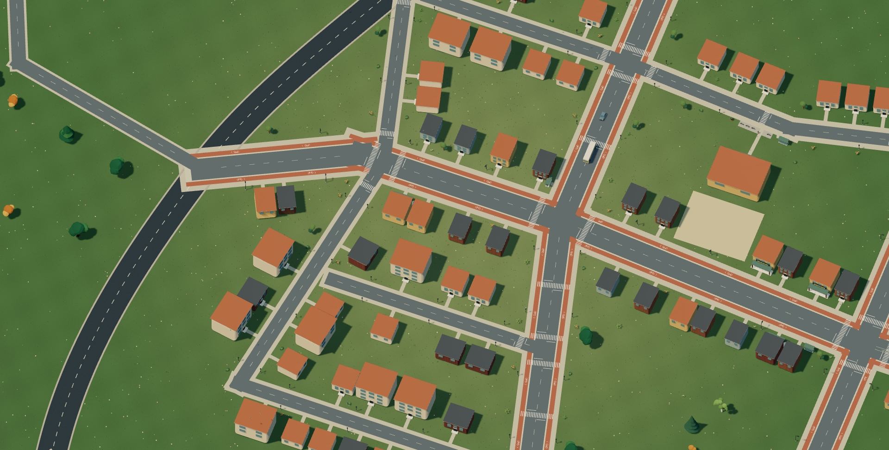
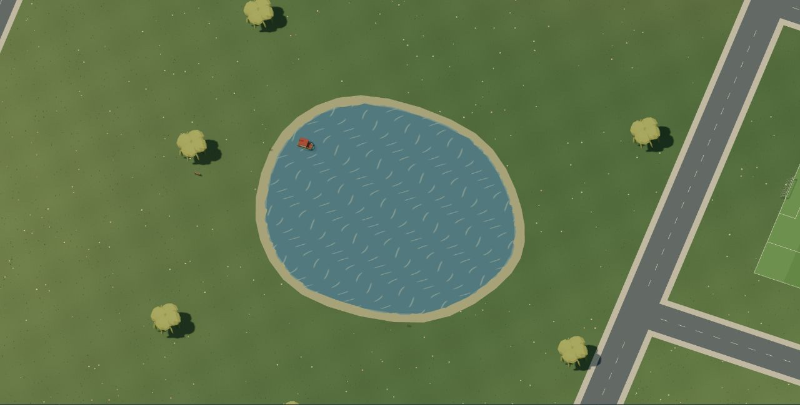
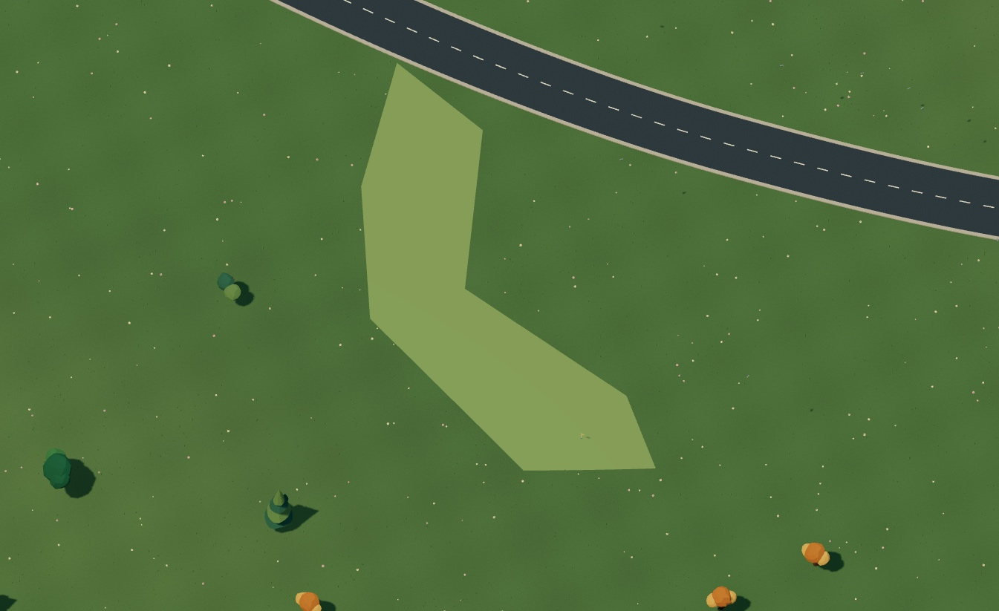

# A world with places to go

[Dream docs](README.md) / Planned world

The mock world covers 1.2 × 1 kilometres, nearly twice the previous map's area. The original circuit and countryside stay where they were. Streets connect the town, southern suburbs, sports park and a new district across the canal.

## Bicycle lanes that go somewhere

The painted lanes follow actual streets. Each side has a two-metre track, a 0.6-metre separator and a sidewalk outside it. They continue across junctions and bridges, connecting the residential streets, town square, sports park, western lakefront and eastern district. There are over eight kilometres of street centerlines with cycling lanes, with a track on each side. These are connected destinations rather than an isolated oval in a field.

A bicycle waits on the new city's avenue and another on the western lakefront. The original bicycle still waits near the starting orchard. Press F to leave the car, walk up to a bicycle and press F again. You steer it yourself; lanes do not constrain the controls. The riverside skate park retains its separate recreational circuit.

The older town has 44 buildings across eleven occupied blocks and a planted public square. Apartments and offices sit alongside shops and a library. Across the canal, another 36 buildings face the new streets, with trees, seats and planted courtyards inside the blocks. The gateways still connect to the original racing circuit.

The suburbs keep 36 homes with three different silhouettes. Driveways meet the sidewalks without covering the cycling surface; trees stay inside the blocks. The southern boulevard connects the suburbs to the lake crossing and sports park.

## One connected waterway

The southern lake narrows into a river, broadens into a bay and continues north as a canal between the sports park and the new city. Its banks follow one width-bearing Dream watercourse. Water keeps its existing surface ripples and current. The older pond and countryside river remain separate habitats.

Five new bridges carry the streets, bicycle lanes and sidewalks over this waterway. Each crossing reserves the full street width between the rails and blends into dry ground at both ends. A canal launch waits near the bank. Boats and swimmers can travel below a bridge with enough hull/body clearance; a low deck blocks them. F prefers dry shore, then allows a water exit. Leaving a boat underneath a bridge puts the driver in the water, never through the deck.

## Parks and people

The football pitch is 100 × 64 metres. The basketball surface is 28 × 15 metres, with space around it. Four people practise kicks and dribbles; visitors stand nearby. The golf park has three fairways, greens, sand traps and flags. Their [Dream programs](dream/npcs.md) alternate practice with rest and turn toward a nearby player. Match rules, scoring and golf controls are still to come.

## Everything is Dream data

[The entry file](../src/scene/world/open-world.dream) includes an [expansion module](../src/scene/world/urban_expansion.dream). The [waterfront district](../src/scene/world/city_waterfront.dream) and [waterside gardens](../src/scene/world/waterside_gardens.dream) describe the new streets and placements. Assets stay separate from where they appear. The complete mock uses 83 reusable assemblies and 796 placements, with no model calls.

`street` owns connected carriageways, optional cycle tracks and sidewalks. `surface` paints terrain-following courts, driveways, turf and sand. `marking` adds paint from bounded point blocks. `watercourse` defines a continuous basin; `bridge` supplies an explicit crossing. The engine supplies the geometry, projection and tested controls.

[Compile the complete city-lane and canal example](examples/city-cycle-lanes.dream), or read the [world guide](dream/worlds.md#streets-grounds-and-paint) and [reference](dream/reference.md#urban-ground-bounds). The acceptance boundary rejects disconnected streets, blocked riding surfaces, covered lanes and water crossings without full-width bridge support.

## Bigger without streaming

The complete world stays resident. Roads, lanes, sidewalks, paint and water have local culling tiles. Water retains its original triangles and wave resolution; its solver skips dry cells inside the waterway's bounding grid. Buildings keep the existing compacted, instanced scenery path. Grass retains its sampling density as the map grows.

Assets, shadow resolution, particles, pixel ratio and post-processing keep their quality settings. [Rendering notes](rendering.md) and the [transport verification](evidence/transport-world/verification.md) record measurements and checks. Local timings do not establish a minimum laptop specification.

The live animation budget remains 24 jointed assemblies, including the standing player. Streets currently support right angles. Ground vehicles have one driving height per XY; the water controller separately checks under-bridge clearance. There is no stacked road system, generated terrain excavation, traffic simulation or automatic layout repair.
