# A world with places to go

[Dream docs](README.md) / River city

The station promenade's benches, lights, planted tubs and rowans now share the
market caretaker's finite repair/replant services. Doorways connect both lobby
benches; narrow unpainted work areas connect outdoor targets to the promenade.
Existing work grounds and the public street network remain intact.
[The station quarter](dream/station-quarter.md#damage-has-a-follow-up).

The world has been rebuilt from scratch. It covers 1.4 × 1.1 kilometres, with an older center, garden streets, a southern neighborhood and a station district across the river. The previous racing layout is no longer a constraint.

This map comes from the accepted Dream source. Roads are drawn as shared surfaces, so pavement borders cannot close an intersection. The game uses the same geometry for the road mesh, driving mask and connection checks. Run `node scripts/render-city-map.mjs` to regenerate it.

## Homes, services and work

There are 187 homes and shops across four areas, with different frontages and setbacks. The center mixes terraces, corner shops and apartments. Garden streets have more space around the houses; the eastbank has larger apartment buildings. Buildings face a street and have a visible entrance path.

The market hall has a square, produce stalls, a vendor and a commuter who walks there from home. Two neighborhood schools and a technical college sit among the housing and workplaces. River hospital has an entrance apron and a health worker outside. Eastbank medical center serves the station and workshop district, with its own entrance and bus stop. Offices, a library and harbor workshops give the city other destinations.

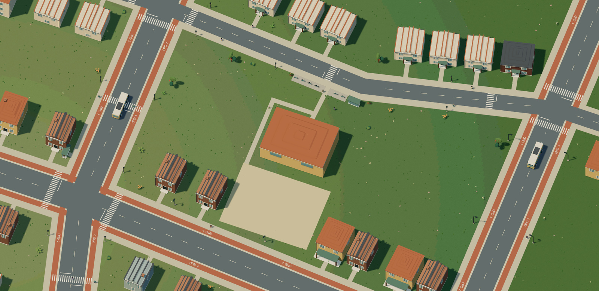

The market hall has a playable ground-floor interior. Its baker serves behind a table, customers enter to buy food, and supply workers use the same doorway for delivery work. The caretaker starts inside and retains the same outdoor repair and replanting coverage. The other civic buildings remain mock destinations with visible routines; hospital services and a general job market are not implemented.

## Station quarter

Two towers now sit north of Workshop Street: the 55-metre brick Copper Court
residences and the 75-metre Lantern Exchange offices. Both entrances face the
street and join a shared promenade. Walk into either ground-floor lobby and sit
on its floor-bound bench, or use the four benches outside. Two taxis and two
cargo vans have their own street-connected aprons and use the existing player
car controls. Eight residents walk through the connected pedestrian network.

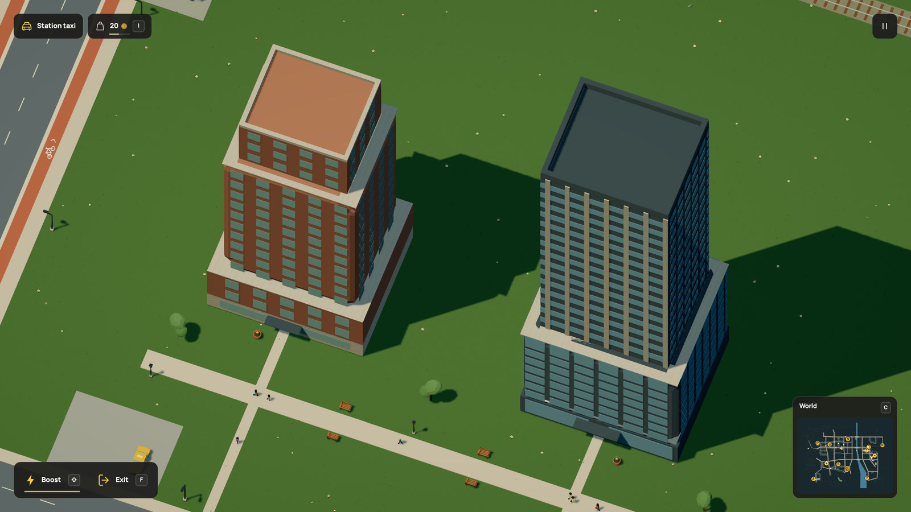

The quarter adds three lamps, three rowan trees and two planters beside the paths.
Benches retain the same sitting and breaking rules as the rest of the city.
The upper tower storeys and lifts remain inaccessible; offices and households
have no new business routines. Taxis have no passenger or fare system.
[Walk through it and inspect the Dream examples](dream/station-quarter.md).

## Buses, tram and regional train

Five buses run four services: the garden/market loop, the southern school/hospital loop, an eastbank medical/station loop and an airport/hospital shuttle. The tram runs along the main avenue to the central station. A regional electric train stops at two connected platforms. Street routes use the actual carriageways; tram rails share the road surface. They do not draw extra paving over streets.

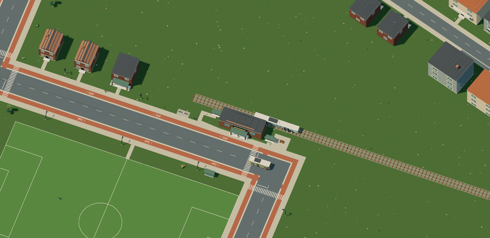

Earlier station view, before the Workshop Street towers.

F boards a bus, tram or regional railcar as a passenger. The service retains its route clock; driving inputs do not take over. Tram heads and grooves follow the constructed street and bridge triangles, including their approaches. Crossing paint leaves the track clear. These static details stream with street chunks; vehicle clocks and passenger ownership stay in simulation. Regional railway rails retain their raised profile and sleepers. Underground metro and subway tunnels are not implemented yet.

Leaving a long vehicle uses its contact envelope, so a clear exit stays beside
the body. An obstructed side falls back to another clear point. Door animations,
chosen platform sides, fares and passenger capacity are still missing.

Stops have named anchors, waits and platform sites in Dream. Platform paths join the pedestrian network, and served destinations must be reachable from them. The regional train is a single rigid railcar, so a shuttle turnaround cannot stack separate carriages. These vehicles follow authored schedules; they do not implement traffic signals or avoidance.

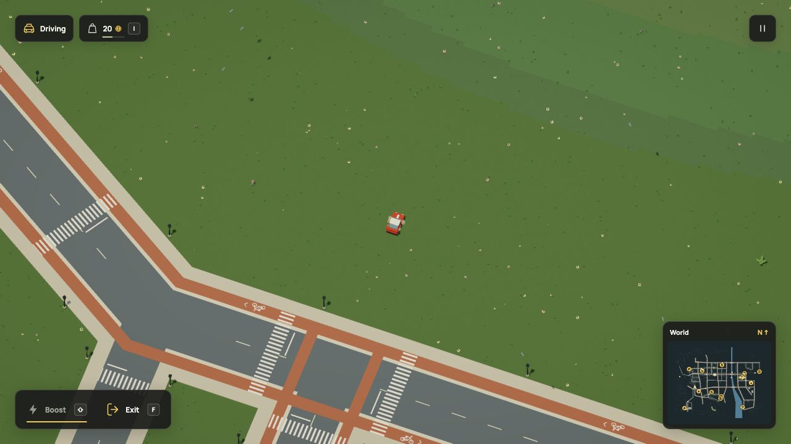

The airport connector meets South avenue at `[3000,6500]`; hospital street meets it at `[3300,6500]`. This replaces their former thirteen-degree merge, which left a long triangular cycle lane between two carriageways. The shuttle uses the revised approach, and its lamps follow that road. Each junction has its own arm crossings. [Geometry and save checks](evidence/cycle-junctions/verification.md).

## Cycle connections

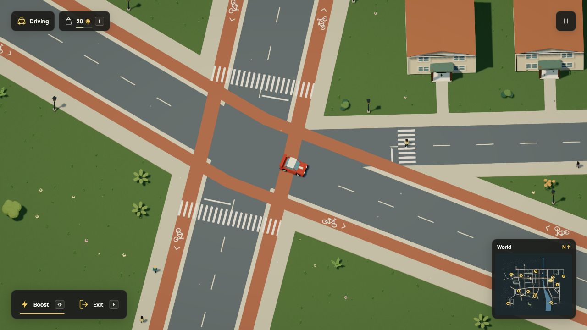

At `crossing(...,junction=true)`, cycle tracks now keep their colored surface
across the connected carriageways. An ending cycle street reaches the other
street's cycle tracks, stopping flush with its riding envelope. If there is no
cycle route to join, it ends on its approach instead of leaving an isolated cap
on the far side. The bounded connection area follows the crossing arms.

The renderer, minimap and source-generated city plan share these outlines.
Centerlines, separators and stop bars clear the cycle surface; zebra stripes
remain visible above it. Bicycle glyphs stay on the dedicated approach lanes.
This changes paint, not physical pavement, navigation, traffic priority or saves.
The shallow terrace fork remains a wide junction; this is not a claim that every
urban layout detail has been resolved. [Native views and checks](evidence/cycle-crossings/verification.md).

[Run the T-junction and four-way example](examples/cycle-junctions.dream):
`npm run -s dream -- check docs/examples/cycle-junctions.dream`.

Bicycle tracks follow the avenues and continue across the three bridges. Painted symbols and road center lines leave clear gaps at zebra crossings. Junction declarations create the crossings on the street arms, with stop lines before them. Duplicate stripes merge and neighboring stop lines leave the zebra clear. Street and cycle-track bends use a shared mitered ribbon, so interior anchors no longer protrude as square tiles. Walkers, drivers and cyclists share one world; you still choose your own route when controlling a vehicle.

The live world has no race circuit. Its streets supply the driving mask, bridge connections and maps. Sidewalks and cycle tracks occupy their full accepted footprints, with no invisible track reservation. Nearby junctions keep crossings on their outer arms, removing ten internal arm crossings. The remaining overlapping parallel pair shares a zebra envelope and stripe phase. Centerlines and stop lines keep their crossing clearance. [Street and save checks](evidence/city-streets/verification.md).

## Four missing crossings

The street audit found four real four-way intersections with no pedestrian
crossing. All four now have explicit Dream junction crossings:

| Intersection | Coordinate |
| --- | --- |
| Station Avenue and Workshop Street, medical interchange | `[11200,5200]` |
| Copper Street and Copper Lane | `[5900,3200]` |
| Market Avenue and Weavers Lane | `[7450,4200]` |
| High Street and South Terrace | `[5345.405405,7363.243243]` |

These join the actual sidewalks. Zebra stripes, stop bars, centerlines and cycle
paint use the shared street footprints, so the new connections follow the same
paint-clearance rules as existing junctions. Two-road bends remain ordinary
bends; changing a street name does not require another zebra.

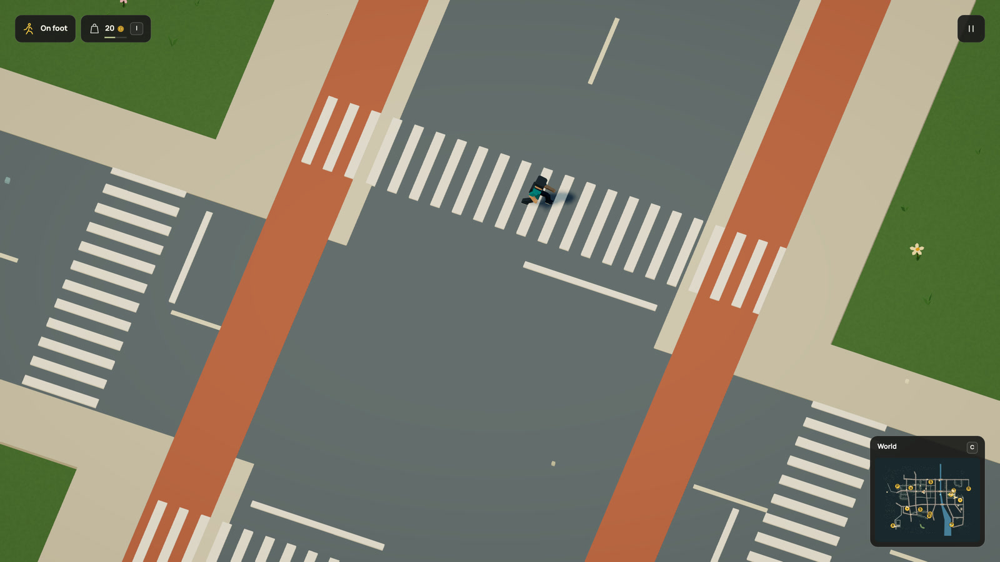

[Walk through the crossing](media/crossingwalk.mp4) ·
[GIF](media/crossingwalk.gif)

The r113 city has 62 crossing declarations, up from 58. Its 1,813 objects,
221 sites, 61 surfaces and 3,458 physical contacts stay unchanged. The accepted
simulation-53 market-to-station bench route dropped from 20,983 to 9,546 world units. Across all
fourteen station maintenance targets, routes are 9,278–9,689 units, previously
17,557–21,125. This measures walking distance from the authored supply home,
without claiming faster rendering or universal shortest paths. Two remaining
corner detours were the next engine issue; simulation 54 addresses them below.
[Crossing and persistence evidence](evidence/crossing-access/verification.md).

## Short journeys around clear corners

The work graph used to add nearby pavement links only between separate connected
areas. Two corners were already connected by a long loop, so the short clear
join was omitted. The engine now considers the same bounded nearby candidates
inside connected areas too. The body still needs dry supported pavement, and
search and movement still check static and current contacts.

The two measured corner routes fall from 1,106 and 1,052 units to 236 and 230.
The station bench is now 7,479 units from the supply home, previously 9,546.
All fourteen station jobs remain reachable in both directions. Graph node counts
are unchanged; links remain under the existing 32,768 cap, with no new actors or
physics bodies. This improves these walking choices without claiming every
possible pavement route is globally shortest.

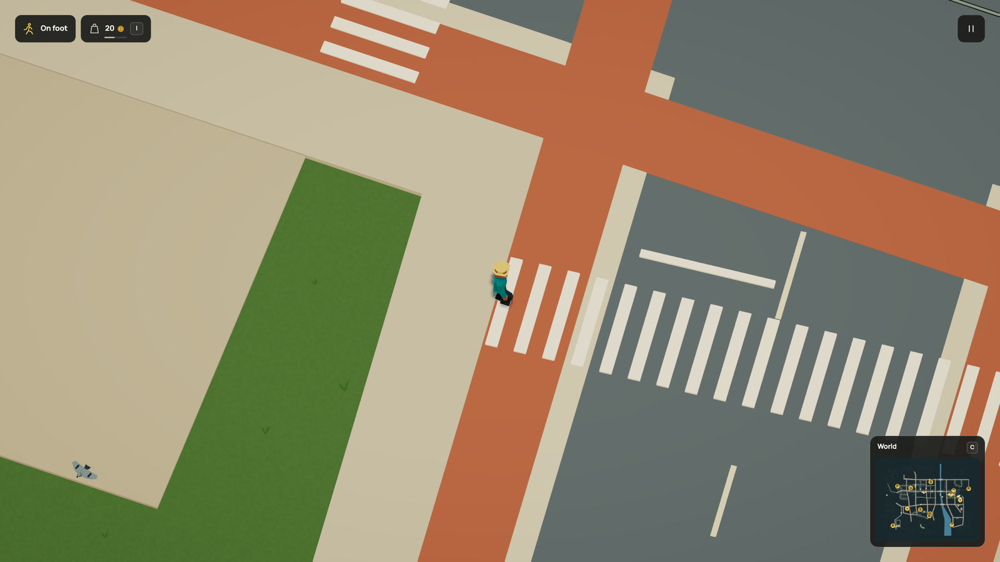

[Current walk in HD](media/workerwalk.mp4) · [GIF](media/workerwalk.gif) ·
[Recorded routes and save checks](evidence/short-links/verification.md)

## A regional airport

The western airfield now has a terminal, maintenance hangar, control tower and a lit public approach. Its bus serves River hospital; the entrance paths join the same pedestrian network as the neighborhoods. Bicycle parking and a rideable scooter sit on the public side. The hangar has a separate service road and crew entrance.

The apron meets the side of the continuous runway. Public entrance paths stay outside it. Cloudhopper remains directly controllable, with its existing terrain contact and free flight. The buildings have no working interiors or flight-control operations.

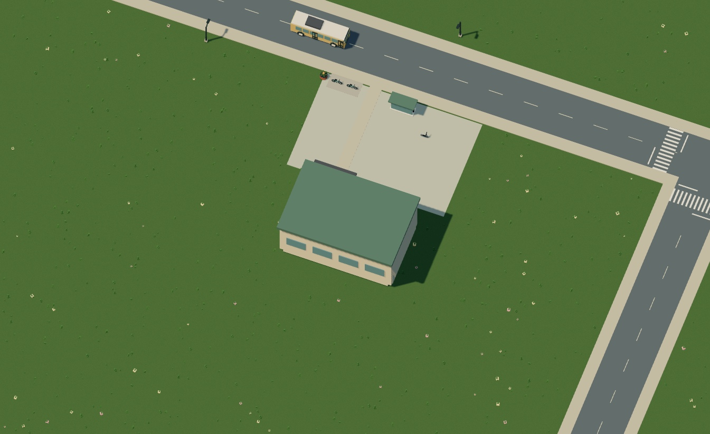

The minimap marks schools and college with **S**, medical destinations with **+**, the airport with **A** railway stations with **R** and parks with **P**. These symbols come from Dream's declared site kinds. Hover the map for the key.

## River, lake and parks

The river enters at the north edge, passes under three bridges and widens into a lake that continues beyond the southern boundary. The watercourse has open ends at the world edges, rather than round pools pretending to be a river. Its banks, flow, ripples, boat clearance and swimming support remain engine-owned.

The eastbank has a 100 × 64-metre football pitch. A basketball court, sports pavilion and golf fairway occupy the southern park area. Football and basketball now support [on-foot practice](dream/sports.md): dribble, aim, charge shots and score, with a closer camera. Paved access strips join both sports grounds to their adjacent sidewalks. Paths also wrap around the two neighborhood schools to reach their rear yards, with full walking-body clearance. These ground finishes do not add NPC route planning. The other people retain their ambient routines. Football and basketball also support six-a-side matches, goalkeepers, passes and tackles; golf controls remain future work.

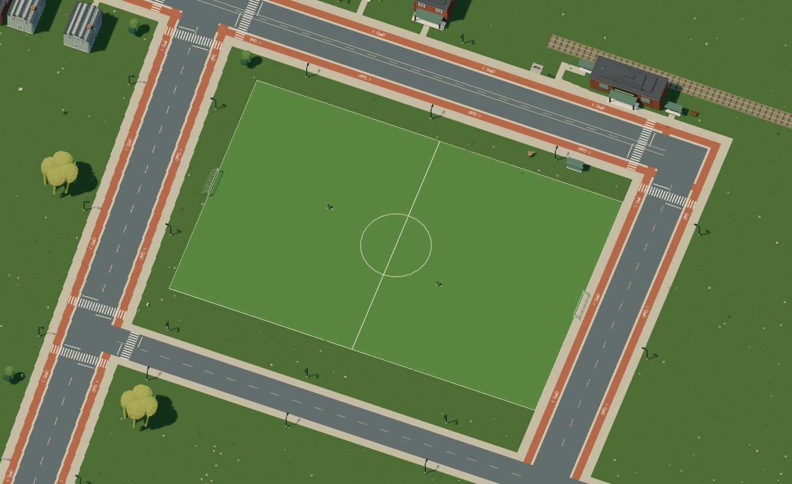

Woodland and meadow surround the city. Oaks, birches, firs, rowan, apple trees and willows mix with understory plants. Deer have a clear habitat, and gulls fly over the river. Destructible trees and benches remain, alongside breakable market props and shop porches.

## Garden park

The land west of Garden Crescent now has a neighborhood park with a 52 × 44-metre
walking loop. One entrance joins Garden Crescent; the other reaches Market Avenue.
Six benches face the paths, three bicycles and three scooters use two connected
parking pockets, and eight visitors walk through the same network as city residents.
The lawn keeps open space between shade trees and planted edges.

Benches support F to sit or stand and share the city's splinter behavior. The
existing caretaker can repair all six benches and four lamps, with finite supplies,
wages and actual sidewalk travel. Dream declares the paths as `walkable` surfaces
and names the destination with `site.label`. [Author connected parks](dream/paths.md).

## Everyday street life

The city has 413 streetlights along six networks and three more on the station promenade, 89 additional street trees, 278 mixed street planting groups and 16 destination planters, plus 64 additional garden and understory clusters and 64 woodland trees. Forty-eight parked bicycles and twenty-five scooters sit beside schools, services and transit stops on paved aprons joined to the sidewalk. Fourteen parked cars use connected civic and eastbank aprons. All of that destination parking is now usable, alongside the explicit scooters near the market, airport and eastbank medical center. Dream declares their ownership through `furnish(...,role=controllable)` and activates one dormant fleet rig when occupied.

The city has 141 people: 129 walking residents, four greeting NPCs and eight existing activity/commuter NPCs. Sidewalk groups keep a walking corridor and avoid entrances and crossings; the eight new station-quarter visitors use the same network. Sixty ground animals and birds roam clear, dry habitats and flee nearby players. The existing route deer, route gull and 256 flock birds retain their routines. Ambient populations share full geometry and GPU joint poses without per-member scene rigs. [Population authoring](dream/populations.md).

Four road cars use three different silhouettes: rally car, hatchback and delivery van. Transit and ordinary resident rides keep their existing actor slots; destination parking reserves one occupied rig within the live-assembly cap. Sixteen habitats distribute 256 decorative birds across city blocks, river, lake, woodland and meadow. These populations come from [Dream rules](dream/populations.md), filtered against the accepted streets, entrances, water and existing objects.

## Day and night

The mock starts at 10:00 and completes a day in ten minutes of play. Sun and moon lighting share one shadow map. Windows and the 416 streetlights fade on after dusk, with soft light pools fitted to the pavement. [Dream owns the clock and light declarations](dream/day-night.md).

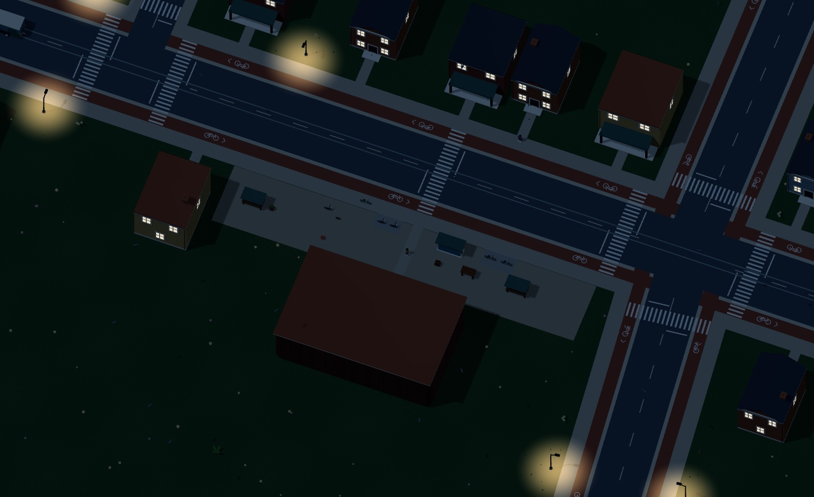

## Dream owns the connections

The [entry source](../src/scene/world/open-world.dream) owns the shared junctions, road, streets, terrain and bridges. [Civic buildings](../src/scene/world/civic.dream), [stations](../src/scene/world/stations.dream), [transport](../src/scene/world/transport.dream), [people](../src/scene/world/life.dream) and frontage modules add the places and activity.

- `junction` gives connecting streets one coordinate to share.
- `site` attaches a local entrance to an object and a clear world-space path to a named sidewalk.
- `crossing` connects pavements; `junction=true` supplies the street-arm crossings.
- `stop` connects a route's named wait to a platform or walking destination.
- `street`, `tram` and `walk` routes use the accepted network.

All declared entrances and platforms belong to one pedestrian network. The compiler rejects detached entrances, blocked paths, short overlapping street endpoints, missing destinations, unsupported water crossings and vehicles that leave their accepted domain. The new architecture has checks for connected roofs, façade details and supported canopies.

[Compile a complete city example](examples/connected-city.dream), read the [connection reference](dream/reference.md#connected-city-declarations), or inspect the [research and design notes](city-design.md).

Static world geometry streams around the player, using the existing instancing and frustum culling within nearby chunks. Simulation, transit, NPCs and damage remain resident. See [rendering](rendering.md) for coverage and memory limits. Asset detail, pixel ratio, shadows, particles and post-processing retain their quality settings. Ground driving still has one height per XY; boats and swimmers use the water layer below bridges. There is no automatic road repair, generated terrain excavation or traffic solver.

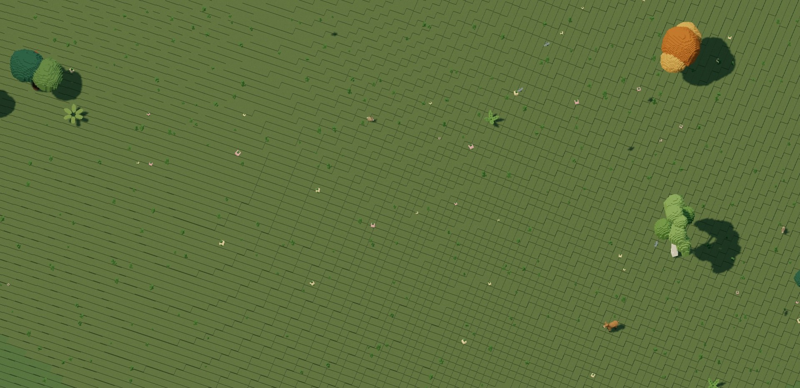

[Inspect the garden and habitat additions](media/population-assets.jpg).

The park seating pocket and east station bench now have concrete paving joined
to their sidewalks. Existing parked scooters, lamp and planter are preserved by
explicit furnishing-ground allowances. A Dream repair service connects these
areas to the market supply home using the same accepted pedestrian infrastructure.
[Connected service grounds](dream/commerce.md#connected-service-grounds).

High Street and South Avenue now meet at an explicit four-arm pedestrian crossing.
Its zebras clear neighboring stop lines and center paint through the shared road
footprints. This connects the four previously isolated lamp work approaches.
That earlier release had 57 crossing declarations. The current r113 city has 62.
[Market-district maintenance](dream/commerce.md#street-verges) serves 84 targets
without moving any of the 1,695 existing placements or the then-existing 35 work/visual surfaces.

The orchard west of High Street has a dry garden path connected to the public
sidewalk and overlapping its natural work ground. `finish=terrain` keeps that
area's existing landscape and cosmetic grass instead of painting a green patch. It preserves the existing three trees
and their scale. The market caretaker reaches them through the pedestrian
network for paid replanting. Route selection accounts for parked vehicles; moving
transit still causes a wait. [Planting and growth](dream/growth.md).

The market caretaker can now fetch replacement kits and saplings from the station
using the same connected pedestrian network. Both contracts share one derived
navigation graph for `market_square`; the existing supplier already stands on
station pavement. No new paving or prop placement is needed. Declared courier
homes, endpoints and complete return routes are checked before the world is
accepted. [Supply rules](dream/commerce.md#npc-supply-trips).

Cycle-lane paint and the HUD share one bicycle outline. Both wheels use the same
radius and axle height; the two frame triangles join at the crank, with a separate
saddle and steering fork. The paint retains terrain projection, lane-direction
rotation and whole-symbol crossing clearance.
[Rendered symbol review](evidence/symbols/verification.md).
