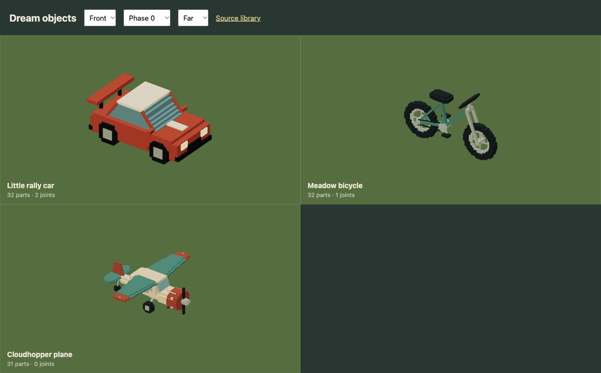
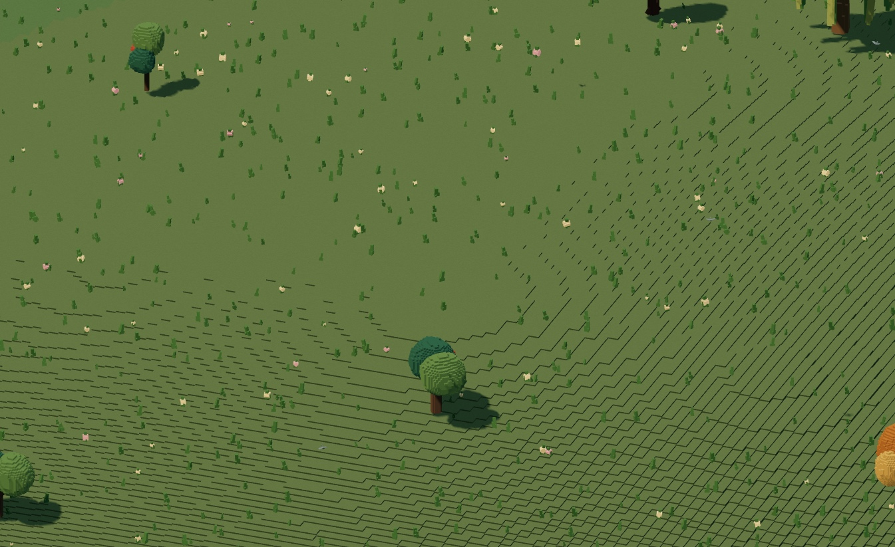
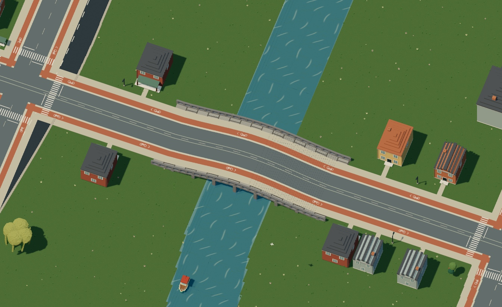

# A world built from cells

The whole live city now goes through voxel construction. Hills have stepped solid sides. Roads, crossings and cycle tracks have their own surfaces. Buildings, bicycles, boats, birds and people use occupied-cell geometry, including the small pieces that make them recognizable.


## Keep the language small

Put this beside `world` and `road` in the file that owns the world:

```dream
voxel_world(object_cell=1,ground_cell=8,height_step=1);
```

[Download a complete runnable world](examples/voxel-world.dream).

The model still writes a roof profile, a wheel, a branch or a beam. The engine treats those shapes as stamps into bounded cell volumes. It meshes the occupied cells, removes internal faces and merges flat faces. Existing `voxels`, `fill` and `cut` remain available when the model needs to carve cells directly.

The policy reaches imported templates, generated street furnishings, the player vehicle and decorative flocks after linking. It preserves their materials, measured envelopes, rigid animation pivots and destruction ownership. A bicycle still has a crank, two tires, a frame, a saddle and handlebars. Converting it doesn't turn it into one box.



## Different grids do different jobs

| Construction | Representation |
| --- | --- |
| Object parts | Local occupied-cell stamps, 4..32 cells per axis; fitted to the authored envelope |
| Explicit volumes | The existing exact integer fill/cut grid and optional fracture chunks |
| Ground | Solid columns in resident 400-unit tiles, with merged tops and exposed steps |
| Roads, paths and bridge decks | World-aligned columns, preserving their layer lifts and connected footprints |
| Crossings, cycle symbols and lane paint | Fine .5-unit cells, keeping narrow markings readable |
| Water | Eight-unit surface columns, displaced rigidly by the existing bounded wave field |
| Dust, sparks and splashes | One instanced draw of voxel particles in the existing fixed-size pool |

`object_cell` is .25..4 local units. The stamp fits its grid to the original part dimensions, with a four-cell minimum for small rings and fittings and a 32-cell maximum along each axis. Long beams remain cuboids; curved profiles produce stepped surfaces. Equal cell dimensions are approximate for fitted stamps. Use explicit volumes with equal size/grid ratios when exact cubic cells matter.

`ground_cell` is exactly 4 or 8 world units. `height_step` is .5..1. Ten world units represent a metre. These are construction settings, fixed for the world, rather than detail levels that change as the camera moves.

Ground and infrastructure are columns, so the engine doesn't allocate a kilometre-wide 3D array. Neighboring terrain tiles sample the same field and emit the height difference at their boundary. Surface lifts stay separate from height quantization, keeping markings above pavement and timber decks clear of asphalt. Water retains its wake simulation; each column uses one wave anchor so its top stays rigid.





## Keep the mechanics that already work

Wheels and rigid joints still animate. Breakable tables, benches, trees and building sections retain their existing fragment groups and impact rules. Explicit chunked volumes expose their new cut faces when they break. Released shaped parts use the same voxel geometry as their intact versions.

Collision cylinders, bridge clearance and the smooth driving heightfield remain the mechanics contract. Hills still affect speed and jumps; visual steps don't add suspension jitter. The voxel surface approximates that smooth height between samples. This is not per-cell collision, editable terrain, arbitrary tunneling or automatic structural collapse. Destruction is still limited to authored reactive objects and the existing fragment budgets.

## Keep the browser in mind

The full world stays resident. Static objects still use prototypes, instancing, material batching and spatial culling. Object stamp meshes share a bounded 16 MiB CPU cache; individual stamps never exceed 32,768 cells or the existing surface-quad limit. Landscape meshing works on one bounded tile at a time. No cell becomes a separate Three.js object or physics body, and intact objects don't remesh each frame.

The explicit fill/cut budgets are unchanged. Their project allocation limit describes authored volumes, while the construction cache contains reusable stamp surfaces. Browser measurements and capture provenance are in the [verification record](evidence/whole-world-voxels/verification.md). Offline recordings show the geometry and motion; they aren't frame-rate benchmarks.

[Voxel language reference](dream/voxels.md) · [World authoring](dream/worlds.md) · [Generated model contract](dream-v2-contract.json)
